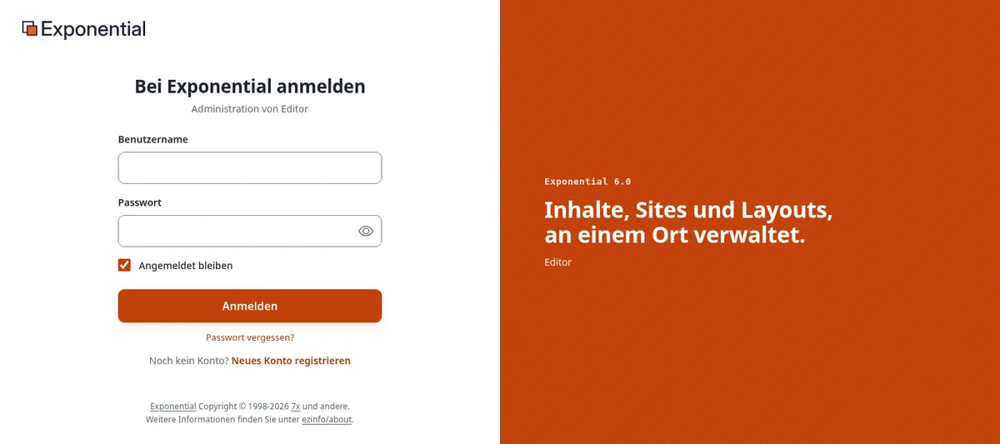
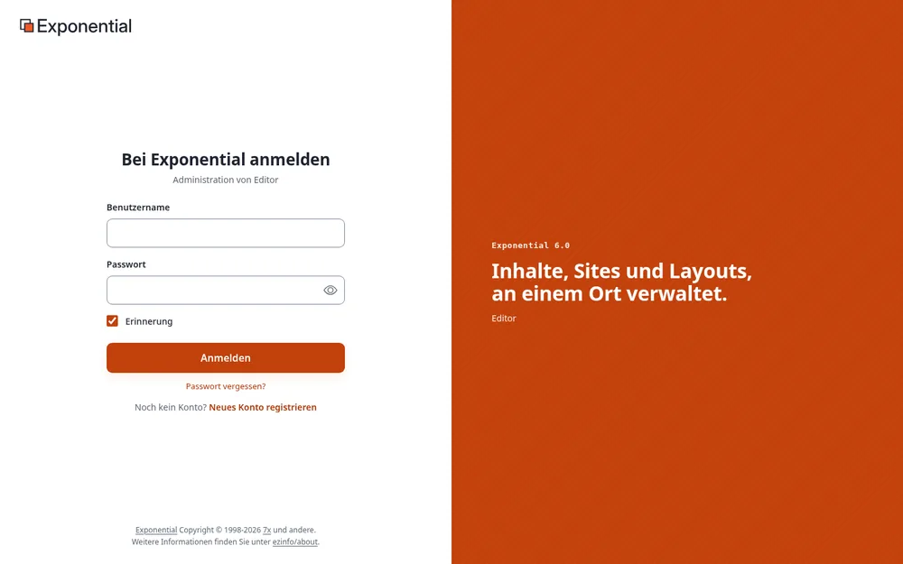
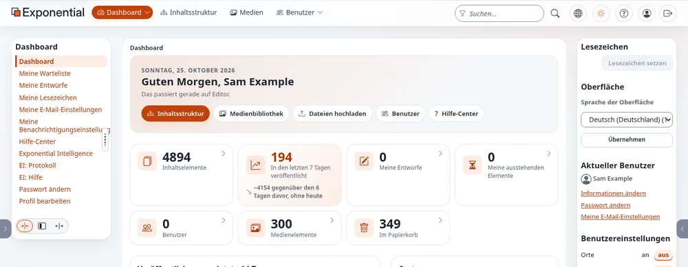
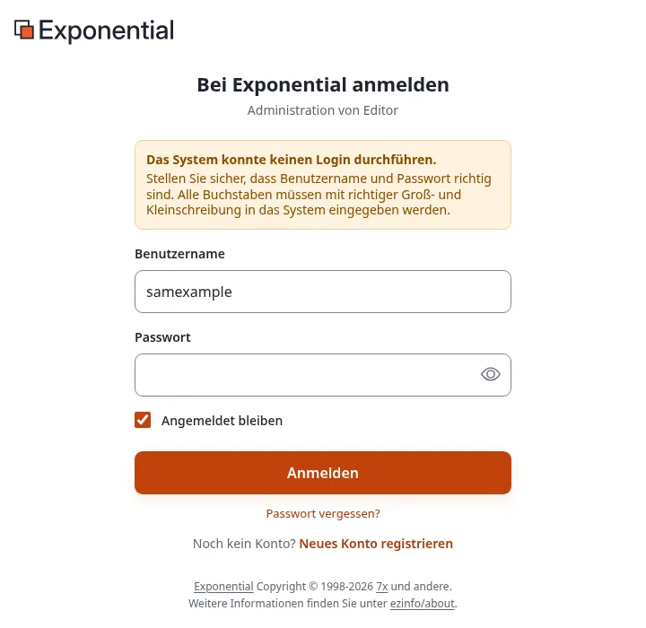

# Anmelden im Editor

Diese Seite ist für Redakteure: Menschen, die Inhalte schreiben, bearbeiten und veröffentlichen. Viele
Installationen stellen ihnen den **Editor** zur Verfügung, eine eigene Oberfläche, die wie die Administration
aussieht, aber nur zeigt, was zum Schreiben und Veröffentlichen nötig ist: das Dashboard, die Inhalte und die
Medienbibliothek. Administratoren verwenden stattdessen [die Administration](anmelden-in-der-administration.md); beide sind
Teile derselben Installation und arbeiten mit denselben Inhalten.

## Die Adresse

Der Editor hat eine eigene Adresse. Welche das ist, hängt von der Einrichtung Ihrer Site ab; Ihr Administrator nennt
sie Ihnen. Die üblichen Formen sind:

| Form | Beispiel |
|---|---|
| Ein Pfad nach der Adresse der Site | `https://www.example.com/editor` |
| Ein eigener Hostname | `https://edit.example.com` |

Jede Seite des Editors setzt einen angemeldeten Benutzer voraus: Welche seiner Adressen Sie auch öffnen, Sie sehen
zuerst das Anmeldeformular.

Legen Sie die Adresse als Lesezeichen in Ihrem Browser ab, dann müssen Sie nie wieder danach suchen.

## Anmelden

1. Geben Sie Ihren **Benutzernamen** ein. Die meisten Sites akzeptieren in diesem Feld auch die **E-Mail-Adresse**
   Ihres Kontos.
2. Geben Sie Ihr **Passwort** ein. Die Schaltfläche mit dem Auge im Feld zeigt zur Kontrolle an, was Sie eingegeben
   haben; ein weiterer Klick verbirgt es wieder.
3. Klicken Sie auf **Anmelden** (oder drücken Sie die Eingabetaste).

Die Zeile unter dem Titel nennt den Teil der Installation, in dem Sie sich anmelden, zum Beispiel *Administration
von Editor*.

Verwendet Ihr Konto die **zweistufige Anmeldung**, folgt eine zweite Seite: **Bestätigen Sie, dass Sie es sind**.
Geben Sie den sechsstelligen Code aus Ihrer Authenticator-App ein (oder aus der E-Mail, die die Site verschickt hat;
der Code steht auch in ihrem Betreff) und klicken Sie auf **Prüfen und anmelden**. Leerzeichen im Code stören nicht;
jeder Code gilt nur einmal. Nach zu vielen falschen Codes endet die Anmeldung, und Sie beginnen erneut mit Ihrem
Passwort. Wie Sie sie einrichten, erklärt
[Ihr Konto und die Anmeldung](konten-und-anmeldung.md#zweistufige-anmeldung).

## Ihre erste Anmeldung

Ein Administrator legt Ihr Konto in der Gruppe **Editors** an und gibt Ihnen die Adresse, Ihren Benutzernamen und ein
vorläufiges Passwort (das Passwort auf einem zweiten Weg, etwa am Telefon). Bei Ihrer ersten Anmeldung bittet die
Website Sie, das vorläufige Passwort vor allem anderen zu ersetzen: Geben Sie es als aktuelles Passwort ein, wählen
Sie Ihr eigenes und bestätigen Sie noch einmal mit dem vorläufigen. Jeden Schritt mit Bildschirmfotos zeigt
[Konten für Redakteure und Administratoren einrichten](konten-fuer-redakteure-und-administratoren-einrichten.md#9-die-erste-anmeldung-des-redakteurs).
Was Ihr Konto danach erlaubt, beschreibt [Was die Redakteursrolle erlaubt](was-die-redakteursrolle-erlaubt.md).

## Nach der Anmeldung

Der Editor öffnet sich mit seinem **Dashboard**: einer Begrüßung mit Ihrem Namen, Schaltflächen zur
**Inhaltsstruktur** und zur **Medienbibliothek**, Ihren Zahlen (Entwürfe, wartende Objekte) und den neuesten
Inhalten.

Von hier an gilt alles aus [Ein Rundgang durch die Administration](rundgang-durch-die-administration.md): der Baum, die Seiten der Objekte,
das Bearbeitungsformular. Was Sie öffnen und ändern dürfen, entscheidet Ihre **Rolle** (meist *Redakteur*): Ein
Redakteur sieht weniger Reiter und Schaltflächen als ein Administrator, und Seiten für Einstellungen, Benutzer und
das System gibt es für ihn nicht.

In der rechten Spalte wählen Sie unter **Sprache der Oberfläche** die Sprache der Menüs und Schaltflächen für sich
selbst; siehe [Sprachen](sprachen.md#die-sprache-der-administration).

## Wenn die Anmeldung nicht funktioniert

| Was Sie sehen | Was Sie tun können |
|---|---|
| *Das System konnte keinen Login durchführen. Stellen Sie sicher, dass Benutzername und Password richtig sind.* | Prüfen Sie die Schreibweise und die Feststelltaste: Groß- und Kleinschreibung müssen stimmen. Versuchen Sie es mit Ihrer E-Mail-Adresse statt des Benutzernamens. |
| *... ist nicht berechtigt, sich anzumelden, da die Anzahl der erlaubten Anmeldeversuche für diesen Benutzer überschritten wurde!* | Die Site sperrt ein Konto nach einer bestimmten Zahl falscher Passwörter. Bitten Sie einen Administrator, die fehlgeschlagenen Anmeldungen Ihres Kontos zurückzusetzen. |
| *Zugriff verweigert! Sie haben keine Berechtigung ...* | Ihr Konto stimmt, aber Ihre Rolle darf diesen Teil der Installation nicht nutzen. Fragen Sie einen Administrator. |
| Die Seite fragt in einem kleinen Browserfenster nach Benutzername und Passwort, bevor die Site erscheint | Manche Test- und Staging-Server sind durch ein zusätzliches Browserpasswort geschützt. Es ist nicht Ihr Exponential-Konto; fragen Sie die Person, die Ihnen die Adresse gegeben hat. |
| Nach der Anmeldung landen Sie wieder beim Anmeldeformular | Ihr Browser blockiert Cookies für die Site. Erlauben Sie Cookies für sie (die Anmeldung braucht eines), oder versuchen Sie es in einem privaten Fenster, um eine Browsererweiterung als Ursache auszuschließen. |

## Passwort vergessen?

1. Wählen Sie auf der Anmeldeseite **Passwort vergessen?**.
2. Geben Sie die **E-Mail-Adresse** Ihres Kontos ein und klicken Sie auf **Neues Passwort erstellen**.
3. Öffnen Sie die E-Mail, die Sie erhalten, und folgen Sie ihrem Link. Der Link gilt **einmal** und standardmäßig
   **eine Stunde** lang; die E-Mail nennt die Dauer. Das Öffnen gibt Ihrem Konto ein neues Passwort, das Ihnen eine
   zweite E-Mail zuschickt.
4. Melden Sie sich damit an und ändern Sie es sofort unter **Passwort ändern**.

Die Seite antwortet gleich, ob es ein Konto mit dieser Adresse gibt oder nicht. Nach ein paar Minuten noch keine
E-Mail? Sehen Sie im Spam-Ordner nach und prüfen Sie, ob Sie die Adresse Ihres Kontos verwendet haben. Ein zu spät
geöffneter Link meldet *Dieser Link ist abgelaufen.*; fordern Sie dann einen neuen an.

## Angemeldet bleiben und abmelden

Solange Sie arbeiten, bleiben Sie angemeldet. Eine Anmeldung gehört zu einem Browser und zu diesem Teil der
Installation: Wer im Editor angemeldet ist, ist damit nicht in der Administration oder auf der öffentlichen Site
angemeldet, und umgekehrt. Eine Sitzung, die lange nicht genutzt wird (mit den ausgelieferten Einstellungen drei
Tage), endet, und Sie melden sich erneut an.

Zum Abmelden klicken Sie auf die letzte Schaltfläche der Kopfzeile, einen Pfeil, der ein Kästchen verlässt
(**Abmelden**). Solange ein Objekt zum Bearbeiten geöffnet ist, ist sie ausgegraut: Speichern oder verwerfen Sie
zuerst Ihren Entwurf. Melden Sie sich an einem gemeinsam genutzten Computer immer ab.

## Ihr Konto schützen

- Verwenden Sie Ihr **eigenes** Konto, nie ein gemeinsames, damit Ihre Arbeit Ihren Namen trägt und die
  Versionsgeschichte und das Audit-Protokoll zeigen, wer was getan hat.
- Verwenden Sie ein langes Passwort, das Sie nirgendwo sonst benutzen; ein Passwortmanager merkt es sich für Sie.
  Die Site lehnt kurze und allgemein bekannte Passwörter ab.
- Schalten Sie die **zweistufige Anmeldung** ein: Ihr Passwort allein nützt dann niemand anderem. Siehe
  [Ihr Konto und die Anmeldung](konten-und-anmeldung.md#zweistufige-anmeldung).
- Schicken Sie Ihr Passwort nie per E-Mail oder Chat, auch nicht an einen Administrator; niemand braucht es.

## Mehr erfahren

- [Erste Schritte](erste-schritte.md)
- [Ihr Konto und die Anmeldung](konten-und-anmeldung.md)
- [Anmelden in der Administration](anmelden-in-der-administration.md), für Administratoren
- [Konten für Redakteure und Administratoren einrichten](konten-fuer-redakteure-und-administratoren-einrichten.md), für Administratoren
- [Mitglieder verwalten](mitglieder-verwalten.md)

<!-- exp-partner-block:start -->
**Werden Sie Exponential-Partner.** Partner teilen ihre Informationen, stellen Mittel bereit, geben Beiträge zurück
und entwickeln die Produkte mit uns, und so wächst Exponential. Eine Partner-Website und ein Dashboard sind für Mitte
2027 geplant: Werden Sie noch heute Partner, damit wir schneller wachsen und neue Funktionen früher liefern. Beginnen
Sie mit [Partner: hier beginnen](partner/partner-hier-beginnen.md) und
[Wie Sie sich bewerben](partner/wie-sie-sich-bewerben.md).
<!-- exp-partner-block:end -->
