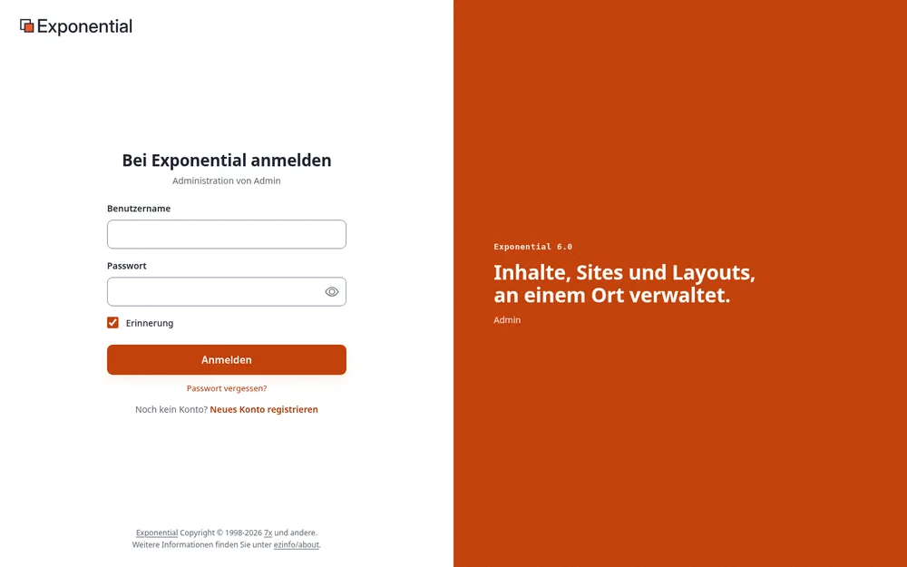
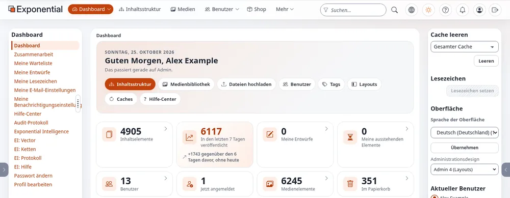
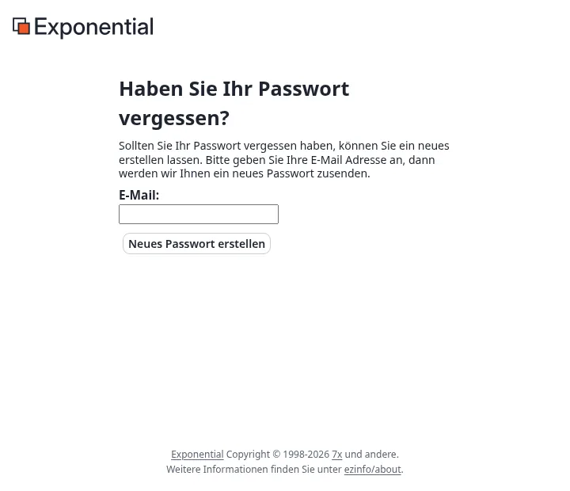

# Anmelden in der Administration

Diese Seite ist für Administratoren und für alle, die in der vollständigen **Administration** einer Installation
arbeiten. Die Administration hat alle Reiter: Inhalte, Medien, Benutzer, Layouts, Setup und mehr, soweit Ihre Rolle
es erlaubt. Redakteure, die nur schreiben und veröffentlichen, nutzen oft stattdessen [den Editor](anmelden-im-editor.md);
beide arbeiten mit denselben Inhalten.

## Die Adresse

Die Administration ist ein eigener Teil der Installation (ein *Siteaccess*) und unter einer eigenen Adresse
erreichbar. Welche das ist, legt die Installation fest; die üblichen Formen sind:

| Form | Beispiel |
|---|---|
| `/admin` nach der Adresse der Site (die Vorgabe einer neuen Installation) | `https://www.example.com/admin` |
| Ein eigener Hostname | `https://admin.example.com` |

Eine Installation kann beides anbieten und auch mehr als eine Administration (zum Beispiel eine in einem anderen
Design oder einer anderen Sprache). **Setup** > **Systeminformationen** > **Adressen der Website** listet jede
Adresse auf, unter der die Installation antwortet.

## Anmelden

1. Geben Sie Ihren **Benutzernamen** oder die **E-Mail-Adresse** Ihres Kontos ein. Mit den ausgelieferten
   Einstellungen funktioniert beides (`site.ini [UserSettings] AuthenticateMatch=login;email`), weil die
   E-Mail-Adresse jedes Kontos eindeutig ist.
2. Geben Sie Ihr **Passwort** ein; die Schaltfläche mit dem Auge zeigt es zur Kontrolle an.
3. Klicken Sie auf **Anmelden** (oder drücken Sie die Eingabetaste). Während der Anmeldung zeigt die Schaltfläche
   *Anmeldung läuft…*.

Unter dem Titel nennt *Administration von ...* den Siteaccess, in dem Sie sich anmelden. Wo die Site es zulässt,
bietet die Seite außerdem **Passwort vergessen?** und **Neues Konto registrieren** an; ein Feld zum Angemeldetbleiben
(**Angemeldet bleiben**) erscheint nur, wenn die Site dafür eine Dauer eingestellt hat (`[Session] RememberMeTimeout`).

### Zweistufige Anmeldung

Ist die zweistufige Anmeldung eingeschaltet, folgt auf das Passwort eine zweite Seite: **Bestätigen Sie, dass
Sie es sind**. Geben Sie den Code ein, den Ihre Authenticator-App für die Site anzeigt (oder den aus der E-Mail; er
steht auch im Betreff), und klicken Sie auf **Prüfen und anmelden**. Jeder Code gilt nur einmal. Nach zu vielen
falschen Codes meldet die Seite *Zu viele falsche Codes*, und die Anmeldung endet; melden Sie sich dann erneut mit
Ihrem Passwort an. Hat eine Anmeldung zu lange gewartet, meldet die Seite *Diese Anmeldung ist beendet*.

Administratoren sollten sie immer verwenden. Einschalten: [Ihr Konto und die Anmeldung](konten-und-anmeldung.md#zweistufige-anmeldung);
für alle verpflichtend machen: [Zweistufige Anmeldung](../anleitungen/zwei-faktor-anmeldung.md).

## Nach der Anmeldung

Die Administration öffnet sich mit dem **Dashboard**. Welche Reiter oben erscheinen (**Dashboard**,
**Inhaltsstruktur**, **Medien**, **Benutzer**, **Layouts**, **Setup** und weitere), hängt von Ihrer Rolle und den
installierten Erweiterungen ab.

[Ein Rundgang durch die Administration](rundgang-durch-die-administration.md) erklärt jeden Teil des Bildschirms.

### Wer sich wo anmelden darf

Ob sich ein Konto in einem Siteaccess anmelden darf, regelt die Richtlinie **user/login** seiner Rolle; sie lässt
sich auf einzelne Siteaccesses beschränken. Ein Konto, das sie für die Administration nicht hat, sieht nach einem
richtigen Passwort *Zugriff verweigert! Sie haben keine Berechtigung ...*. Die übliche Einrichtung:

| Rolle | Administration | Editor |
|---|---|---|
| Administrator | alles | alles, was der Editor bietet |
| Redakteur | die Reiter für Inhalte, Medien und das Dashboard, ohne Einstellungen, Benutzer und Setup | dasselbe |
| Mitglied (registrierte Besucher) | nein | nein |

Rollen bearbeiten Sie unter **Benutzer** > **Rollen und Richtlinien**; siehe [Rollen und Richtlinien](../anleitungen/rollen-und-richtlinien.md).

### Das Design und die Sprache der Oberfläche

Die rechte Spalte enthält den Kasten **Oberfläche**:

- **Sprache der Oberfläche**: die Sprache der Menüs und Schaltflächen, nur für Sie und bis Sie sich abmelden. Siehe
  [Sprachen](sprachen.md#die-sprache-der-administration).
- **Administrationsdesign**: für Rollen mit der entsprechenden Berechtigung das Design, in dem Sie arbeiten, zum
  Beispiel **Admin 4 (layouts)** (`admin4l`), **Admin 4** (`admin4`), **AdminUI**, **Admin 3** oder **Classic**
  (`admin`). Die Wahl gilt nur für Sie und für die Dauer der Sitzung. Siehe
  [Das Design der Administration wählen](../funktionen/6.0/ui-umschalter-design.md).

## Fehlgeschlagene Anmeldungen und Sperre

Ein falscher Benutzername oder ein falsches Passwort führt zur Meldung *Das System konnte keinen Login durchführen.
Stellen Sie sicher, dass Benutzername und Password richtig sind.* Die Seite verrät nie, welche der beiden Angaben
falsch war.

Eine Installation kann ein Konto nach einer bestimmten Zahl falscher Passwörter sperren (`site.ini [UserSettings]
MaxNumberOfFailedLogin`; `0`, der ausgelieferte Wert, sperrt nie). Die Anmeldeseite nennt dann die Zahl der
erlaubten Versuche, und ein gesperrtes Konto sieht die Meldung *... ist nicht berechtigt, sich anzumelden, da die
Anzahl der erlaubten Anmeldeversuche für diesen Benutzer überschritten wurde!* Ein Administrator entsperrt es auf der
Seite des Benutzers unter **Benutzerkonten-Einstellungen konfigurieren** > **Zurücksetzen** für die fehlgeschlagenen
Versuche. Adressen in `TrustedIPList[]` werden nie gesperrt.

Als einziger Administrator ausgesperrt? Siehe
[Ausgesperrt: wenn sich kein Administrator mehr anmelden kann](administratorpasswort-aendern.md#ausgesperrt-wenn-sich-kein-administrator-anmelden-kann).

## Passwort vergessen?

1. Wählen Sie auf der Anmeldeseite **Passwort vergessen?**.
2. Geben Sie die E-Mail-Adresse des Kontos ein und klicken Sie auf **Neues Passwort erstellen**. Die Seite antwortet
   gleich, ob es ein Konto mit dieser Adresse gibt oder nicht.
3. Die E-Mail enthält einen Link, der einmal und standardmäßig eine Stunde lang gilt (`[UserSettings]
   ForgotPasswordKeyLifetime`, in Sekunden); ein zu spät geöffneter Link meldet *Dieser Link ist abgelaufen.*
4. Das Öffnen des Links gibt dem Konto ein neues Passwort, das in einer zweiten E-Mail kommt. Melden Sie sich an und
   ändern Sie es sofort.

Das funktioniert nur, wenn das Konto eine echte E-Mail-Adresse hat und die Site E-Mails versenden kann. Einzelheiten:
[Passwort vergessen?](administratorpasswort-aendern.md#passwort-vergessen).

## Angemeldet bleiben und abmelden

- Eine Anmeldung gehört zu einem Browser und einem Siteaccess: Wer sich in der Administration anmeldet, ist damit
  nicht im Editor oder auf der öffentlichen Site angemeldet (`[Session] SessionNamePerSiteAccess=enabled`).
- Eine Sitzung, die lange nicht genutzt wird, endet (`[Session] SessionTimeout`, in der Auslieferung drei Tage), und
  Sie melden sich erneut an.
- Eine Änderung des Passworts meldet alle anderen Sitzungen des Kontos ab.

Zum Abmelden klicken Sie auf die letzte Schaltfläche der Kopfzeile, einen Pfeil, der ein Kästchen verlässt
(**Abmelden** und Ihr Benutzername). Solange ein Objekt zum Bearbeiten geöffnet ist, ist sie ausgegraut: Speichern
oder verwerfen Sie zuerst den Entwurf. Wohin Sie danach gelangen, legt `[UserSettings] LogoutRedirect` fest,
meist die Titelseite der Site.

## Wenn die Anmeldung nicht funktioniert

| Anzeichen | Ursache und Abhilfe |
|---|---|
| Direkt nach der Anmeldung wieder das Anmeldeformular, ohne Meldung | Der Browser blockiert das Sitzungs-Cookie. Erlauben Sie Cookies für die Site oder versuchen Sie es in einem privaten Fenster. |
| *Zugriff verweigert! Sie haben keine Berechtigung ...* | Die Rolle hat für diesen Siteaccess kein **user/login**. Erteilen Sie es oder verwenden Sie den Editor. |
| Ein kleines Browserfenster fragt nach Benutzername und Passwort, bevor überhaupt eine Seite erscheint | Ein zusätzliches Passwort des Webservers (HTTP-Basic-Authentifizierung), üblich auf Staging- und Testservern. Es ist kein Exponential-Konto; fragen Sie die Betreiber des Servers. |
| Die Seite lädt ohne Formatierung, oder die Schaltfläche reagiert nicht | Eine Browsererweiterung oder eine veraltete Kopie; laden Sie die Seite ohne Cache neu (Strg+Umschalt+R, auf dem Mac Cmd+Umschalt+R). |
| Alles andere | Siehe [Wenn etwas schiefgeht](wenn-etwas-schiefgeht.md). |

## Administratorkonten schützen

- **Arbeiten Sie mit einem persönlichen Konto**, nie mit dem gemeinsamen Konto `admin` einer neuen Installation.
  Geben Sie Ihrem eigenen Konto die Rolle Administrator und heben Sie `admin` mit einem langen, einmaligen Passwort
  für Notfälle auf, oder schalten Sie es ab. Dann nennen das Audit-Protokoll und die Versionsgeschichte die Person, die
  etwas getan hat.
- **Schalten Sie die zweistufige Anmeldung** für jeden Administrator ein.
- **Verwenden Sie lange, einmalige Passwörter**: Die Site lehnt kurze (`MinPasswordLength`, in der Auslieferung 10)
  und allgemein bekannte ab. Siehe [Das Administratorpasswort ändern](administratorpasswort-aendern.md).
- **Geben Sie Konten eine echte E-Mail-Adresse**, damit **Passwort vergessen?** und die Sicherheits-E-Mails Sie
  erreichen.
- **Melden Sie sich** an gemeinsam genutzten Computern **ab** und entfernen Sie die Konten von Personen, die gegangen
  sind.

Mehr dazu: [Sicherheitshärtung](sicherheitshaertung.md).

**Demo-Sites.** Eine öffentliche Demo veröffentlicht die Anmeldedaten ihres Administrators und läuft im Demo-Modus: Sie können sich mit dem veröffentlichten Passwort anmelden, es aber weder ändern noch zurücksetzen, und **Passwort vergessen?** verschickt für einen Administrator keine E-Mail. [Demo-Modus](demomodus.md).

## Mehr erfahren

- [Anmelden im Editor](anmelden-im-editor.md)
- [Ihr Konto und die Anmeldung](konten-und-anmeldung.md)
- [Ein Rundgang durch die Administration](rundgang-durch-die-administration.md)

<!-- exp-partner-block:start -->
**Werden Sie Exponential-Partner.** Partner teilen ihre Informationen, stellen Mittel bereit, geben Beiträge zurück
und entwickeln die Produkte mit uns, und so wächst Exponential. Eine Partner-Website und ein Dashboard sind für Mitte
2027 geplant: Werden Sie noch heute Partner, damit wir schneller wachsen und neue Funktionen früher liefern. Beginnen
Sie mit [Partner: hier beginnen](partner/partner-hier-beginnen.md) und
[Wie Sie sich bewerben](partner/wie-sie-sich-bewerben.md).
<!-- exp-partner-block:end -->
