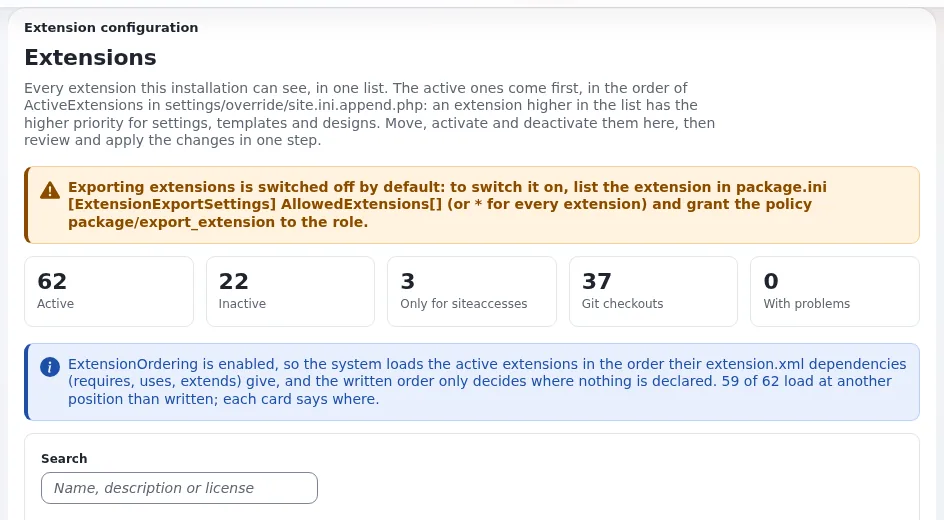

# Ein Theme aktivieren: ActiveExtensions und ActiveAccessExtensions

Diese Seite ist für Designer, die ein Theme auf einer Installation testen, und für Administratoren, die eines
installieren.

## Zwei Schalter

| Einstellung (`site.ini [ExtensionSettings]`) | Geltungsbereich | Verwenden Sie sie, wenn |
|---|---|---|
| `ActiveExtensions[]` | Die ganze Installation | Die Einstellungen des Themes für jeden Siteaccess unbedenklich sind (der übliche Fall) |
| `ActiveAccessExtensions[]` | Ein Siteaccess (in dessen Einstellungen gesetzt) | Das Theme andere Siteaccesses überhaupt nicht berühren darf |

## Im Browser

1. Öffnen Sie **Setup > Extensions** (`/setup/extensions`).
2. Suchen Sie die Karte des Themes und drücken Sie **Aktivieren**.
3. Drücken Sie **Änderungen prüfen**: Die Seite zeigt die resultierenden Zeilen `ActiveExtensions[]` und die Risiken.
4. Drücken Sie **Änderungen anwenden**. Die Seite nennt die Datei, die sie gespeichert hat, und die Sicherungskopie, die
   sie angelegt hat.



Die ganze Seite: [Die Seite Extensions](../../../anleitungen/extensions-seite.md).

## Auf der Kommandozeile

```bash
./console exp:ini add 'site.ini/ExtensionSettings/ActiveExtensions[]' mytheme global --dry-run --allow-root-user
./console exp:ini add 'site.ini/ExtensionSettings/ActiveExtensions[]' mytheme global --allow-root-user
```

Der erste Befehl gibt die Änderung aus, ohne zu schreiben; der zweite schreibt sie mit einer Sicherung nach
`settings/override/site.ini.append.php`. Für einen Siteaccess verwenden Sie den Geltungsbereich `siteaccess:<name>` und
`ActiveAccessExtensions[]`.

## Die Änderung sichtbar machen

```bash
php bin/php/ezpgenerateautoloads.php -e
php bin/php/ezcache.php --clear-all --allow-root-user
```

Erwartet vom ersten: `Found <n> classes, added <n> of them to the autoload array.` Laden Sie dann den PHP-Dienst neu,
der die Website ausliefert (PHP-FPM oder Exponential Velocity), damit seine Worker neue Klassen sehen
([Ausrollen](../../../anleitungen/bereitstellung.md)).

## Prüfen

- **Setup > Extensions** führt das Theme als aktiv.
- **Setup > Über** zeigt seine Version.
- Eine Seite des Siteaccess, der das Design verwendet, zeigt es.

## Verwandte Seiten

- [Ladereihenfolge und welches Theme gewinnt](ladereihenfolge-von-themes.md)
- [Das Design registrieren](das-design-registrieren.md)
- [Anleitung zu Erweiterungen, Abschnitt 4](../../../anleitungen/extensions.md#4-die-extension-einschalten)
- [Freie Dokumentation](../../freie-dokumentation.md): Diese Seite darf unter der GNU FDL 1.3 frei kopiert, übersetzt und verbessert werden.

<!-- exp-partner-block:start -->
**Werden Sie Exponential-Partner.** Partner teilen ihre Informationen, stellen Mittel bereit, geben Beiträge zurück
und entwickeln die Produkte mit uns, und so wächst Exponential. Eine Partner-Website und ein Dashboard sind für Mitte
2027 geplant: Werden Sie noch heute Partner, damit wir schneller wachsen und neue Funktionen früher liefern. Beginnen
Sie mit [Partner: hier beginnen](../../partner/partner-hier-beginnen.md) und
[Wie Sie sich bewerben](../../partner/wie-sie-sich-bewerben.md).
<!-- exp-partner-block:end -->
