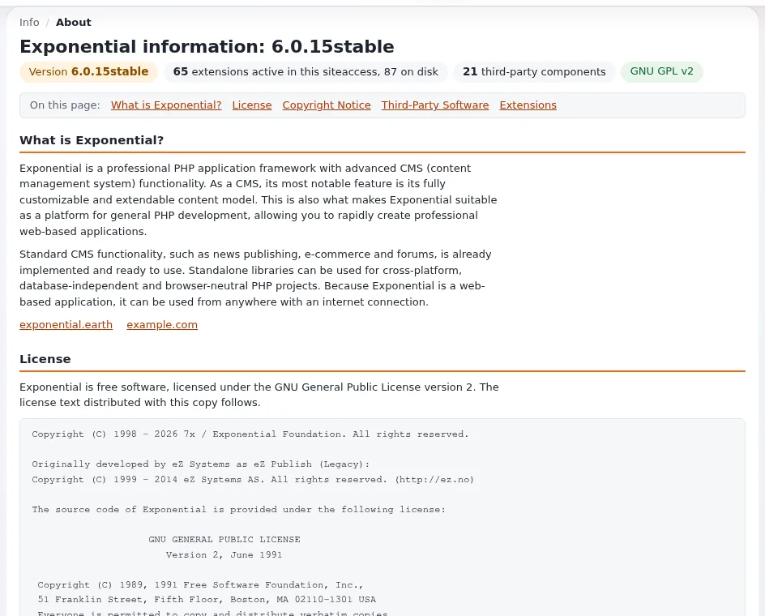

# ezinfo.php: was die Seite Über liest

Jede Theme-Erweiterung sagt dem System in zwei kleinen Dateien, wer sie ist: `ezinfo.php` und
[`extension.xml`](extension-xml.md). Diese Seite behandelt die erste. Wenn Sie fertig sind, haben Sie eine `ezinfo.php`,
die Name, Version, Lizenz und Website Ihres Themes unter **Setup > Über** (`/ezinfo/about`) und unter
**Setup > Extensions** anzeigt.

## Bevor Sie beginnen

- Sie haben einen Ordner für die Theme-Erweiterung, zum Beispiel `extension/mytheme/`
  ([Die Ordnerstruktur einer Theme-Erweiterung](ordnerstruktur-einer-theme-erweiterung.md)).
- Sie kennen die Version, die Sie gleich veröffentlichen ([Eine Versionsnummer wählen](../veroeffentlichung/eine-versionsnummer-waehlen.md)).

## Schritt für Schritt

1. Legen Sie `extension/mytheme/ezinfo.php` an. Der Klassenname ist der Ordnername gefolgt von `Info`, und `info()` ist
   `static`:

   ```php
   <?php
   class mythemeInfo
   {
       public static function info()
       {
           return array(
               'Name'      => "My Theme",
               'Version'   => "1.0.0",
               'Copyright' => "Copyright (C) 2026 Your Name",
               'License'   => "GNU General Public License v2.0 (or any later version)",
               'Info_url'  => "https://github.com/<you>/mytheme",
           );
       }
   }
   ```

2. Füllen Sie jeden Schlüssel:

   | Schlüssel | Was Sie schreiben | Beispiel eines echten Themes |
   |---|---|---|
   | `Name` | Der lesbare Name des Themes | `CJW Themes Jumper` |
   | `Version` | Die Release-Version ohne `v` (Tag `v0.1.6` ergibt `0.1.6`) | `0.1.6` |
   | `Copyright` | Die Jahre und jeder Rechteinhaber, dessen Arbeit im Theme steckt | `2007 - 2026 CJW Network, JAC Systeme GmbH and 7x` |
   | `License` | Genau das, was Ihre Datei `LICENSE` sagt | `GNU General Public License v2.0 (or any later version)` |
   | `Info_url` | Die Projektseite des Themes, meist sein Repository | `https://github.com/se7enxweb/cjw_themes_jumper` |
   | `Author` (optional) | Wer es geschrieben hat | `7x` |

   Die Beispiele sind aus `extension/cjw_themes_jumper/ezinfo.php` kopiert, wie es mit Release 0.1.6 ausgeliefert wird.

3. Schreiben Sie dieselbe Version, Lizenz und Website in [`extension.xml`](extension-xml.md). Die Seite Über liest
   `extension.xml` zuerst, wenn sie einen Block `<metadata>` hat, also müssen die beiden Dateien übereinstimmen
   ([Alle Versionsfelder synchron halten](versionsfelder-synchron-halten.md)).

4. Prüfen Sie die Datei:

   ```bash
   php -l extension/mytheme/ezinfo.php
   ```

   Erwartet: `No syntax errors detected in extension/mytheme/ezinfo.php`.

5. Öffnen Sie **Setup > Über** in der Administration. Die Zeile Ihres Themes zeigt den Namen, die Version, die Lizenz
   und die Website, die Sie geschrieben haben. Ein Strich bedeutet, dass der Wert fehlt.

## Regeln, die sich bewähren

- **Setzen Sie jeden Schlüssel in Anführungszeichen** (`'Version'`, nicht `Version`) und lassen Sie `info()` `static`.
- **Schreiben Sie nie einen Platzhalter** wie `//autogentag//` oder `dev-master` als Version. Die Seite Über und die
  Upgrade-Prüfung können einen Platzhalter nicht von einem echten Release unterscheiden.
- **Erhöhen Sie die Version in dem Commit, auf den der Release-Tag zeigt**, nie nach dem Tag
  ([Die Version vor dem Tag erhöhen](../veroeffentlichung/version-vor-dem-tag-erhoehen.md)).
- **Die Lizenzzeile muss zur Datei `LICENSE` passen.** Steht das Theme unter der GPL, schreiben Sie den vollen Namen der
  Lizenz wie oben.



## Verwandte Seiten

- [extension.xml: die paketierte Beschreibung](extension-xml.md)
- [Alle Versionsfelder synchron halten](versionsfelder-synchron-halten.md)
- [Copyright- und Autorenzeilen](copyright-und-autorenzeilen.md)
- [Spezifikation: Metadaten von Erweiterungen](../../../spezifikationen/6.0/extension-metadaten.md)
- [Theme-Erweiterungen: hier beginnen](theme-erweiterungen-hier-beginnen.md)
- [Freie Dokumentation](../../freie-dokumentation.md): Diese Seite darf unter der GNU FDL 1.3 frei kopiert, übersetzt und verbessert werden.

<!-- exp-partner-block:start -->
**Werden Sie Exponential-Partner.** Partner teilen ihre Informationen, stellen Mittel bereit, geben Beiträge zurück
und entwickeln die Produkte mit uns, und so wächst Exponential. Eine Partner-Website und ein Dashboard sind für Mitte
2027 geplant: Werden Sie noch heute Partner, damit wir schneller wachsen und neue Funktionen früher liefern. Beginnen
Sie mit [Partner: hier beginnen](../../partner/partner-hier-beginnen.md) und
[Wie Sie sich bewerben](../../partner/wie-sie-sich-bewerben.md).
<!-- exp-partner-block:end -->
