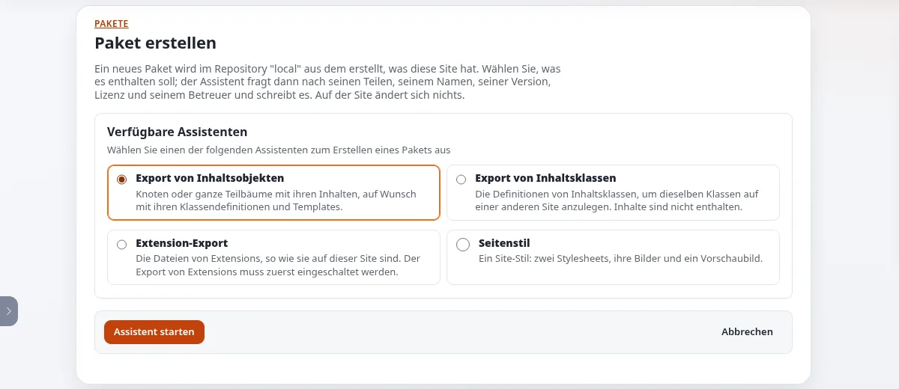

# Der Paketerstellungs-Assistent Schritt für Schritt

Diese Seite ist für Designer, die im Browser Klassen, Inhalte oder ein Theme in ein Exponential-Paket packen. Während Sie
den Assistenten verwenden, ändert sich nichts an der Website; er schreibt nur ein neues Paket in das Repository `local`.

## Bevor Sie beginnen

- Die Richtlinie `package/create` (eingeschränkt nach Typ, Ersteller und Rolle); ohne sie ist die Schaltfläche
  ausgegraut.
- Für einen Extension-Export: das Exportieren eingeschaltet ([Eine Erweiterung als Paket exportieren](eine-erweiterung-als-paket-exportieren.md)).

## Schritt für Schritt

1. Öffnen Sie **Setup > Pakete** (`/package/list`) und drücken Sie **Neues Paket erstellen** (`/package/create`).
2. Wählen Sie einen Assistenten und drücken Sie **Assistent starten**:

   | Assistent | Exportiert | Seine eigenen Schritte |
   |---|---|---|
   | Export von Inhaltsklassen | Klassendefinitionen | Aufzunehmende Inhaltsklassen |
   | Export von Inhaltsobjekten | Knoten oder Teilbäume mit Inhalten | Objekte, die inkludiert werden sollen, Limits von Objekten |
   | Extension-Export | Dateien von Erweiterungen | Extensions, die inkludiert werden sollen |
   | Seitenstil | Zwei Stylesheets, Bilder, ein Vorschaubild | Paket Miniaturbild, CSS-Dateien, Bilddateien |

3. Jeder Schritt zeigt oben die Liste der Schritte, „Schritt n von m“, seinen Namen und was er abfragt. Verwenden Sie
   **Fortfahren**, **Zurück** (behält, was Sie eingegeben haben) und **Abbrechen** (schreibt nichts). Die Eingabetaste in
   einem Feld entspricht Fortfahren.
4. Erledigen Sie die eigenen Schritte des Assistenten. Die Klassenauswahl hat einen Filter und „n von m ausgewählt“; die
   Inhaltsauswahl hat **Knoten hinzufügen**, **Teilbaum hinzufügen** und **Ausgewählte entfernen**; der Schritt für
   Optionen legt Klassen, Templates, Siteaccesses, Versionen und Sprachen fest.
5. **Paket Informationen**: Name (Kleinbuchstaben, Ziffern und `_`), Zusammenfassung, Beschreibung, Version, Format
   (Classic XML oder JSON), Lizenz ([Eine Lizenz wählen](paketlizenzen-im-assistenten.md)), Host und Paketierer.
6. **Paket Betreuer**: Person, E-Mail und Rolle. Dieser Schritt entfällt, wenn Ihre Rolle keine Betreuerrolle vergeben
   darf. Verwenden Sie eine öffentliche Kontaktadresse.
7. **Paket-Changelog**: wer und was. Der letzte Schritt zeigt die **Übersicht** über das ganze Paket.
8. Drücken Sie **Paket erstellen**. Die Seite des Pakets öffnet sich mit **Herunterladen**, **Installieren** und den
   anderen Aktionen.

Stimmt etwas nicht, bleibt der Schritt stehen, eine Zusammenfassung oben listet die Fehler als Links, und jedes Feld
zeigt seinen Fehler darunter.

## Nach dem Erstellen

- **Herunterladen** schreibt `<name>-<version>.ezpkg` (oder **Als JSON herunterladen**).
- **Prüfen** auf der Seite des Pakets prüft es so, wie ein Upload geprüft würde
  ([Ein Paket prüfen](ein-paket-pruefen.md)).
- Um es anderswo zu installieren, siehe [Ihr Paket auf einer Testseite installieren](ihr-paket-auf-einer-testseite-installieren.md).

## Verwandte Seiten

- [Der Paket-Assistent](../../../funktionen/6.0/paketassistent.md)
- [Pakete, Abschnitt 8](../../../anleitungen/pakete.md#8-ein-paket-erstellen)
- [Freie Dokumentation](../../freie-dokumentation.md): Diese Seite darf unter der GNU FDL 1.3 frei kopiert, übersetzt und verbessert werden.

<!-- exp-partner-block:start -->
**Werden Sie Exponential-Partner.** Partner teilen ihre Informationen, stellen Mittel bereit, geben Beiträge zurück
und entwickeln die Produkte mit uns, und so wächst Exponential. Eine Partner-Website und ein Dashboard sind für Mitte
2027 geplant: Werden Sie noch heute Partner, damit wir schneller wachsen und neue Funktionen früher liefern. Beginnen
Sie mit [Partner: hier beginnen](../../partner/partner-hier-beginnen.md) und
[Wie Sie sich bewerben](../../partner/wie-sie-sich-bewerben.md).
<!-- exp-partner-block:end -->
