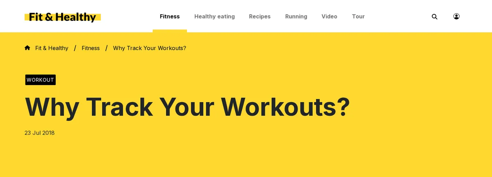

# Brotkrumennavigation

Diese Seite ist für Designer, die über dem Inhalt zeigen, „wo bin ich“. Der Pfad steht schon in `$module_result.path`; das
Brotkrumen-Template macht daraus Links.



## Inhalt

1. [Markup](#markup)
2. [Das Template](#das-template)
3. [Die Wurzel auslassen](#die-wurzel-auslassen)
4. [In den mitgelieferten Designs](#in-den-mitgelieferten-designs)

## Markup

Eine beschriftete Navigations-Landmark mit einer geordneten Liste; die aktuelle Seite zuletzt, mit `aria-current`
gekennzeichnet und nicht verlinkt:

```html
<nav class="breadcrumbs" aria-label="Breadcrumb">
  <ol>
    <li><a href="/">Home</a></li>
    <li><a href="/news">News</a></li>
    <li aria-current="page">An article</li>
  </ol>
</nav>
```

Trennzeichen kommen aus dem CSS (`li + li::before`), sodass Screenreader sie nicht vorlesen.

## Das Template

```tpl
{* pagelayout/breadcrumbs.tpl *}
{if and( is_array( $module_result.path ), $module_result.path|count|gt( 1 ) )}
<nav class="breadcrumbs" aria-label="{'Breadcrumb'|i18n( 'design/mytheme' )}">
    <ol>
    {foreach $module_result.path as $step}
        {if $step.url}
            <li><a href={first_set( $step.url_alias, $step.url )|ezurl}>{$step.text|wash}</a></li>
        {else}
            <li aria-current="page">{$step.text|wash}</li>
        {/if}
    {/foreach}
    </ol>
</nav>
{/if}
```

`url_alias` liefert die lesbare Adresse; `url` ist die System-URL (`/content/view/full/<id>`) und der Rückfall.

## Die Wurzel auslassen

Der erste Eintrag eines Inhaltspfads ist die Spitze des Baums. Das Design media lässt die gemeinsame Wurzel (Tiefe 1) weg
und baut im Pagelayout ein eigenes `path_array` aus Paaren `text`/`url`; beim Design starter zeigen die Klassen mit großem
Kopfbereich (die Startseite) gar keine Brotkrumen. Wählen Sie, was zur Website passt: meist „Home“ zuerst, verlinkt auf
`'/'|ezurl`.

## In den mitgelieferten Designs

- media: `pagelayout/breadcrumbs.tpl`, gespeist aus dem `$path_array`, das das Pagelayout baut.
- starter: `pagelayout/breadcrumbs.tpl`, als Template-Block in seinem Rahmen-Layout gezeichnet.
- ezwebin: `page_toppath.tpl`.
- admin4: ein `ol.a4-crumbs` mit `aria-current="page"` innerhalb der Navigations-Landmark `#path`.

## Verwandte Seiten

- [Module result und content info](../../../../eng-us/help/designers/templates/module-result-and-content-info.md)
- [Landmarks und Überschriften](../../../../eng-us/help/designers/theme-design/landmarks-and-headings.md)
- [Freie Dokumentation](../../freie-dokumentation.md): Diese Seite darf unter der GNU FDL 1.3 frei kopiert, übersetzt und verbessert werden.

<!-- exp-partner-block:start -->
**Werden Sie Exponential-Partner.** Partner teilen ihre Informationen, stellen Mittel bereit, geben Beiträge zurück und
entwickeln die Produkte mit uns, und so wächst Exponential. Eine Partner-Website und ein Dashboard sind für
Mitte 2027 geplant: Werden Sie bitte schon heute Partner, damit wir schneller wachsen und neue Funktionen früher
bereitstellen können. Beginnen Sie mit [Partner: hier beginnen](../../partner/partner-hier-beginnen.md) und [Wie Sie sich bewerben](../../partner/wie-sie-sich-bewerben.md).
<!-- exp-partner-block:end -->
