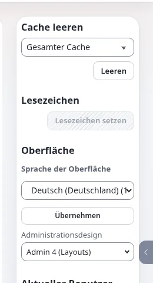

# Admin-Designs im Überblick

Diese Seite ist für Designer, die das Aussehen der Administration ändern oder die Admin-Seiten einer Erweiterung gestalten. Sie
beantwortet: welche Admin-Designs es gibt, wie sie aufeinander aufbauen und welche Regeln für jedes Template und jedes Stylesheet
gelten, das Sie ihnen hinzufügen.

## Inhalt

1. [Die Designs](#die-designs)
2. [Wie sie aufeinander aufbauen](#wie-sie-aufeinander-aufbauen)
3. [Was admin4 mitbringt](#was-admin4-mitbringt)
4. [admin4l: die Administration mit Layouts gezeichnet](#admin4l-die-administration-mit-layouts-gezeichnet)
5. [Das Design editor](#das-design-editor)
6. [Regeln für jedes Admin-Template](#regeln-für-jedes-admin-template)
7. [Wie es weitergeht](#wie-es-weitergeht)

## Die Designs

| Design | Ordner | Was es ist |
|---|---|---|
| `admin` | `design/admin` | das klassische Administrationsdesign; zugleich der letzte Rückfall der neueren |
| `admin2`, `admin3` | `design/admin2`, `design/admin3` | Zwischendesigns; admin3 brachte den responsiven Rahmen |
| `admin4` | `design/admin4` | das aktuelle Design: vollständig und eigenständig, mit Token, gemeinsamen Komponenten und einem dunklen Modus ([Das Design admin4](../../../funktionen/6.0/admin4-design.md)) |
| `admin4l` | `design/admin4l` | ein dünnes Design auf admin4, dessen Rahmen von Layout-Blöcken gezeichnet wird |
| `editor` | `design/editor` | der Siteaccess editor: fast leer, der Unterschied liegt in seinen Einstellungen |
| `adminui` | `extension/exp_adminui/design/adminui` | die Administration AdminUI, mit eigenem Stylesheet und einer Kopie für rechts nach links |

## Wie sie aufeinander aufbauen

Auf der Demonstrationsinstallation:



```
admin    siteaccess: admin4l > admin4 > admin3 > admin2 > admin > standard
editor   siteaccess: editor > admin4l > admin4 > admin3 > admin2 > admin > standard
adminui  siteaccess: adminui > admin4l > admin4 > admin3 > admin2 > admin > standard
```

Ein angemeldeter Benutzer kann das Administrationsdesign für sich selbst auch mit dem Oberflächenschalter wechseln
([Oberflächenschalter: Design](../../../funktionen/6.0/ui-umschalter-design.md)); testen Sie Admin-Änderungen daher in jedem Design,
das ein Benutzer wählen kann.

## Was admin4 mitbringt

- **Token.** Farben, Abstände, Größen, Radius und Schriften sind CSS-Custom-Properties `--a4-*` in
  `design/admin4/stylesheets/components.css`, mit dunklen Werten unter `html[data-a4-theme="dark"]`
  ([admin4-Token](admin4-tokens.md)).
- **Gemeinsame Komponenten.** `.a4-card`, `.a4-btn`, `.a4-table`, `.a4-toolbar`, `.a4-filterbar`, `.a4-tag` /
  `.a4-badge`, `.a4-sr-only`, `.a4-skip-link` und mehr, in derselben Datei ([admin4-Komponenten](admin4-komponenten.md)).
- **Modul-Stylesheets.** Eine Datei pro Bereich in `stylesheets/modules/` (`setup.css`, `content.css`, `people.css`,
  `structure.css`, `workflow.css`, `help.css`), geladen über `design.ini [StylesheetSettings]
  AdminComponentCSSFileList[]` ([admin4-Modul-Stylesheets](admin4-modul-stylesheets.md)).
- **Heller, dunkler und Systemmodus.** Ein Skript vor dem ersten Zeichnen (`javascript/a4_head.js`, von
  `page_head_style.tpl` als Datei geladen) setzt `data-a4-theme` vor dem ersten Zeichnen ([Der Theme-Umschalter und der Schutz vor dem ersten Zeichnen](theme-umschalter-und-pre-paint-guard.md)).
- **Rechts nach links.** Durchgehend logische CSS-Eigenschaften ([Designs für rechts nach links](rechts-nach-links-designs.md)).
- **Bereit für Content Security Policy.** Keine Inline-Skripte oder -Stile in seinen Templates.

## admin4l: die Administration mit Layouts gezeichnet

`design/admin4l` enthält ein `pagelayout.tpl` und etwa zwei Dutzend Block-Templates unter `templates/explayouts/block/`
(`admin_logo.tpl`, `admin_tab_menu.tpl`, `admin_left_menu.tpl`, `admin_breadcrumb.tpl`, `admin_module_result.tpl`,
`admin_footer.tpl`, `admin_theme_switch.tpl` ...). Der Rahmen der Administration ist ein Admin-Layout (Layouttypen `admin_3col`,
`admin_2col`, `admin_full` in `explayouts.ini`), dessen Zonen diese Blöcke enthalten, sodass sich der Rahmen mit dem
Layout-Editor umordnen lässt. Das Pagelayout fragt `fetch( 'explayouts', 'resolve_admin_layout', hash( 'module', ..., 'view', ... ) )`
nach dem Layout der aktuellen View, hinter dem Sicherheitsschalter `explayouts.ini [AdminLayoutSettings] Enabled`.
Alles andere kommt von admin4.

## Das Design editor

`design/editor` enthält nur ein README und leere Ordner. Sein README erklärt, dass das, was die Administration des Redakteurs
unterscheidet, in den Einstellungen des Siteaccess steht (`settings/siteaccess/editor`): weniger Menüreiter, Module, die mit 404
antworten, keine Entwicklerleiste. Fügen Sie dort nur Templates hinzu, wo die Administration des Redakteurs anders aussehen muss.

## Regeln für jedes Admin-Template

Das sind die Regeln des Projekts für jedes Admin-Design (admin, admin3, admin4, admin4l und neue) und für Admin-Templates von
Erweiterungen; `tests/tests/design/AdminStylingRulesTest.php` setzt sie durch:

- **Kein `<style>`-Block und kein `style=""`-Attribut in einem Template.** CSS gehört in die `stylesheets/` des Designs.
- **Verwenden Sie die gemeinsamen Komponenten wieder**, bevor Sie CSS schreiben; fügen Sie eine neue gemeinsame Komponente nur
  zentral hinzu, wenn nichts passt.
- **Nur Token** für Farben, Radius, Abstände und Schriften; keine fest eingetragenen Werte, keine lokalen Token-Aliasse. Ein
  Akzent, ein Radius.
- **Jedes neue Farbtoken bekommt einen dunklen Wert** für `html[data-a4-theme="dark"]`, in derselben Änderung.
- **Modul-CSS** gehört in `stylesheets/modules/<group>.css`, mit Klassennamen `.a4-<module>-*`.
- **Prüfen Sie hell und dunkel**, bei 1440 px (Skalierung 1) und 960 px mit Skalierung 2 (200 % Zoom): keine weiße Karte auf
  dunklem Hintergrund, Kontrast mindestens 4,5:1, kein waagrechter Überlauf, keine Fehler in der Konsole.
- **CSS erreicht den Browser über den Packer**: Fügen Sie Links nie Versionsabfragen wie `?v=` hinzu.

Die Dokumentation für Mitwirkende ist [Gestaltung der Administration](../../../bc/6.0/admin4-gestaltung.md).

## Wie es weitergeht

- Die Admin-Seite einer Erweiterung gestalten: [Tutorial: ein Admin-Modul-Stylesheet hinzufügen](tutorial-ein-admin-modul-stylesheet-hinzufuegen.md).
- Eine Seite prüfen: [Der Test der Admin-Gestaltungsregeln](der-test-der-admin-gestaltungsregeln.md).
- Farben: [admin4-Token](admin4-tokens.md).

## Verwandte Seiten

- [Designs und Siteaccesses](designs-und-siteaccesses.md)
- [Dunkler Modus im Überblick](dunkelmodus-ueberblick.md)
- [CSP-sicheres Design](csp-sicheres-design.md)
- [Freie Dokumentation](../../freie-dokumentation.md): Diese Seite darf unter der GNU FDL 1.3 frei kopiert, übersetzt und verbessert werden.

<!-- exp-partner-block:start -->
**Werden Sie Exponential-Partner.** Partner teilen ihre Informationen, stellen Mittel bereit, geben Beiträge zurück
und entwickeln die Produkte mit uns, und so wächst Exponential. Eine Partner-Website und ein Dashboard sind für Mitte
2027 geplant: Werden Sie noch heute Partner, damit wir schneller wachsen und neue Funktionen früher liefern. Beginnen
Sie mit [Partner: hier beginnen](../../partner/partner-hier-beginnen.md) und
[Wie Sie sich bewerben](../../partner/wie-sie-sich-bewerben.md).
<!-- exp-partner-block:end -->
