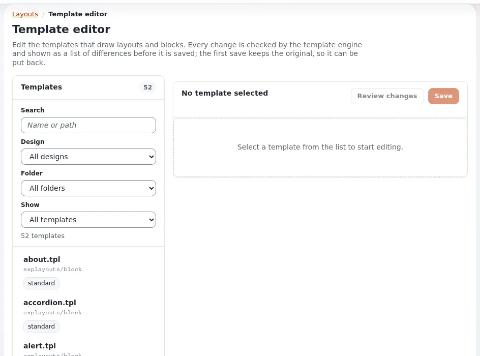

# Block-Ansichtstemplates

Diese Seite ist für Designer, die das Template eines Layout-Blocks schreiben oder neu gestalten. Sie beantwortet: was ein
Block-Template erhält, wie es seine Einträge zeichnet und wie ein Container seine Kinder zeichnet.



## Inhalt

1. [Wo Block-Templates liegen](#wo-block-templates-liegen)
2. [Was ein Block-Template erhält](#was-ein-block-template-erhält)
3. [Ein einfacher Block](#ein-einfacher-block)
4. [Ein Listenblock mit Einträgen](#ein-listenblock-mit-einträgen)
5. [Container und ihre Kinder](#container-und-ihre-kinder)
6. [Template-Blöcke](#template-blöcke)
7. [Regeln](#regeln)

## Wo Block-Templates liegen

`explayouts/block/<definition identifier>.tpl`, gefunden über die Design-Kaskade. Die eigenen Kopien der Erweiterung liegen in
`extension/explayouts/design/standard/templates/explayouts/block/`; ein Design ersetzt jede davon, indem es eine Datei an
denselben Pfad legt, wie es das Design media in `design/media/templates/explayouts/block/` tut.

## Was ein Block-Template erhält

| Variable | Inhalt |
|---|---|
| `$block.id` | die id des Blocks |
| `$block.definition_identifier` | `title`, `list`, `two_columns` ... |
| `$block.view_type` | der View-Typ, den der Redakteur gewählt hat |
| `$block.name` | der Name des Blocks, falls der Redakteur einen vergeben hat |
| `$block.values` | die Parameter des Blocks (zum Beispiel `title`, `level`, `tag`, `link` des Titelblocks) und, bei Blöcken mit Sammlung, `items` |
| `$block.parent_id`, `$block.placeholder` | bei einem Kind eines Containers: sein Elternblock und seine Stelle |
| `$zone` | die Zone mit allen ihren Blöcken (`$zone.blocks`) |
| `$module_result` | das Modulergebnis der Seite (der Block `full_view` gibt dessen `content` aus) |

## Ein einfacher Block

Der mitgelieferte Titelblock (`block/title.tpl`), gekürzt:

```tpl
<div class="slb slb-title" data-block-id="{$block.id|wash}">
    {if $block.values.title}
        {def $tag = cond( $block.values.tag|ne( '' ), $block.values.tag, concat( 'h', $block.values.level ) )}
        <{$tag} class="title">{$block.values.title|wash}</{$tag}>
        {undef $tag}
    {/if}
</div>
```

## Ein Listenblock mit Einträgen

Die Einträge der Sammlung des mitgelieferten Listenblocks sind Knoten (`$block.values.items`):

```tpl
<div class="slb slb-list" data-block-id="{$block.id|wash}">
    {if $block.name}<h2 class="block-title">{$block.name|wash}</h2>{/if}
    {if $block.values.items|count}
    <ul class="block-list">
        {foreach $block.values.items as $item}
        <li>{node_view_gui content_node=$item view='line'}</li>
        {/foreach}
    </ul>
    {else}
    <p class="block-empty">{'No items found.'|i18n( 'design/mytheme/block' )}</p>
    {/if}
</div>
```

Jeden Eintrag mit `node_view_gui` und einem View-Modus zu zeichnen (`line` oder einem eigenen wie `card`), verwendet die
line-Templates und Overrides Ihres Designs wieder ([node_view_gui](../vorlagen/node-view-gui.md)).

## Container und ihre Kinder

Ein Containerblock zeichnet die Blöcke, deren `parent_id` seine id ist, nach Platzhalter. Aus dem mitgelieferten
`block/two_columns.tpl`:

```tpl
{foreach $zone.blocks as $child}
    {if and( is_set( $child.parent_id ), $child.parent_id|eq( $block.id ),
             is_set( $child.placeholder ), $child.placeholder|eq( 'left' ),
             is_set( $child.definition_identifier ), $child.definition_identifier|ne( '' ) )}
        {include uri=concat( 'design:explayouts/block/', $child.definition_identifier, '.tpl' )
                 block=$child zone=$zone module_result=$module_result}
    {/if}
{/foreach}
```

Die Zonen-Templates zeichnen nur Blöcke der obersten Ebene (`parent_id` 0); Kinder werden immer von ihrem Container gezeichnet.

## Template-Blöcke

Der Block `tpl_block` nennt einen Template-Teil (Parameter `block_name`), gezeichnet aus `explayouts/tpl_block/<name>.tpl`.
Designs verwenden ihn für Teile, die zur Seite gehören, aber von Redakteuren platziert werden sollen: Das Design media hat
`article_header.tpl`, `article_body.tpl`, `article_media.tpl`; das Design starter zeichnet seinen Kopf- und Fußbereich so.

## Regeln

- Maskieren Sie jeden Wert (`|wash`); Blockparameter sind Eingaben von Redakteuren.
- Behalten Sie das äußere Element mit `data-block-id`: Die Vorschau des Layout-Editors verwendet es.
- Kein Inline-CSS oder -JavaScript; gestalten Sie über Klassen ([Layout-Blöcke gestalten](layout-bloecke-gestalten.md)).
- Eine mit `{def}` in einem eingebundenen Template definierte Variable kann mit der des Einbindenden kollidieren; entfernen Sie
  mit `{undef}`, was Sie definieren.

## Verwandte Seiten

- [Blockdefinitionen](blockdefinitionen.md)
- [Layout-Blöcke gestalten](layout-bloecke-gestalten.md)
- [Layouts für Designer](layouts-fuer-designer.md)
- [Freie Dokumentation](../../freie-dokumentation.md): Diese Seite darf unter der GNU FDL 1.3 frei kopiert, übersetzt und verbessert werden.

<!-- exp-partner-block:start -->
**Werden Sie Exponential-Partner.** Partner teilen ihre Informationen, stellen Mittel bereit, geben Beiträge zurück und
entwickeln die Produkte mit uns, und so wächst Exponential. Eine Partner-Website und ein Dashboard sind für
Mitte 2027 geplant: Werden Sie bitte schon heute Partner, damit wir schneller wachsen und neue Funktionen früher
bereitstellen können. Beginnen Sie mit [Partner: hier beginnen](../../partner/partner-hier-beginnen.md) und [Wie Sie sich bewerben](../../partner/wie-sie-sich-bewerben.md).
<!-- exp-partner-block:end -->
