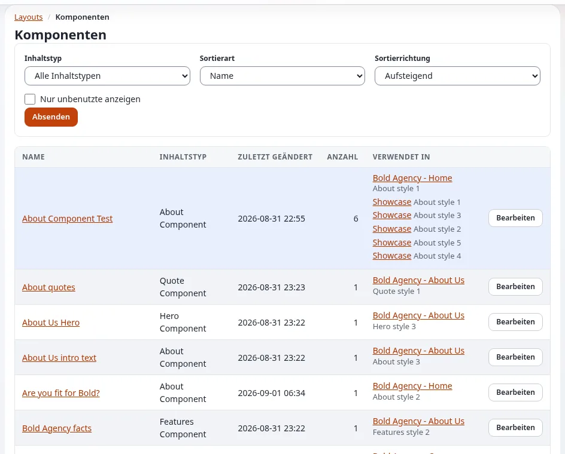

# Blockdefinitionen

Diese Seite ist für Designer, die wissen möchten, welche Blöcke Redakteure platzieren können und wie sie ihnen neue Ansichten
geben. Jeder Blocktyp ist ein Abschnitt `[BlockDefinition_<identifier>]` von
`extension/explayouts/settings/explayouts.ini.append.php`.

## Inhalt

1. [Aufbau einer Definition](#aufbau-einer-definition)
2. [Die mitgelieferten Blöcke](#die-mitgelieferten-blöcke)
3. [Einen View-Typ hinzufügen: ohne PHP](#einen-view-typ-hinzufügen-ohne-php)
4. [Einen Blocktyp hinzufügen](#einen-blocktyp-hinzufügen)

## Aufbau einer Definition

```ini
[BlockDefinition_list]
Name=List
Handler=expLayoutsListBlockHandler
ViewTypes[]=list
ViewTypes[]=grid
ViewTypes[]=list_numbered
ViewTypes[]=list_zigzag
ViewTypes[]=list_accordion
ViewTypes[]=grid_featured
HasCollection=1
Category=listing
```

| Schlüssel | Bedeutung |
|---|---|
| `Name` | die Bezeichnung, die Redakteure sehen |
| `Handler` | die PHP-Klasse, die die Parameter und Daten des Blocks festlegt |
| `ViewTypes[]` | die Formen, in denen der Block rendern kann; Redakteure wählen eine |
| `IsContainer=1` + `Placeholders[]` | der Block enthält andere Blöcke an benannten Stellen (`two_columns` hat `left` und `right`) |
| `HasCollection=1` | der Block zeigt Inhalte aus einer Sammlung (ausgewählte Einträge oder eine Abfrage) |
| `Category` | die Gruppe in der Blockliste des Editors: `basic`, `containers`, `listing`, `gallery`, `components`, `placeholders` |

`[BlockSettings] AvailableBlocks[]` listet die Blöcke, die Redakteure hinzufügen dürfen.

## Die mitgelieferten Blöcke

| Kategorie | Blöcke |
|---|---|
| basic | title, text, html, rich_text, image, button, spacer, divider, markdown, video, map, alert, badge, progress ... |
| containers | column, two_columns, three_columns, four_columns |
| listing | list, grid, list_zigzag, list_accordion, single (und weitere) |
| gallery | gallery, slider, thumb_gallery, grid_gallery, carousel, sushi_bar |
| components | hero, about, features, logos, quote, lead und die Blöcke `exp_component_*` |
| placeholders | tpl_block (ein Template-Teil der Seite), full_view (der eigene Inhalt der Seite) |



Die genaue Liste und die Kategorien stehen in der INI-Datei; `doc/eng-us/bc/6.0/LAYOUTS.md` hat einen Blockkatalog mit Parametern.

## Einen View-Typ hinzufügen: ohne PHP

Der günstigste Weg, Redakteuren eine neue Ansicht zu geben: Fügen Sie einem vorhandenen Block einen View-Typ hinzu und schreiben
Sie sein Template. In `settings/explayouts.ini.append.php` Ihrer Design-Erweiterung:

```ini
[BlockDefinition_list]
ViewTypes[]=mytheme_cards
```

Lassen Sie ihn dann vom Block-Template zeichnen. Das mitgelieferte `block/list.tpl` hat ein einziges Markup; das `block/list.tpl`
des Designs media verteilt nach View-Typ auf `block/list/<view_type>.tpl`, und diesem Muster folgen Sie:

```tpl
{* design/mytheme/templates/explayouts/block/list.tpl *}
{def $vt = first_set( $block.view_type, 'list' )}
{include uri=concat( 'design:explayouts/block/list/', $vt, '.tpl' ) block=$block}
{undef $vt}
```

und `design/mytheme/templates/explayouts/block/list/mytheme_cards.tpl`. Siehe [Block-Ansichtstemplates](block-ansichtstemplates.md).

## Einen Blocktyp hinzufügen

Ein neuer Blocktyp braucht eine Handler-Klasse (PHP) und ist daher eine Aufgabe für Entwickler: Registrieren Sie ihn mit `Name`,
`Handler`, `ViewTypes[]` (und `HasCollection=1` für Inhalte), fügen Sie unter `block/` ein Template pro View-Typ hinzu, erzeugen
Sie die Autoloads neu und leeren Sie die Caches (`doc/eng-us/bc/6.0/LAYOUTS.md`, „Extending the system“). Ein Container braucht
selten einen eigenen Handler: `expLayoutsContainerBlockHandler` mit `IsContainer=1` und `Placeholders[]` genügt.

## Verwandte Seiten

- [Block-Ansichtstemplates](block-ansichtstemplates.md)
- [Layout-Blöcke gestalten](layout-bloecke-gestalten.md)
- [Layouts für Designer](layouts-fuer-designer.md)
- [Freie Dokumentation](../../freie-dokumentation.md): Diese Seite darf unter der GNU FDL 1.3 frei kopiert, übersetzt und verbessert werden.

<!-- exp-partner-block:start -->
**Werden Sie Exponential-Partner.** Partner teilen ihre Informationen, stellen Mittel bereit, geben Beiträge zurück
und entwickeln die Produkte mit uns, und so wächst Exponential. Eine Partner-Website und ein Dashboard sind für Mitte
2027 geplant: Werden Sie noch heute Partner, damit wir schneller wachsen und neue Funktionen früher liefern. Beginnen
Sie mit [Partner: hier beginnen](../../partner/partner-hier-beginnen.md) und
[Wie Sie sich bewerben](../../partner/wie-sie-sich-bewerben.md).
<!-- exp-partner-block:end -->
