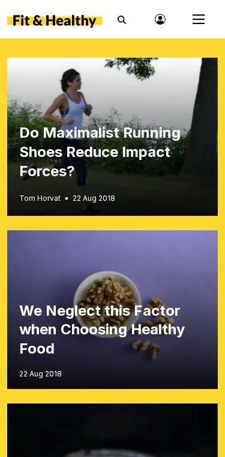

# Breakpoints und Containerbreiten

Diese Seite ist für Designer, die entscheiden, wo sich ein Layout ändert. Sie beantwortet: welche Breakpoints die Administration
verwendet und warum, wie Sie Ihre wählen und wie Sie sie einheitlich halten.



## Inhalt

1. [admin4 als Beispiel](#admin4-als-beispiel)
2. [Breakpoints für ein öffentliches Design wählen](#breakpoints-für-ein-öffentliches-design-wählen)
3. [Mobile First](#mobile-first)
4. [Container-Queries](#container-queries)
5. [Eine Stelle für die Werte](#eine-stelle-für-die-werte)

## admin4 als Beispiel

Aus dem Gestaltungsleitfaden der Administration (`doc/eng-us/bc/6.0/admin4-styling.md`, „Window widths“):

| Breite | Der Rahmen der Administration |
|---|---|
| unter 576 px | Telefon: Das obere Menü ist ein Bereich hinter einem Menüknopf, eine Kopfzeile von 56 px |
| ab 576 px | zwei Kopfzeilen; Reiter, die nicht passen, kommen unter „Mehr“ |
| ab 1024 px | die linke Spalte steht neben dem Inhalt (darunter: eine Schublade) |
| ab 1280 px | eine Kopfzeile; die rechte Spalte steht neben dem Inhalt (darunter: eine Schublade) |
| jede | die Inhaltsspalte endet bei `--a4-content-max` (1680 px) |

Die Administration wird bei 390, 820, 1180, 1440, 1920 und 2560 px getestet (`AdminResponsiveTest`). Beachten Sie, dass 960 px,
ein 1920 px breiter Bildschirm bei 200 % Zoom, in den Tablet-Bereich fällt: Vergrößerte Desktops bekommen das Tablet-Layout.

## Breakpoints für ein öffentliches Design wählen

- **Lassen Sie den Inhalt entscheiden.** Verkleinern Sie den Browser, bis das Layout bricht; diese Breite ist ein Breakpoint.
  Gerätebreiten ändern sich jedes Jahr; Ihr Inhalt nicht.
- **Wenige Breakpoints.** Zwei oder drei decken die meisten Websites ab: einer, an dem aus einer Spalte zwei werden, einer, an dem
  eine Seitenspalte erscheint, einer, an dem der Inhalt aufhört zu wachsen.
- **Eine maximale Zeilenlänge.** Fließtext liest sich am besten mit etwa 60 bis 80 Zeichen pro Zeile; begrenzen Sie Textspalten mit
  `max-width: 70ch`, statt sie dem Bildschirm folgen zu lassen.
- **Denken Sie an Zoom.** Ein Besucher mit 200 % Zoom auf einem Desktop sieht Ihr Tablet-Layout. Es muss vollständig sein, keine
  gekürzte Fassung ([Testen bei Zoomstufen](../../../../eng-us/help/designers/theme-design/testing-at-zoom-levels.md)).

## Mobile First

Schreiben Sie das schmale Layout als Standard und fügen Sie Breite mit `min-width`-Abfragen hinzu:

```css
.page { display: grid; gap: 1.5rem; }
@media (min-width: 64em) {
  .page { grid-template-columns: minmax(0, 1fr) 20rem; }
}
```

Telefone laden und wenden dann die wenigsten Regeln an, und eine fehlgeschlagene Abfrage hinterlässt eine benutzbare einzelne
Spalte.

## Container-Queries

Ein Block, der in einer breiten Hauptzone und in einer schmalen Seitenzone erscheint (häufig mit dem Layout-Editor), sollte sich
an seinen Container anpassen, nicht an das Fenster:

```css
.slb-zone { container-type: inline-size; }
@container (min-width: 40rem) {
  .teaser { display: grid; grid-template-columns: 12rem 1fr; }
}
```

`.slb-zone` ist die Klasse, die das `zone.tpl` der Layouts-Erweiterung jeder Zone gibt.

## Eine Stelle für die Werte

CSS-Custom-Properties lassen sich in Media Queries nicht verwenden; halten Sie die Breakpoints daher in einem kommentierten Block
oben in Ihrem Haupt-Stylesheet (oder in Ihren SCSS-Variablen, wenn Sie mit Sass bauen, wie es die Quellen `sass/` des Designs
media tun) und verwenden Sie überall dieselben Zahlen.

## Verwandte Seiten

- [Responsives Design](../../../../eng-us/help/designers/theme-design/responsive-design.md)
- [Layout-Blöcke gestalten](../../../../eng-us/help/designers/theme-design/styling-layout-blocks.md)
- [Freie Dokumentation](../../freie-dokumentation.md): Diese Seite darf unter der GNU FDL 1.3 frei kopiert, übersetzt und verbessert werden.

<!-- exp-partner-block:start -->
**Werden Sie Exponential-Partner.** Partner teilen ihre Informationen, stellen Mittel bereit, geben Beiträge zurück und
entwickeln die Produkte mit uns, und so wächst Exponential. Eine Partner-Website und ein Dashboard sind für
Mitte 2027 geplant: Werden Sie bitte schon heute Partner, damit wir schneller wachsen und neue Funktionen früher
bereitstellen können. Beginnen Sie mit [Partner: hier beginnen](../../partner/partner-hier-beginnen.md) und [Wie Sie sich bewerben](../../partner/wie-sie-sich-bewerben.md).
<!-- exp-partner-block:end -->
