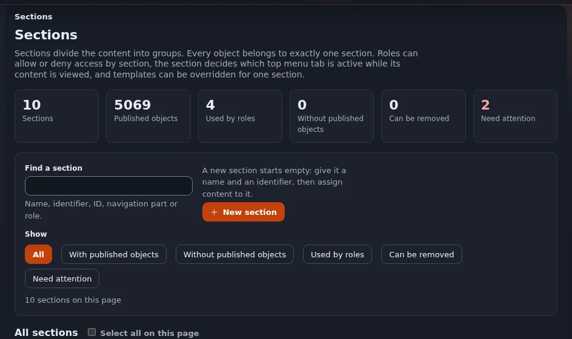
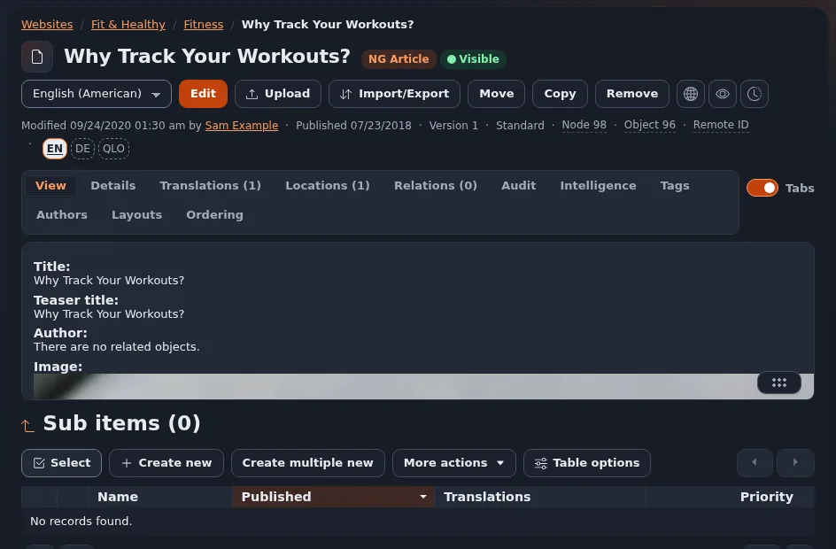
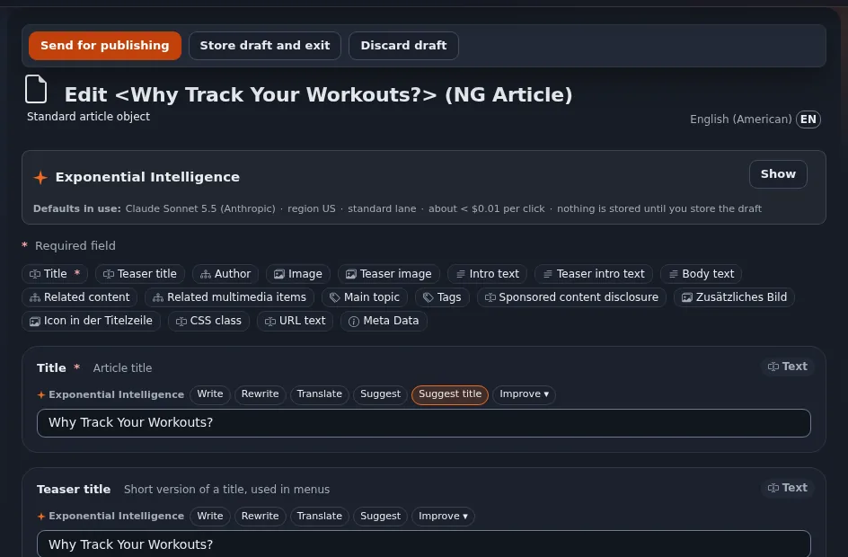

# Checkliste: dunkler Modus

Diese Seite ist für Designer, die einen dunklen Modus prüfen. Hintergrund: [Dunkler Modus im Überblick](dunkelmodus-ueberblick.md).

## Inhalt

1. [Token](#token)
2. [Aussehen](#aussehen)
3. [Verhalten](#verhalten)

## Token

- [ ] Kein direkter Farbwert in Regeln; jede Farbe ist ein Token ([Design-Token](design-tokens.md)).
- [ ] Jedes Farbtoken hat einen dunklen Wert, neben dem hellen definiert.
- [ ] `color-scheme: dark` im dunklen Block (Formularelemente und Bildlaufleisten folgen).
- [ ] Bei Admin-Designs: Der Test der Admin-Gestaltungsregeln läuft durch ([Der Test der Admin-Gestaltungsregeln](der-test-der-admin-gestaltungsregeln.md)).

## Aussehen

- [ ] Kein weißer oder heller Kasten auf einer dunklen Seite (Karten, Tabellen, Codeblöcke, Dialoge, Widgets von Drittanbietern).
- [ ] Textkontrast mindestens 4,5:1 auf jeder dunklen Fläche, auch in Hover- und Auswahlzuständen ([Farbkontrast](farbkontrast.md)).
- [ ] Rahmen sichtbar, aber nicht grell; Flächen unterscheidbar (Seite, Karte, erhöht).
- [ ] Logo auf dem dunklen Kopfbereich lesbar ([SVG-Bilder](svg-bilder.md)).
- [ ] Symbole folgen der Textfarbe.
- [ ] Fokusring auf dunklen Flächen sichtbar.
- [ ] Bei 1440 px und 960 px mit Skalierung 2 geprüft.

## Verhalten

- [ ] Folgt der Systemeinstellung, wenn keine Auswahl getroffen ist, auch wenn sich das System ändert, während die Seite offen ist.
- [ ] Ein Umschalter (falls vorhanden) bietet hell, dunkel und System, nennt seinen Zustand und ist mit der Tastatur bedienbar ([Der Theme-Umschalter und der Schutz vor dem ersten Zeichnen](theme-umschalter-und-pre-paint-guard.md)).
- [ ] Kein helles Aufblitzen beim Laden einer Seite im dunklen Modus.
- [ ] Die Auswahl übersteht Neuladen und Navigation.
- [ ] Drucken ergibt eine helle Seite.

## Verwandte Seiten

- [Tutorial: einen dunklen Modus hinzufügen](tutorial-dunkelmodus-hinzufuegen.md)
- [Dunkler Modus mit prefers-color-scheme](dunkelmodus-mit-prefers-color-scheme.md)
- [Freie Dokumentation](../../freie-dokumentation.md): Diese Seite darf unter der GNU FDL 1.3 frei kopiert, übersetzt und verbessert werden.

<!-- exp-partner-block:start -->
**Werden Sie Exponential-Partner.** Partner teilen ihre Informationen, stellen Mittel bereit, geben Beiträge zurück
und entwickeln die Produkte mit uns, und so wächst Exponential. Eine Partner-Website und ein Dashboard sind für Mitte
2027 geplant: Werden Sie noch heute Partner, damit wir schneller wachsen und neue Funktionen früher liefern. Beginnen
Sie mit [Partner: hier beginnen](../../partner/partner-hier-beginnen.md) und
[Wie Sie sich bewerben](../../partner/wie-sie-sich-bewerben.md).
<!-- exp-partner-block:end -->
