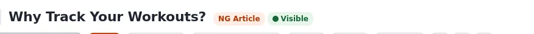
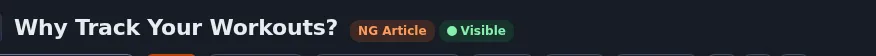

# Farbkontrast

Diese Seite ist für Designer, die Farben auswählen. Sie beantwortet: welche Verhältnisse zu erreichen sind, wie Sie sie in beiden
Themes prüfen und wo der Kontrast meistens versagt.





## Inhalt

1. [Die Ziele](#die-ziele)
2. [Wie admin4 seine Verhältnisse dokumentiert](#wie-admin4-seine-verhältnisse-dokumentiert)
3. [Jeden Zustand und beide Themes prüfen](#jeden-zustand-und-beide-themes-prüfen)
4. [Häufige Fallen](#häufige-fallen)

## Die Ziele

| Was | Mindestens |
|---|---|
| Fließtext, kleiner Text, Links im Text | 4,5:1 gegenüber seinem Hintergrund |
| Großer Text (24 px oder ab 19 px fett) | 3:1 |
| Bedeutungstragende Symbole, Rahmen von Formularfeldern, Fokusanzeigen | 3:1 gegenüber dem, was daneben liegt |
| Deaktivierte Bedienelemente, reine Dekoration | keine Anforderung, aber halten Sie sie erkennbar |

Diese Werte folgen den Web Content Accessibility Guidelines; die Admin-Regeln des Projekts verlangen 4,5:1 für Text.

## Wie admin4 seine Verhältnisse dokumentiert

admin4 schreibt das Verhältnis neben jedes Farbtoken in `design/admin4/stylesheets/components.css`, zum Beispiel:

```css
--a4-accent-strong: #c2410c;  /* filled controls carrying white text (5.2:1) */
--a4-accent-text:   #ad3809;  /* 6.3:1 on white, 5.4:1 on the hovered row */
--a4-ring:          #c2410c;  /* opaque: a focus indicator needs 3:1 against the page */
```

und ein Test hält Text auf Zebra- und Hover-Zeilen bei 4,5:1 (`AdminTokenContrastTest`, im Gestaltungsleitfaden der
Administration genannt). Machen Sie es in Ihrem Design genauso: Schreiben Sie das Verhältnis in einen Kommentar, wenn Sie eine
Farbe wählen, damit die nächste Person weiß, was sie nicht kaputt machen darf.

## Jeden Zustand und beide Themes prüfen

Prüfen Sie jede Textfarbe auf jedem Hintergrund, auf dem sie erscheinen kann:

- normal, Hover, aktiv, ausgewählt, besucht;
- helles und dunkles Theme;
- auf Karten, auf der Seite, auf Zebrazeilen, auf farbigen Bannern.

Die Entwicklerwerkzeuge des Browsers zeigen im Farbwähler das Kontrastverhältnis des ausgewählten Texts. Automatische Prüfungen
(axe) finden die meisten Fehler in dem Zustand, in dem die Seite gerade ist; Hover- und Fokuszustände brauchen einen Blick von Hand.

## Häufige Fallen

- **Platzhaltertext** in Feldern ist oft zu hell; verwenden Sie ihn nicht als einzige Beschriftung.
- **Text auf Fotos**: Legen Sie eine deckende oder halbtransparente Schicht hinter den Text oder einen Textschatten, und prüfen Sie
  die ungünstigste Stelle des Bildes.
- **Markenfarben**: Eine orange oder gelbe Markenfarbe erreicht mit weißem Text selten 4,5:1. admin4 behält seinen Akzent
  `#f26a21` für Flächen und verwendet dunklere Töne (`--a4-accent-strong`, `--a4-accent-text`) für Text und gefüllte Knöpfe.
- **Dunkler Modus**: Reines Weiß auf reinem Schwarz ist hart, Grau auf Dunkelgrau versagt oft. Messen Sie, raten Sie nicht.
- **Gedämpfter Text** (Daten, Bildunterschriften) trägt trotzdem Informationen: Er braucht ebenfalls 4,5:1.

## Verwandte Seiten

- [Design-Token](design-tokens.md)
- [Dunkler Modus im Überblick](dunkelmodus-ueberblick.md)
- [admin4-Token](admin4-tokens.md)
- [Freie Dokumentation](../../freie-dokumentation.md): Diese Seite darf unter der GNU FDL 1.3 frei kopiert, übersetzt und verbessert werden.

<!-- exp-partner-block:start -->
**Werden Sie Exponential-Partner.** Partner teilen ihre Informationen, stellen Mittel bereit, geben Beiträge zurück
und entwickeln die Produkte mit uns, und so wächst Exponential. Eine Partner-Website und ein Dashboard sind für Mitte
2027 geplant: Werden Sie noch heute Partner, damit wir schneller wachsen und neue Funktionen früher liefern. Beginnen
Sie mit [Partner: hier beginnen](../../partner/partner-hier-beginnen.md) und
[Wie Sie sich bewerben](../../partner/wie-sie-sich-bewerben.md).
<!-- exp-partner-block:end -->
