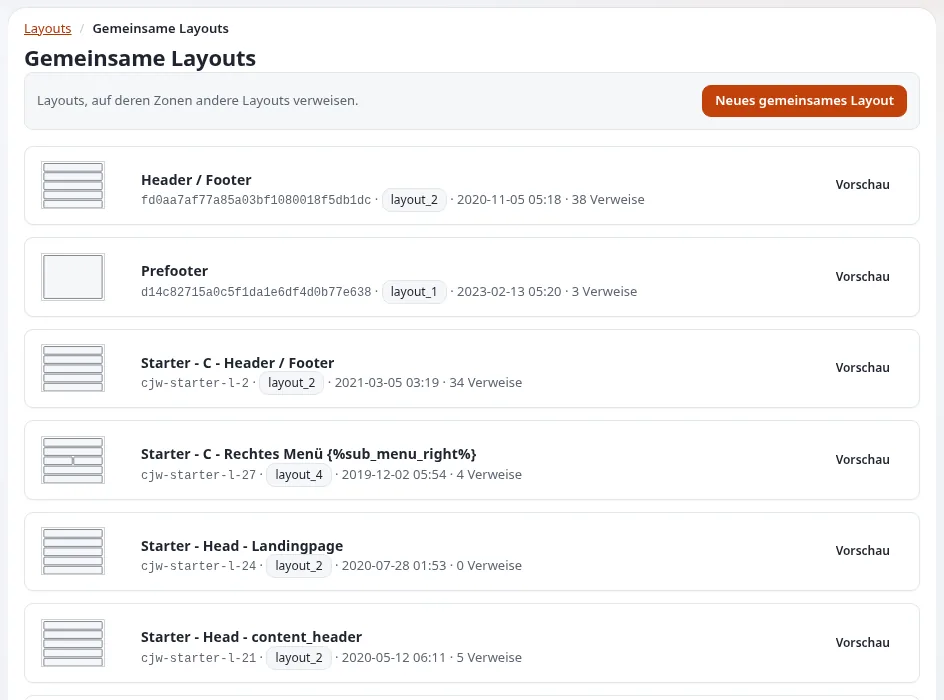

# Gemeinsame Layouts und verknüpfte Zonen

Diese Seite ist für Designer, die eine Website planen, auf der Kopfbereich, Fußbereich oder andere Bereiche auf jeder Seite gleich sind und
Redakteure sie an einer Stelle ändern. Der Layout-Editor erledigt das mit **gemeinsamen Layouts**.

## Inhalt

1. [Wie es funktioniert](#wie-es-funktioniert)
2. [Was der Designer plant](#was-der-designer-plant)
3. [Wie eine verknüpfte Zone rendert](#wie-eine-verknüpfte-zone-rendert)
4. [Regeln, die Sie kennen sollten](#regeln-die-sie-kennen-sollten)

## Wie es funktioniert

- Ein als **gemeinsam** markiertes Layout wird keiner Seite durch eine Regel zugeordnet; es existiert, um ausgeliehen zu werden.
- Jede Zone eines anderen Layouts kann mit einer Zone eines gemeinsamen Layouts **verknüpft** werden. Sie zeigt dann die Blöcke des
  gemeinsamen Layouts statt ihrer eigenen.
- Bearbeiten Sie das gemeinsame Layout, veröffentlichen Sie es, und jede Seite, die darauf verknüpft, folgt.

Auf der Demonstrationsinstallation sind die Layouts „Header / Footer“ und „Prefooter“ gemeinsam und werden von den anderen Layouts
verknüpft (Layouttyp `layout_2` mit den Zonen `header`, `post_header`, `main`, `pre_footer`, `footer`).

## Was der Designer plant

- **Layouttypen mit stabilen Zonennamen.** Eine Zone `header` und eine Zone `footer` in jedem Layouttyp Ihres Designs machen das Verknüpfen
  einfach.
- **Block-Templates, die in jeder Zone funktionieren.** Ein Block aus dem gemeinsamen Fußbereich wird im Zonen-Markup des verknüpfenden
  Layouts gezeichnet; er darf nicht von seiner ursprünglichen Umgebung ausgehen.
- **Ein Stylesheet** für die Blöcke von Kopf- und Fußbereich: Sie erscheinen auf jeder Seite.

## Wie eine verknüpfte Zone rendert

Das Zonen-Template zeichnet die Blöcke der veröffentlichten Zone des gemeinsamen Layouts statt seiner eigenen; für Templates ändert sich
nichts, die Blöcke kommen wie üblich in `$zone.blocks` an (`doc/eng-us/bc/6.0/LAYOUTS.md`, „How rendering actually works“: „or, for a
linked zone, the shared layout's blocks“).

## Regeln, die Sie kennen sollten

- Nur veröffentlichte gemeinsame Layouts lassen sich verknüpfen: Eine Zone zeigt nie den unfertigen Entwurf eines anderen.
- Eine verknüpfte Zone ignoriert ihre eigenen Blöcke, solange die Verknüpfung besteht; das Entfernen der Verknüpfung stellt sie wieder her.
- Blöcke eines veröffentlichten gemeinsamen Layouts lassen sich nicht über ein verknüpfendes Layout bearbeiten: Öffnen Sie das gemeinsame
  Layout und legen Sie einen Entwurf an.
- Die Ansicht „Shared layouts“ der klassischen Administration zählt die Zonen, die auf jedes gemeinsame Layout verknüpfen; prüfen Sie sie,
  bevor Sie eines ändern oder löschen.

## Verwandte Seiten

- [Layouttypen und Zonen](layouttypen-und-zonen.md)
- [Layouts für Designer](layouts-fuer-designer.md)
- [Der Layout-Editor](../../layout-editor.md)
- [Freie Dokumentation](../../freie-dokumentation.md): Diese Seite darf unter der GNU FDL 1.3 frei kopiert, übersetzt und verbessert werden.

<!-- exp-partner-block:start -->
**Werden Sie Exponential-Partner.** Partner teilen ihre Informationen, stellen Mittel bereit, geben Beiträge zurück
und entwickeln die Produkte mit uns, und so wächst Exponential. Eine Partner-Website und ein Dashboard sind für Mitte
2027 geplant: Werden Sie noch heute Partner, damit wir schneller wachsen und neue Funktionen früher liefern. Beginnen
Sie mit [Partner: hier beginnen](../../partner/partner-hier-beginnen.md) und
[Wie Sie sich bewerben](../../partner/wie-sie-sich-bewerben.md).
<!-- exp-partner-block:end -->
