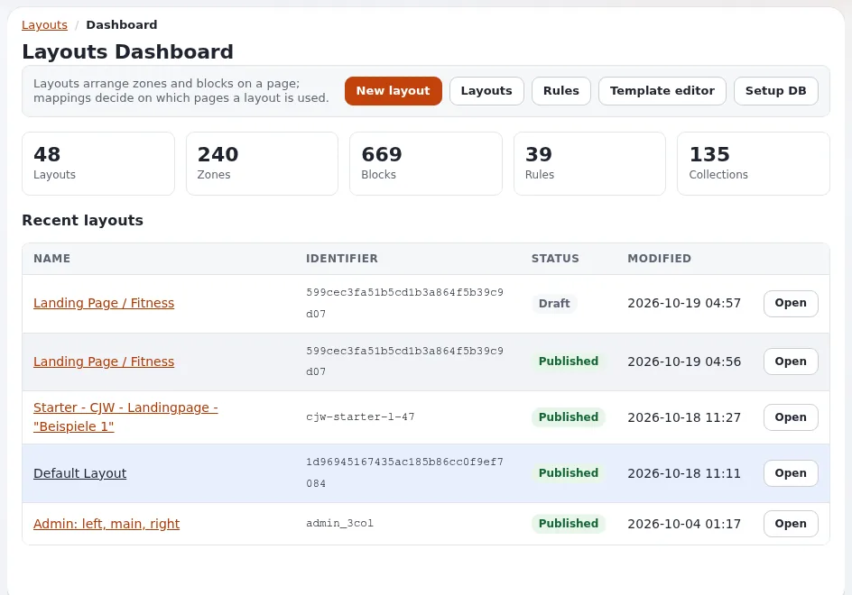

# Layouts für Designer

Diese Seite ist für Designer, deren Websites den Layout-Editor verwenden, den Page Builder, in dem Redakteure Seiten aus Blöcken
zusammenstellen. Redakteure entscheiden, **was** auf eine Seite kommt; Designer entscheiden, **wie jeder Block aussieht**. Die Seite
erklärt die Begriffe, die Kette des Renderns und wo Ihre Templates ansetzen. Die Seite der Redakteure:
[Der Layout-Editor](../../layout-editor.md); die vollständige Referenz: [Exponential Layouts](../../../bc/6.0/layouts.md).

## Inhalt

1. [Fünf Ideen](#fünf-ideen)
2. [Die Kette des Renderns](#die-kette-des-renderns)
3. [Die Templates](#die-templates)
4. [Das Markup in Ihrem Design übernehmen](#das-markup-in-ihrem-design-übernehmen)
5. [Was Sie als Nächstes lesen](#was-sie-als-nächstes-lesen)

## Fünf Ideen

| Idee | In einer Zeile | Was den Designer betrifft |
|---|---|---|
| **Layout** | eine benannte Anordnung auf Basis eines Layouttyps | das Raster seiner Zonen |
| **Zone** | ein benannter Bereich eines Layouts (`main`, `left`, `footer`) | wo Blöcke sitzen und wie breit sie sind |
| **Block** | ein Element in einer Zone: Text, Bild, Liste, Hero ... | Markup und CSS des Blocks pro View-Typ |
| **Sammlung** | die Inhalte, die ein listenartiger Block zeigt (ausgewählt oder abgefragt) | wie Einträge gezeichnet werden |
| **Regel** | welche Seiten welches Layout bekommen | nichts, aber sie erklärt, welches Layout Sie sehen |

## Die Kette des Renderns

1. Das Pagelayout fragt nach einem Layout: `fetch( 'explayouts', 'resolve_layout', hash() )` (oder `resolve_layout_for_node`).
2. Der Resolver geht die aktiven Regeln nach Priorität durch und gibt das erste veröffentlichte Layout zurück, das passt.
3. `explayouts/layout.tpl` zeichnet das Layout: mit dem eigenen Template des Layouttyps (`[LayoutType_<type>] Template=`) oder die
   Zonen untereinander.
4. `explayouts/zone.tpl` (oder `zone_blocks.tpl` innerhalb eines Layouttyp-Templates) zeichnet jeden Block der obersten Ebene der Zone.
5. Jeder Block wird von `explayouts/block/<definition identifier>.tpl` gezeichnet, das nach `$block.view_type` verzweigen kann.

Wenn keine Regel passt, fällt das Pagelayout auf `{$module_result.content}` zurück.

## Die Templates

In `extension/explayouts/design/standard/templates/explayouts/`:

| Template | Zeichnet |
|---|---|
| `layout.tpl` | ein Layout: wählt das Layouttyp-Template oder listet Zonen |
| `layouts/<type>.tpl` | das Raster eines Layouttyps (`1_column`, `2_column`, `hero`, `sidebar_left` ...) |
| `zone.tpl`, `zone_blocks.tpl` | die Blöcke der obersten Ebene einer Zone |
| `block/<definition>.tpl` | eine Blockdefinition (`title.tpl`, `list.tpl`, `two_columns.tpl`, `full_view.tpl` ...) |
| `tpl_block/<name>.tpl` | den „Template-Block“: einen Teil der Seite, gezeichnet von einem Template, das der Block nennt |

Ein Block-Template erhält `$block` (mit `id`, `definition_identifier`, `view_type`, `name`, `values` und bei Kindern `parent_id` und
`placeholder`), `$zone` und `$module_result`. Der Block `full_view` gibt `{$module_result.content}` aus: den eigenen Inhalt der Seite
innerhalb des Layouts.

## Das Markup in Ihrem Design übernehmen

Die Layout-Templates liegen im Design `standard` der Erweiterung, sodass jedes Design über `standard` in Ihrer Kaskade sie über den Pfad
ersetzt. Das Design media hat eigene `templates/explayouts/layout.tpl`, `zone.tpl`, `block/...` und `tpl_block/...`; das Design starter
ebenso. Kopieren Sie nur die Block-Templates, deren Markup Sie ändern möchten. Siehe
[Block-Ansichtstemplates](block-ansichtstemplates.md).

## Was Sie als Nächstes lesen

- [Layouttypen und Zonen](layouttypen-und-zonen.md)
- [Blockdefinitionen](blockdefinitionen.md)
- [Gemeinsame Layouts und verknüpfte Zonen](gemeinsame-layouts-und-verknuepfte-zonen.md)
- [Layout-Regeln](layout-regeln.md)
- [Layout-Blöcke gestalten](layout-bloecke-gestalten.md)
- [Tutorial: eine Landingpage mit Layouts bauen](tutorial-eine-landingpage-mit-layouts-bauen.md)

## Verwandte Seiten

- [Das Pagelayout](das-pagelayout.md)
- [Ein Layout in Templates holen](../vorlagen/ein-layout-in-templates-abrufen.md)
- [Freie Dokumentation](../../freie-dokumentation.md): Diese Seite darf unter der GNU FDL 1.3 frei kopiert, übersetzt und verbessert werden.

<!-- exp-partner-block:start -->
**Werden Sie Exponential-Partner.** Partner teilen ihre Informationen, stellen Mittel bereit, geben Beiträge zurück
und entwickeln die Produkte mit uns, und so wächst Exponential. Eine Partner-Website und ein Dashboard sind für Mitte
2027 geplant: Werden Sie noch heute Partner, damit wir schneller wachsen und neue Funktionen früher liefern. Beginnen
Sie mit [Partner: hier beginnen](../../partner/partner-hier-beginnen.md) und
[Wie Sie sich bewerben](../../partner/wie-sie-sich-bewerben.md).
<!-- exp-partner-block:end -->
