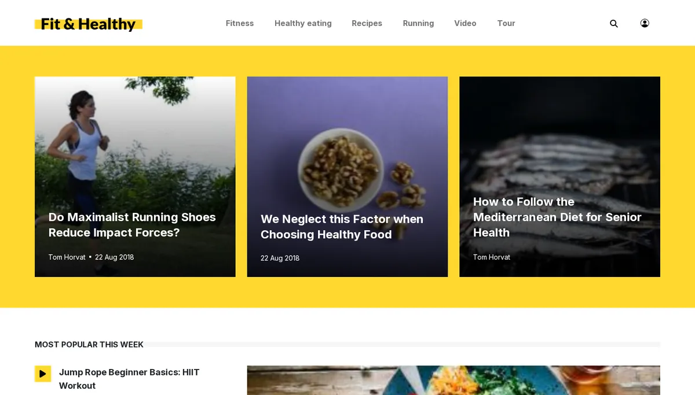

# Ein Rundgang durch das Theme media

Diese Seite ist für Designer, die am besten an einem echten, vollständigen Theme lernen. Das Design media aus der Erweiterung
`sevenx_themes_media` (Composer-Paket `se7enxweb/sevenx-themes-media`) zeichnet die öffentlichen Siteaccesses `site` und `bold` der
Demonstrationsinstallation. Die Seite beantwortet: wo seine Teile liegen, was es tut, das Sie vielleicht übernehmen möchten, und woran Sie
denken sollten, wenn Sie darauf aufbauen.

## Inhalt

1. [Größe und Form](#größe-und-form)
2. [Das Pagelayout und seine Teile](#das-pagelayout-und-seine-teile)
3. [Stylesheets: eine gepackte Datei](#stylesheets-eine-gepackte-datei)
4. [Skripte: zwei Bündel, eines verzögert](#skripte-zwei-bündel-eines-verzögert)
5. [Schriften aus dem Design ausgeliefert](#schriften-aus-dem-design-ausgeliefert)
6. [Zoom und Telefone](#zoom-und-telefone)
7. [Block-Templates für den Layout-Editor](#block-templates-für-den-layout-editor)
8. [Einstellungen und Overrides](#einstellungen-und-overrides)
9. [Eigene Template-Operatoren](#eigene-template-operatoren)
10. [Was Sie übernehmen, was Sie lassen](#was-sie-übernehmen-was-sie-lassen)

## Größe und Form

- Erweiterung `extension/sevenx_themes_media/`, Design `design/media/`.
- Etwa 440 Templates unter `design/media/templates/` und weitere unter `override/templates/` (`content`, `edit`, `embed`, `full`, `line`,
  `node`, `standard`, `view`).
- Stylesheets, Skripte und Schriften in `stylesheets/`, `javascript/`, `fonts/`; SCSS-Quellen unter `sass/`.
- Sein README stellt fest, dass die Templates von Hand gepflegte Quellen sind: Bearbeiten Sie sie direkt.

## Das Pagelayout und seine Teile

`templates/pagelayout.tpl` bereitet einige Variablen vor (den aktuellen Knoten, den Pfad des Brotkrumenpfads), bindet
`pagelayout/variables.tpl` ein und zeichnet dann einen von drei Rahmen:

- View-Modus `payload`: nur `{$module_result.content}`, kein Rahmen;
- View-Modus `layout_preview`: ein reduzierter Rahmen für Vorschauen;
- jede andere Seite: der volle Rahmen.

Der Kopf des vollen Rahmens besteht aus fünf Einbindungen (`pagelayout/head/title.tpl`, `meta.tpl`, `link.tpl`, `style.tpl`, `script.tpl`)
plus Teilen für Open Graph und den Tag Manager; der Body beginnt mit `pagelayout/accessibility_links.tpl`, einem Skip-Link zu `#main`.
Kopfbereich, Brotkrumenpfad, Fußbereich, Cookie-Steuerung und Skripte am Ende sind ebenfalls Teile.

## Stylesheets: eine gepackte Datei

`pagelayout/head/style.tpl` lädt jedes Stylesheet mit **einem** Aufruf von `ezcss_load`: zuerst `inter.css` (Schriften), dann das
Layout-Raster, `index.css`, dann die eigenen Ergänzungen des Themes (`account.css`, `error-page.css`, `zoom-support.css`,
`exp-header-menu.css`, `exp-page-parts.css`, `exp-mobile-layout.css` ...). Der Packer führt sie zu einer Datei in
`var/<site>/cache/public/stylesheets/` zusammen.

Erkenntnisse, die der Kommentar der Datei festhält:

- `ezcss_load`, nicht `ezcss`: `_load` gibt auch die Stylesheets aus, die Inhalts-Templates während des Renderns mit `ezcss_require`
  angefordert haben.
- Die Reihenfolge bleibt erhalten: Die Basisstile des Themes kommen zuerst, angeforderte Dateien danach.
- Pfade sind relativ zum Design und laufen über die Kaskade: `'explayouts_standard/grid.css'` wird im `design/standard` der
  Layouts-Erweiterung gefunden.
- `exp-page-parts.css` enthält Regeln, die früher `<style>`-Blöcke und `style=""`-Attribute von Seiten-Templates waren.

Beachten Sie, dass auch `settings/design.ini.append.php` der Erweiterung Einträge `CSSFileList[]` auflistet; das Pagelayout von media liest
diese Liste nicht, es nennt seine Dateien selbst. Designs unterscheiden sich hier: Prüfen Sie das Kopf-Template des Designs, auf dem Sie
aufbauen ([Stylesheets laden](stylesheets-laden.md)).

## Skripte: zwei Bündel, eines verzögert

`pagelayout/head/script.tpl` packt die Skripte, die das Rendern blockieren (`runtime.js`, `index.js`), mit `ezscript_load` in Packstufe 2,
und den Rest (`index-noncritical.js`, `ajax-load-more.js`, die Skripte für Einwilligung und Kopfbereich) mit
`ezscriptfiles( ..., 2, true() )`, das URLs zurückgibt, sodass das Template `<script defer src=...>` selbst schreiben kann. Konfiguration,
die ein Skript braucht (Texte in der Sprache der Seite, eine URL der Datenschutzseite), wird als Daten
`<script type="application/json" id="exp-yt-config">` ausgegeben, gebaut mit `json_encode` und `i18n`. Ein JSON-Datenblock wird nicht
ausgeführt und braucht daher keine CSP-Nonce.

## Schriften aus dem Design ausgeliefert

Der Webfont Inter wird aus `design/media/fonts/` ausgeliefert und in `stylesheets/inter.css` deklariert, das mit dem Rest gepackt wird.
Der Kommentar in `style.tpl` erklärt warum: Ein fremder Schrift-Host kostet zusätzliche DNS-, TCP- und TLS-Rundreisen, bevor irgendein Text
gezeichnet werden kann. Siehe [Schriften in einem Design](schriften-in-einem-design.md).

## Zoom und Telefone

- `zoom-support.css`: Der Browser-Zoom verkleinert den Viewport in CSS-Pixeln (ein 1920 px breiter Bildschirm bei 200 % ist ein Viewport
  von 960 px). Seine Regeln geben Bedienelemente zurück, die das ursprüngliche Theme unterhalb eines Breakpoints versteckt hat.
- `exp-mobile-layout.css`: Tippziele, Eingabegrößen und Bildkorrekturen für Telefone, Tablets und 200 % Zoom.

Beide werden von Hand gepflegt und nach der Build-Ausgabe geladen. Siehe [Testen bei Zoomstufen](testen-bei-zoomstufen.md).

## Block-Templates für den Layout-Editor

`templates/explayouts/` enthält die media-Fassungen von `layout.tpl`, `zone.tpl` und den Block-Templates: `block/list.tpl` verteilt nach
View-Typ auf `block/list/<view_type>.tpl` (`grid.tpl`, `numbered.tpl`, `zigzag.tpl`, `accordion.tpl` ...), und `tpl_block/` enthält die
Template-Blöcke (`article_header.tpl`, `article_body.tpl`, `article_media.tpl` ...). Sie ersetzen über die Kaskade die eigenen Templates der
Layouts-Erweiterung, weil `media` vor `standard` durchsucht wird. Siehe [Block-Ansichtstemplates](block-ansichtstemplates.md).

## Einstellungen und Overrides

| Datei | Enthält |
|---|---|
| `settings/design.ini.append.php` | `DesignExtensions[]=sevenx_themes_media` |
| `settings/site.ini.append.php` | `[TemplateSettings] ExtensionAutoloadPath[]=sevenx_themes_media`, was seine Template-Operatoren registriert |
| `settings/siteaccess/site/site.ini.append.php` (und `bold/`) | die Design-Kette und `TranslationExtensions[]` |
| `settings/siteaccess/site/override.ini.append.php` (und `bold/`) | die Override-Regeln der Ansichten full, line und embed |
| `settings/image.ini.append.php` | die Bildaliase, die seine Templates anfordern |
| `settings/explayouts.ini.append.php` | Layout-Einstellungen des Themes |
| `translations/<locale>/translation.ts` | die Texte des Themes in elf Katalogen (`eng-US`, `ger-DE`, `fre-FR`, `heb-IL` ...) |

## Eigene Template-Operatoren

Die Erweiterung registriert eigene Template-Operatoren (`autoloads/eztemplateautoload.php`), zum Beispiel `intro`, `title`, `path`,
`content_link`, `image`, `ng_image_alias`, `site_url`, `json_ld`, `explayouts_render_zone`. Sie stammen aus der Geschichte des Themes als
Portierung eines Twig-Themes. Templates eines anderen Designs können sie nur verwenden, wenn diese Erweiterung aktiv ist. Ziehen Sie in
einem Design, das portabel sein soll, Operatoren des Kernels vor.

## Was Sie übernehmen, was Sie lassen

**Übernehmen:** das aufgeteilte Pagelayout, ein einziger Aufruf von `ezcss_load`, zwei Skriptbündel mit `defer`, JSON-Konfigurationsblöcke
statt Inline-Skripten, selbst gehostete Schriften, ein Zoom-Stylesheet, ein Skip-Link.

**Lassen:** die Inhaltsklassen der Media-Site (`ng_*`) und die daran gebundenen Operatoren, außer Ihre Website verwendet dieses
Inhaltsmodell.

## Verwandte Seiten

- [Die Themes, die mit Exponential geliefert werden](themes-die-mit-exponential-kommen.md)
- [Der Packer](der-packer.md)
- [Layouts für Designer](layouts-fuer-designer.md)
- [Freie Dokumentation](../../freie-dokumentation.md): Diese Seite darf unter der GNU FDL 1.3 frei kopiert, übersetzt und verbessert werden.

<!-- exp-partner-block:start -->
**Werden Sie Exponential-Partner.** Partner teilen ihre Informationen, stellen Mittel bereit, geben Beiträge zurück
und entwickeln die Produkte mit uns, und so wächst Exponential. Eine Partner-Website und ein Dashboard sind für Mitte
2027 geplant: Werden Sie noch heute Partner, damit wir schneller wachsen und neue Funktionen früher liefern. Beginnen
Sie mit [Partner: hier beginnen](../../partner/partner-hier-beginnen.md) und
[Wie Sie sich bewerben](../../partner/wie-sie-sich-bewerben.md).
<!-- exp-partner-block:end -->
