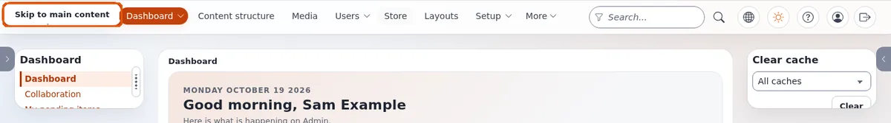

# Skip-Links

Diese Seite ist für Designer, die das Pagelayout bauen. Ein Skip-Link ist der erste Link der Seite; er bleibt verborgen, bis er den
Tastaturfokus erhält, und springt zum Hauptinhalt, damit Tastaturbenutzer nicht auf jeder Seite durch den ganzen Kopfbereich tabben müssen.

## Inhalt

1. [Markup](#markup)
2. [CSS](#css)
3. [Beispiele in den mitgelieferten Designs](#beispiele-in-den-mitgelieferten-designs)
4. [Prüfungen](#prüfungen)

## Markup

Das erste Element im `<body>`:

```tpl
<a class="skip-link" href="#main">{'Skip to main content'|i18n( 'design/mytheme' )}</a>
...
<main id="main" tabindex="-1">
```

Das Ziel hat `tabindex="-1"`, damit Browser den Fokus hineinsetzen und nicht nur scrollen.

## CSS

Außerhalb des Bildschirms verborgen, bis er den Fokus hat, dann obenauf gezeigt:

```css
.skip-link {
  position: fixed;
  inset-block-start: 0.5rem;
  inset-inline-start: 0.5rem;
  z-index: 1000;
  padding: 0.5rem 1rem;
  background: var(--site-surface);
  color: var(--site-ink);
  transform: translateY(-200%);
}
.skip-link:focus {
  transform: none;
  outline: 3px solid var(--site-focus);
  outline-offset: 2px;
}
```

Verbergen Sie ihn nicht mit `display: none` oder `visibility: hidden`: Dann könnte er nie den Fokus erhalten. Logische Eigenschaften
(`inset-inline-start`) setzen ihn auf Seiten von rechts nach links an den rechten Rand.

## Beispiele in den mitgelieferten Designs

- **admin4**: `<a class="a4-skip-link" href="#maincontent">` (oder `#a4-main`) in `design/admin4/templates/pagelayout.tpl`, gestaltet von
  `.a4-skip-link` in `components.css` (feste Position, ein eigenes z-index-Token `--a4-z-skip-link`, ein Fokusring).
- **media**: `pagelayout/accessibility_links.tpl` gibt einen Link „Skip to main content“ auf `#main` aus, direkt nach `<body>` eingebunden.



## Prüfungen

- [ ] Drücken Sie auf einer frisch geladenen Seite einmal Tab: Der Skip-Link erscheint.
- [ ] Drücken Sie Enter: Der Fokus liegt im Hauptinhalt (der nächste Tab geht zum ersten Link des Inhalts).
- [ ] Der Text ist in jeder Sprache der Website übersetzt.

## Verwandte Seiten

- [Tastatur und Fokus](tastatur-und-fokus.md)
- [Landmarks und Überschriften](landmarks-und-ueberschriften.md)
- [Freie Dokumentation](../../freie-dokumentation.md): Diese Seite darf unter der GNU FDL 1.3 frei kopiert, übersetzt und verbessert werden.

<!-- exp-partner-block:start -->
**Werden Sie Exponential-Partner.** Partner teilen ihre Informationen, stellen Mittel bereit, geben Beiträge zurück und
entwickeln die Produkte mit uns, und so wächst Exponential. Eine Partner-Website und ein Dashboard sind für
Mitte 2027 geplant: Werden Sie bitte schon heute Partner, damit wir schneller wachsen und neue Funktionen früher
bereitstellen können. Beginnen Sie mit [Partner: hier beginnen](../../partner/partner-hier-beginnen.md) und [Wie Sie sich bewerben](../../partner/wie-sie-sich-bewerben.md).
<!-- exp-partner-block:end -->
