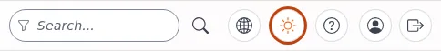

# Tastatur und Fokus

Diese Seite ist für Designer und Frontend-Entwickler eines Designs. Viele Menschen verwenden eine Tastatur statt einer Maus. Die Seite
beantwortet: wie der Fokus aussehen muss, wie er sich bewegen muss und welche Elemente Sie verwenden.

## Inhalt

1. [Ein sichtbarer Fokusring](#ein-sichtbarer-fokusring)
2. [Echte Elemente](#echte-elemente)
3. [Tab-Reihenfolge](#tab-reihenfolge)
4. [Menüs, Aufklappbereiche und Dialoge](#menüs-aufklappbereiche-und-dialoge)
5. [Mit der Tastatur testen](#mit-der-tastatur-testen)

## Ein sichtbarer Fokusring

Jedes Element, das den Fokus erhalten kann, muss ihn zeigen. Die Regel von admin4 (`components.css`):



```css
.a4-page :focus-visible,
.a4-focus:focus-visible,
.a4-btn:focus-visible {
  outline: 3px solid var(--a4-ring);
  outline-offset: 2px;
}
```

- `:focus-visible` zeigt den Ring beim Tastaturfokus und nicht nach einem Mausklick.
- Die Farbe des Rings ist ein Token mit einem Kontrast von 3:1 zur Seite, in beiden Themes.
- Schreiben Sie nie `outline: none`, außer dieselbe Regel zeichnet eine andere deutliche Anzeige.

Für ein öffentliches Design:

```css
:where(a, button, input, select, textarea, summary, [tabindex]):focus-visible {
  outline: 3px solid var(--site-focus);
  outline-offset: 2px;
}
```

## Echte Elemente

- Etwas, das irgendwohin führt, ist ein `<a href>`; etwas, das etwas tut, ist ein `<button type="button">`.
- Machen Sie kein `<div>` klickbar: Es ist nicht fokussierbar und reagiert nicht auf Enter und Leertaste.
- `<details>` und `<summary>` ergeben einen funktionierenden Aufklappbereich ohne Skript.

## Tab-Reihenfolge

- Lassen Sie die Quelltextreihenfolge der sichtbaren Reihenfolge folgen; korrigieren Sie sie nicht mit positiven `tabindex`-Werten.
- `tabindex="-1"` nur für Elemente, die Sie per Skript fokussieren (ein Dialog, das Ziel eines Skip-Links).
- Versteckte Inhalte (geschlossene Menüs, Bereiche außerhalb des Bildschirms) müssen aus der Tab-Reihenfolge heraus: `hidden`,
  `display: none` oder `inert`.

## Menüs, Aufklappbereiche und Dialoge

| Widget | Verhalten mit der Tastatur |
|---|---|
| Menüknopf | Enter/Leertaste schaltet um; `aria-expanded` nennt den Zustand; Escape schließt und gibt den Fokus an den Knopf zurück |
| Navigation außerhalb des Bildschirms | der Fokus wandert beim Öffnen hinein, Tab bleibt darin, solange sie offen ist, Escape schließt |
| Dialog | ziehen Sie `<dialog>` mit `showModal()` vor; der Fokus geht hinein, Escape schließt, der Fokus kehrt zum Auslöser zurück |

Die seitlichen Schubladen von admin4 folgen diesem Modell (Fokus auf das erste Bedienelement, Fokusfalle, Escape gibt den Fokus an den
Reiter zurück, `aria-expanded` am Reiter), wie im Gestaltungsleitfaden der Administration beschrieben.

## Mit der Tastatur testen

1. Klicken Sie in die Adressleiste und drücken Sie dann wiederholt Tab durch die ganze Seite.
2. Ist der erste Halt der Skip-Link? Ist der Fokus immer sichtbar? Ergibt die Reihenfolge Sinn?
3. Öffnen Sie jedes Menü und jeden Dialog mit der Tastatur und schließen Sie sie mit Escape.
4. Wiederholen Sie das bei 200 % Zoom und im dunklen Modus.

## Verwandte Seiten

- [Skip-Links](sprunglinks.md)
- [Barrierefreiheit: Grundlagen für Themes](barrierefreiheit-grundlagen-fuer-themes.md)
- [Reduzierte Bewegung](reduzierte-bewegung.md)
- [Freie Dokumentation](../../freie-dokumentation.md): Diese Seite darf unter der GNU FDL 1.3 frei kopiert, übersetzt und verbessert werden.

<!-- exp-partner-block:start -->
**Werden Sie Exponential-Partner.** Partner teilen ihre Informationen, stellen Mittel bereit, geben Beiträge zurück und
entwickeln die Produkte mit uns, und so wächst Exponential. Eine Partner-Website und ein Dashboard sind für
Mitte 2027 geplant: Werden Sie bitte schon heute Partner, damit wir schneller wachsen und neue Funktionen früher
bereitstellen können. Beginnen Sie mit [Partner: hier beginnen](../../partner/partner-hier-beginnen.md) und [Wie Sie sich bewerben](../../partner/wie-sie-sich-bewerben.md).
<!-- exp-partner-block:end -->
