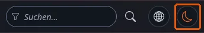

# Der Theme-Umschalter und der Schutz vor dem ersten Zeichnen

Diese Seite ist für Designer, die einem Design einen Umschalter für hell, dunkel und System hinzufügen. Die Schwierigkeit ist nicht der
Umschalter; es ist, eine Seite zu vermeiden, die hell gezeichnet wird und dann dunkel wird. Die Seite beantwortet: wo der Schutz läuft, wie
er mit einer Content Security Policy verträglich bleibt und wie admin4 es macht.

## Inhalt

1. [Warum ein Schutz](#warum-ein-schutz)
2. [Der Schutz als Datei, nicht inline](#der-schutz-als-datei-nicht-inline)
3. [Das Schutzskript](#das-schutzskript)
4. [Der Umschalter](#der-umschalter)
5. [Die Umsetzung in admin4](#die-umsetzung-in-admin4)

## Warum ein Schutz

Stylesheets lesen das Theme aus einem Attribut am `<html>`. Setzt es ein Skript am Ende des Body, hat der Browser die Seite bereits im
Standard-Theme gezeichnet: ein weißes Aufblitzen auf jeder Seite für Benutzer des dunklen Modus. Das Attribut muss von einem Skript im
`<head>` gesetzt werden, vor den Stylesheets, das das Rendern für die wenigen Mikrosekunden blockiert, die es läuft.

## Der Schutz als Datei, nicht inline

Der übliche Trick ist ein Inline-`<script>` im Kopf. Exponential-Designs vermeiden Inline-Skripte, weil eine Content Security Policy mit
`script-src 'self'` sie blockiert. Laden Sie den Schutz als winzige Datei, ohne `defer` oder `async`, vor den Stylesheets:

```tpl
<head>
    <meta charset="utf-8">
    {ezscript( array( 'theme-guard.js' ) )}
    {ezcss_load( array( 'tokens.css', 'mytheme.css' ) )}
```

admin4 macht genau das: `page_head_style.tpl` gibt `{ezscript( array( 'a4_head.js' ) )}` vor seinen Stylesheets aus, und der Kommentar der
Datei erklärt, sie sei „a file of its own, not an inline script, so it runs under a Content Security Policy without 'unsafe-inline'“.

## Das Schutzskript

```js
/* design/mytheme/javascript/theme-guard.js */
(function () {
  var root = document.documentElement, KEY = 'mytheme-theme', choice = 'system';
  try { choice = window.localStorage.getItem(KEY) || 'system'; } catch (e) { /* blocked storage */ }
  var mq = window.matchMedia ? window.matchMedia('(prefers-color-scheme: dark)') : null;
  function apply(c) {
    var dark = c === 'dark' || (c === 'system' && mq && mq.matches);
    root.setAttribute('data-theme', dark ? 'dark' : 'light');
    root.setAttribute('data-theme-choice', c);
  }
  apply(choice);
  if (mq && mq.addEventListener) mq.addEventListener('change', function () {
    if (root.getAttribute('data-theme-choice') === 'system') apply('system');
  });
  window.mythemeTheme = { apply: apply, save: function (c) { try { localStorage.setItem(KEY, c); } catch (e) {} apply(c); } };
})();
```

Der Speicher kann blockiert sein (private Fenster, Richtlinien); das `try` hält die Seite lauffähig, sie vergisst nur die Auswahl.

## Der Umschalter

Ein echter Knopf, sein Zustand als Text, der Handler in Ihrer Haupt-Skriptdatei:




```tpl
<button type="button" id="theme-toggle" class="theme-toggle">
    <span class="theme-toggle-label">{'Color mode'|i18n( 'design/mytheme' )}</span>
</button>
<span id="theme-status" class="sr-only" role="status"></span>
```

```js
/* in mytheme.js */
document.getElementById('theme-toggle').addEventListener('click', function () {
  var order = { light: 'dark', dark: 'system', system: 'light' };
  var next = order[document.documentElement.getAttribute('data-theme-choice')] || 'light';
  window.mythemeTheme.save(next);
  document.getElementById('theme-status').textContent = next;  /* translate in real code */
});
```

Übersetzen Sie die Beschriftungen mit `i18n` und legen Sie sie in `data-`-Attribute, die das Skript liest.

## Die Umsetzung in admin4

`design/admin4/javascript/a4_head.js`:

- liest die Auswahl aus der Benutzerpräferenz `admin_color_mode` (über `window.a4Pref`) oder auf Seiten ohne angemeldeten Benutzer aus dem
  `localStorage`-Schlüssel `exp-admin4-theme`;
- setzt `data-a4-theme` und `data-a4-theme-choice` am `<html>`;
- folgt dem System, solange die Auswahl `system` ist;
- wechselt an `#a4-theme-toggle` zwischen hell, dunkel, System und kündigt den neuen Modus in `#a4-theme-status` an;
- folgt Änderungen in anderen Tabs (das Ereignis `storage`);
- druckt im hellen Modus (`beforeprint` und `afterprint`).

## Verwandte Seiten

- [Dunkler Modus im Überblick](dunkelmodus-ueberblick.md)
- [Kein Inline-JavaScript](kein-inline-javascript.md)
- [Tutorial: einen dunklen Modus hinzufügen](tutorial-dunkelmodus-hinzufuegen.md)
- [Freie Dokumentation](../../freie-dokumentation.md): Diese Seite darf unter der GNU FDL 1.3 frei kopiert, übersetzt und verbessert werden.

<!-- exp-partner-block:start -->
**Werden Sie Exponential-Partner.** Partner teilen ihre Informationen, stellen Mittel bereit, geben Beiträge zurück
und entwickeln die Produkte mit uns, und so wächst Exponential. Eine Partner-Website und ein Dashboard sind für Mitte
2027 geplant: Werden Sie noch heute Partner, damit wir schneller wachsen und neue Funktionen früher liefern. Beginnen
Sie mit [Partner: hier beginnen](../../partner/partner-hier-beginnen.md) und
[Wie Sie sich bewerben](../../partner/wie-sie-sich-bewerben.md).
<!-- exp-partner-block:end -->
