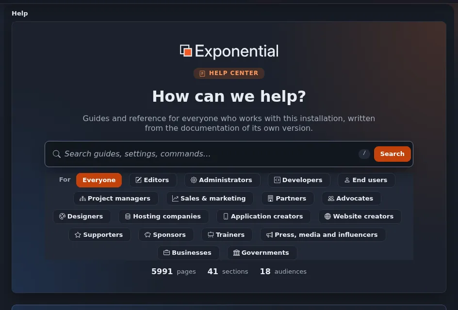
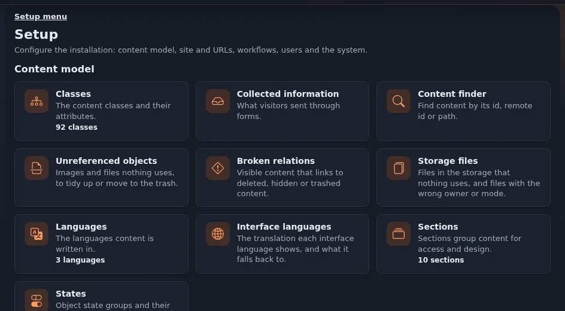

# Tutorial: einen dunklen Modus hinzufügen

Dieses Tutorial ist für Designer, die einem Design, das nur einen hellen Modus hat, einen dunklen Modus hinzufügen. Teil A folgt der
Systemeinstellung (kein Skript); Teil B fügt einen Umschalter hinzu. Planen Sie zwei bis vier Stunden ein, das meiste davon für Schritt 1.

## Inhalt

1. [Schritt 1: Farben in Token](#schritt-1-farben-in-token)
2. [Schritt 2: dunkle Werte für die Systemeinstellung](#schritt-2-dunkle-werte-für-die-systemeinstellung)
3. [Schritt 3: Bilder und Logos](#schritt-3-bilder-und-logos)
4. [Schritt 4: ein Umschalter](#schritt-4-ein-umschalter)
5. [Schritt 5: testen](#schritt-5-testen)

## Schritt 1: Farben in Token

1. Listen Sie jede Farbe in Ihren Stylesheets auf:



   ```bash
   grep -n -o -E "#[0-9a-fA-F]{3,8}\b|rgba?\([^)]*\)" extension/mytheme/design/mytheme/stylesheets/*.css | sort | uniq -c | sort -rn
   ```

2. Gruppieren Sie sie nach Rolle: Text, gedämpfter Text, Seitenhintergrund, Kartenhintergrund, Rahmen, Akzent, Fokus.
3. Definieren Sie ein Token pro Rolle in `tokens.css` und ersetzen Sie jeden direkten Wert durch `var(--site-...)`
   ([Design-Token](design-tokens.md)). Fast identische Grautöne werden zu einem Token.
4. Laden Sie neu: Die helle Seite muss aussehen wie vorher.

## Schritt 2: dunkle Werte für die Systemeinstellung

Ergänzen Sie `tokens.css`:

```css
@media (prefers-color-scheme: dark) {
  :root:not([data-theme="light"]) {
    color-scheme: dark;
    --site-ink: #e8ebf0;
    --site-muted: #a3abb9;
    --site-surface: #171c25;
    --site-card: #1b212c;
    --site-line: #2e3644;
    --site-accent: #7fb3f0;
    --site-focus: #7fb3f0;
  }
}
```

Stellen Sie Ihr Betriebssystem auf dunkel und laden Sie neu. Messen Sie den Kontrast jedes Text-Tokens auf jedem Flächen-Token
([Farbkontrast](farbkontrast.md)).

## Schritt 3: Bilder und Logos

- Logo: eine Fassung für dunkle Hintergründe oder ein SVG, das mit `currentColor` gezeichnet ist ([SVG-Bilder](svg-bilder.md)).
- Symbole als CSS-Masken folgen der Textfarbe.
- Schatten: im dunklen Modus dunkler und zurückhaltender oder stattdessen ein Rahmen.

## Schritt 4: ein Umschalter

1. Kopieren Sie die dunklen Werte in einen zweiten Block für eine ausdrückliche Wahl:

   ```css
   :root[data-theme="dark"] { color-scheme: dark; --site-ink: #e8ebf0; /* the same values as above */ }
   ```

2. Fügen Sie `javascript/theme-guard.js` aus [Der Theme-Umschalter und der Schutz vor dem ersten Zeichnen](theme-umschalter-und-pre-paint-guard.md)
   hinzu und laden Sie es im Kopf, **vor** den Stylesheets:

   ```tpl
   {ezscript( array( 'theme-guard.js' ) )}
   {ezcss_load( array( 'tokens.css', 'mytheme.css' ) )}
   ```

3. Fügen Sie den Knopf im Kopfbereich und seinen Klick-Handler in Ihrer Haupt-Skriptdatei hinzu (dieselbe Seite).
4. Übersetzen Sie die Beschriftungen des Knopfes.

## Schritt 5: testen

Verwenden Sie die [Checkliste für den dunklen Modus](checkliste-dunkelmodus.md). Kurz: jeder Seitentyp hell und dunkel, bei 1440 px und 960 px
mit Skalierung 2; keine weißen Kästen; Kontrast gemessen; Neuladen behält die Auswahl; kein Aufblitzen beim Laden; der Druck ist hell.



## Verwandte Seiten

- [Dunkler Modus im Überblick](dunkelmodus-ueberblick.md)
- [Dunkler Modus mit prefers-color-scheme](dunkelmodus-mit-prefers-color-scheme.md)
- [Checkliste: dunkler Modus](checkliste-dunkelmodus.md)
- [Freie Dokumentation](../../freie-dokumentation.md): Diese Seite darf unter der GNU FDL 1.3 frei kopiert, übersetzt und verbessert werden.

<!-- exp-partner-block:start -->
**Werden Sie Exponential-Partner.** Partner teilen ihre Informationen, stellen Mittel bereit, geben Beiträge zurück und
entwickeln die Produkte mit uns, und so wächst Exponential. Eine Partner-Website und ein Dashboard sind für
Mitte 2027 geplant: Werden Sie bitte schon heute Partner, damit wir schneller wachsen und neue Funktionen früher
bereitstellen können. Beginnen Sie mit [Partner: hier beginnen](../../partner/partner-hier-beginnen.md) und [Wie Sie sich bewerben](../../partner/wie-sie-sich-bewerben.md).
<!-- exp-partner-block:end -->
