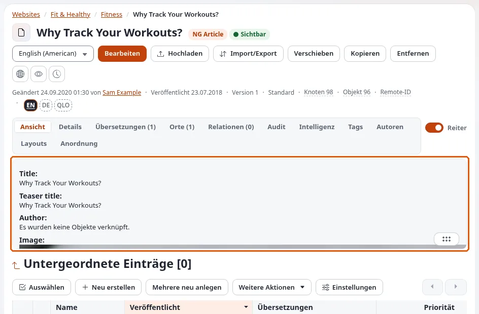

# Ansichtsmodi

Diese Seite ist für Designer, die die Templates eines Designs planen. Derselbe Artikel erscheint als ganze Seite, als Eintrag in
einer Liste, als Teaser in einem Block, als Einbettung in einem anderen Text. Jedes davon ist ein **Ansichtsmodus**, und jeder hat
sein eigenes Template.

## Inhalt

1. [Die üblichen Ansichtsmodi](#die-üblichen-ansichtsmodi)
2. [Wie ein Ansichtsmodus gewählt wird](#wie-ein-ansichtsmodus-gewählt-wird)
3. [Templates hinter einem Ansichtsmodus](#templates-hinter-einem-ansichtsmodus)
4. [Caching](#caching)
5. [Die Ansichtsmodi eines Designs planen](#die-ansichtsmodi-eines-designs-planen)

## Die üblichen Ansichtsmodi

| Modus | Verwendet für | Template |
|---|---|---|
| `full` | die Seite des Inhalts selbst | `node/view/full.tpl` ([Vollansicht](vollansicht.md)) |
| `line` | einen Eintrag in einer Liste | `node/view/line.tpl` ([Zeilenansicht](zeilenansicht.md)) |
| `embed` | Inhalte, als Block in Rich Text eingebettet | `content/view/embed.tpl`, `node/view/embed.tpl` ([Embed-Ansicht](embed-ansicht.md)) |
| `embed-inline` | Inhalte, innerhalb einer Textzeile eingebettet | `embed-inline.tpl` ([Embed-Inline-Ansicht](embed-inline-ansicht.md)) |
| `text_linked`, `text`, `tiny`, `plain` | kurze Formen in Listen, Beziehungen und der Administration | `node/view/` und `content/view/` |
| `listitem`, `thumb`, `sitemap`, `print`, `pdf` | weitere mitgelieferte Modi in `design/standard/templates/node/view/` | |

Designs fügen eigene hinzu (das Design media hat kartenartige Modi und `payload`; siehe [Eigene Ansichtsmodi](eigene-ansichtsmodi.md)).

## Wie ein Ansichtsmodus gewählt wird

- **Die URL**: `/content/view/<mode>/<node id>`; ein URL-Alias öffnet den Modus `full`.
- **Templates**: `{node_view_gui content_node=$child view='line'}` und `{content_view_gui ... view='embed'}`.
- **Einbettungen in Rich Text**: die Wahl der Ansicht durch den Redakteur (`embed`, `embed-inline`), für den Online-Editor durch
  `content.ini [embed] AvailableViewModes[]` begrenzt.
- **Layout-Blöcke**: Block-Templates wählen einen Ansichtsmodus für ihre Einträge.

## Templates hinter einem Ansichtsmodus

`node/view/<mode>.tpl` ist der Standard für alle Klassen; Overrides geben Klassen ihr eigenes Template für einen Modus,
abgeglichen auf `Source=node/view/<mode>.tpl` ([Knoten-Templates nach Klasse](knoten-templates-nach-klasse.md)). Ein Modus ohne
`node/view/<mode>.tpl` irgendwo in der Kaskade scheitert: Liefern Sie für jeden eigenen Modus ein Standard-Template mit.

## Caching

`site.ini [ContentSettings] CachedViewModes=full;sitemap;pdf`: Diese Modi werden, als Seiten geöffnet, im View-Cache gespeichert.
Modi, die innerhalb anderer Templates gezeichnet werden (line, embed), sind Teil der Seite, die sie zeichnet, und werden mit ihr
gecacht.

## Die Ansichtsmodi eines Designs planen

1. Listen Sie die Orte auf, an denen Inhalte erscheinen: Seite, Liste, Kartenraster, Suchergebnis, verwandte Einträge,
   Einbettung, Layout-Blöcke.
2. Ordnen Sie jedem einen Ansichtsmodus zu; verwenden Sie `line` und `embed` wieder, bevor Sie neue erfinden.
3. Planen Sie für jede Inhaltsklasse, die in einem Modus ein besonderes Aussehen braucht, einen Override.
4. Schreiben Sie zuerst das Standard-Template jedes Modus, dann die Klassen-Overrides.

## Verwandte Seiten

- [Vollansicht](vollansicht.md)
- [Zeilenansicht](zeilenansicht.md)
- [Eigene Ansichtsmodi](eigene-ansichtsmodi.md)
- [Freie Dokumentation](../../freie-dokumentation.md): Diese Seite darf unter der GNU FDL 1.3 frei kopiert, übersetzt und verbessert werden.

<!-- exp-partner-block:start -->
**Werden Sie Exponential-Partner.** Partner teilen ihre Informationen, stellen Mittel bereit, geben Beiträge zurück
und entwickeln die Produkte mit uns, und so wächst Exponential. Eine Partner-Website und ein Dashboard sind für Mitte
2027 geplant: Werden Sie noch heute Partner, damit wir schneller wachsen und neue Funktionen früher liefern. Beginnen
Sie mit [Partner: hier beginnen](../../partner/partner-hier-beginnen.md) und
[Wie Sie sich bewerben](../../partner/wie-sie-sich-bewerben.md).
<!-- exp-partner-block:end -->
