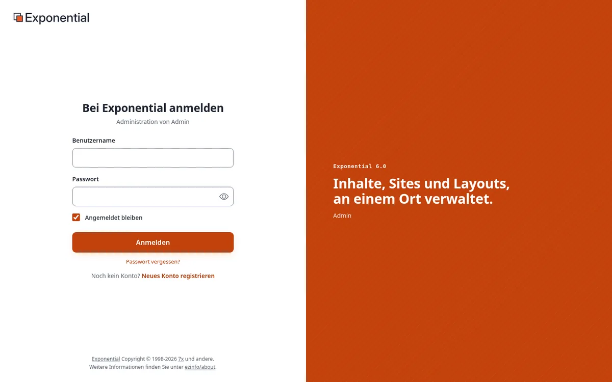
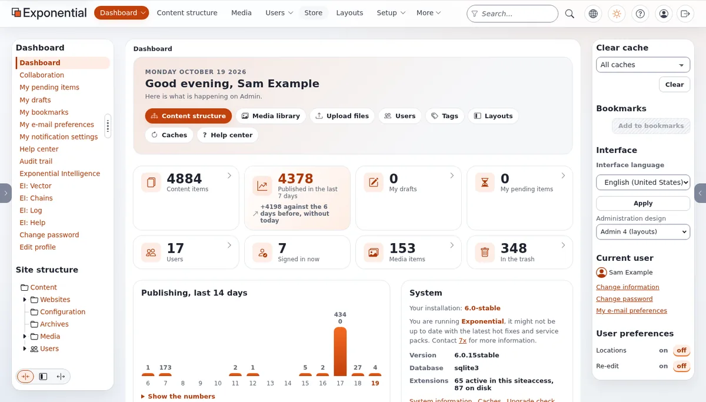
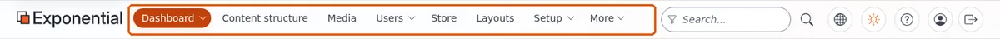
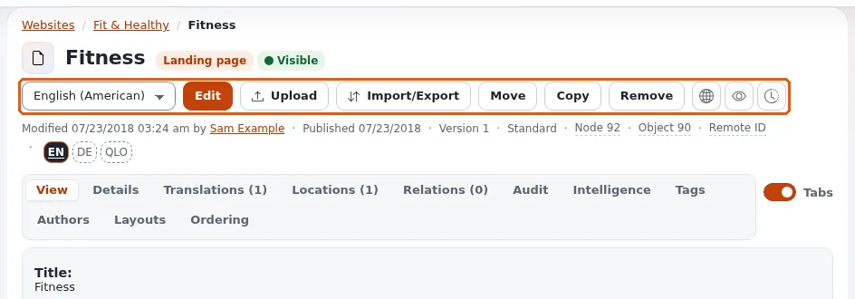
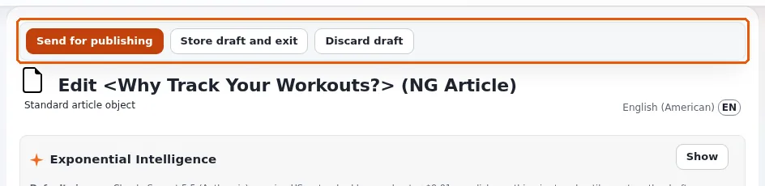
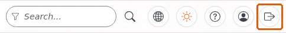
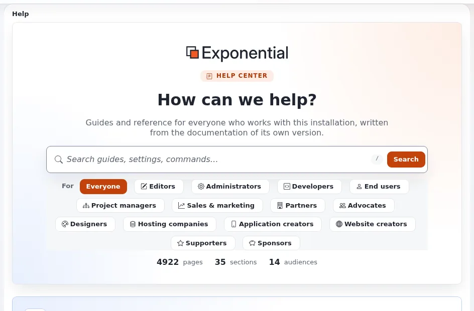

# Erste Schritte

Diese Seite richtet sich an alle, die gerade ein Konto bekommen haben: an Redakteure, die für eine Site schreiben, oder
an Benutzer, die sich zurechtfinden möchten. In zehn Minuten melden Sie sich an, finden den Weg zu den Inhalten, an
denen Sie arbeiten, nehmen eine erste Änderung vor und wissen, wo Sie nachsehen können, wenn Sie nicht weiterkommen.

## Was Exponential ist

Exponential ist das Content-Management-System hinter Ihrer Site. Alles auf der Site, von einer Seite oder einem
Nachrichtenartikel bis zu einem Bild, einer Datei oder einem Benutzerkonto, ist ein **Inhaltsobjekt** (kurz: Objekt).
Die Objekte sind in einem Baum angeordnet, wie Ordner auf einem Computer: Ein Ordner enthält Artikel, ein Artikel kann
Bilder enthalten und so weiter. Sie schreiben und ändern Objekte in der **Administration**, und Besucher sehen sie auf
der **Site**.

Eine Änderung ist nie sofort sichtbar: Sie arbeiten an einem **Entwurf**, und die Site zeigt ihn erst, wenn Sie ihn
**veröffentlichen**. Die vorherige Version bleibt erhalten, sodass Sie jederzeit zurückgehen können.
[Veröffentlichen, Versionen und der Papierkorb](veroeffentlichen-und-versionen.md) erklärt, wie.

## 1. Anmelden

Schritt für Schritt, mit jeder Meldung, die Ihnen begegnen kann: [Im Editor anmelden](anmelden-im-editor.md) für
Redakteure, [In der Administration anmelden](anmelden-in-der-administration.md) für Administratoren.

1. Öffnen Sie die Adresse der Administration, die Sie erhalten haben. Auf vielen Sites ist das die Adresse der Site
   gefolgt von `/admin`, zum Beispiel `https://www.example.com/admin`. Manche Sites haben eine eigene Adresse für
   Redakteure.
2. Geben Sie Ihren **Benutzername** und Ihr **Passwort** ein und klicken Sie auf **Anmelden**. Die Schaltfläche mit dem
   Auge im Passwortfeld zeigt, was Sie eingegeben haben.
3. Wenn Ihr Konto die Zwei-Faktor-Authentifizierung verwendet, fragt die nächste Seite nach einem Code von Ihrem
   Telefon oder aus Ihrer E-Mail. Siehe
   [Ihr Konto und die Anmeldung](konten-und-anmeldung.md#zweistufige-anmeldung).

Passwort vergessen? Wählen Sie **Passwort vergessen?** unter der Schaltfläche. Siehe
[Ihr Konto und die Anmeldung](konten-und-anmeldung.md#wenn-sie-ihr-passwort-vergessen-haben).

## 2. Umsehen

Nach der Anmeldung sehen Sie das **Dashboard**: eine Begrüßung, Schnelllinks, einige Zahlen (Ihre Entwürfe, Ihre
wartenden Objekte, kürzlich veröffentlichte Inhalte) und Listen aktueller Inhalte. Die Reiter oben führen zu den
wichtigsten Bereichen:

- **Inhaltsstruktur**: die Seiten der Site als Baum.
- **Medien**: die Medienbibliothek mit Bildern, Dateien und Videos.
- **Benutzer**, **Layouts**, **Setup** und weitere, wenn Ihre Rolle sie erlaubt.

[Ein Rundgang durch die Administration](rundgang-durch-die-administration.md) erklärt jeden Teil des Bildschirms.

## 3. Das Objekt finden, das Sie ändern möchten

- Klicken Sie auf **Inhaltsstruktur** und öffnen Sie die Ordner im Baum in der linken Spalte, oder
- geben Sie ein Wort in das Feld **Suchen...** oben ein und drücken Sie die Eingabetaste. [Suchen](suchen.md) zeigt
  weitere Wege.

Klicken Sie auf den Namen eines Objekts, um es zu öffnen. Seine Seite zeigt den Inhalt des Objekts und die
Schaltflächen für das, was Sie damit tun können: **Bearbeiten**, **Verschieben**, **Kopieren**, **Entfernen** und mehr.

## 4. Eine erste Änderung vornehmen

1. Klicken Sie auf der Seite des Objekts auf **Bearbeiten**.
2. Ändern Sie ein Feld, zum Beispiel den Titel.
3. Klicken Sie auf **Zur Veröffentlichung schicken**. Die Änderung ist jetzt auf der Site.

Noch nicht fertig? Klicken Sie auf **Entwurf speichern und beenden** und machen Sie später weiter: Der Entwurf wartet
unter **Meine Entwürfe** auf dem Dashboard. Sie haben es sich anders überlegt? **Entwurf verwerfen** verwirft den
Entwurf und lässt das veröffentlichte Objekt, wie es war.
[Inhalte anlegen und bearbeiten](inhalte-bearbeiten.md) erklärt das Formular im Detail.

## 5. Abmelden

Verwenden Sie die letzte Schaltfläche am rechten Ende der Kopfzeile, einen Pfeil, der aus einem Kasten zeigt; wenn
Sie darauf zeigen, erscheinen **Abmelden** und Ihr Benutzername. Solange ein Objekt zur Bearbeitung geöffnet ist, ist
die Schaltfläche ausgegraut: Schließen Sie die Bearbeitung zuerst ab oder verlassen Sie sie. Melden Sie sich an einem
gemeinsam genutzten Computer immer ab.

## Hilfe bekommen

- Die Hilfeseiten finden Sie unter **Hilfe** in der Administration. Das Dashboard der Hilfe listet jede Seite nach
  Zielgruppe und Thema auf, und ihre Suche findet jede Seite in einer Sekunde.
- Viele Seiten der Administration erklären sich in ein oder zwei Sätzen unter dem Titel selbst; Schaltflächen erklären
  sich, wenn Sie auf sie zeigen.
- Wenn etwas defekt aussieht, lesen Sie [Wenn etwas schiefgeht](wenn-etwas-schiefgeht.md).

## Vom Benutzer zum Entwickler

Alles, was Sie hier verwenden, ist freie Software, und jede Seite dieser Hilfe ist freie Dokumentation. Wenn Sie
bereit sind, über das Bearbeiten von Inhalten hinauszugehen, Templates zu ändern, eine Korrektur auszuprobieren oder
eine eigene Site zu bauen, beginnen Sie mit [Mit Git entwickeln](mit-git-entwickeln.md): Die Seite zeigt Schritt für
Schritt den empfohlenen Weg, Exponential als Git-Klone mit ihrer vollständigen Historie zu installieren, und wie Sie
Ihre Verbesserungen an das Projekt zurückschicken.

**Ein Banner „Demo-Modus“?** Auf einer öffentlichen Demo zeigt die Administration ein gelbes Banner **Demo-Modus**: Das Administratorpasswort ist veröffentlicht, und Administratorpasswörter lassen sich weder ändern noch zurücksetzen. Siehe [Demo-Modus](demomodus.md).

## Nächste Schritte

- [Ein Rundgang durch die Administration](rundgang-durch-die-administration.md)
- [Inhalte anlegen und bearbeiten](inhalte-bearbeiten.md)
- [Tastenkürzel](tastenkuerzel.md)
- [Mit Git entwickeln](mit-git-entwickeln.md)

<!-- exp-partner-block:start -->
**Werden Sie Exponential-Partner.** Partner teilen ihre Informationen, stellen Mittel bereit, geben Beiträge zurück
und entwickeln die Produkte mit uns, und so wächst Exponential. Eine Partner-Website und ein Dashboard sind für Mitte
2027 geplant: Werden Sie noch heute Partner, damit wir schneller wachsen und neue Funktionen früher liefern. Beginnen
Sie mit [Partner: hier beginnen](partner/partner-hier-beginnen.md) und
[Wie Sie sich bewerben](partner/wie-sie-sich-bewerben.md).
<!-- exp-partner-block:end -->
