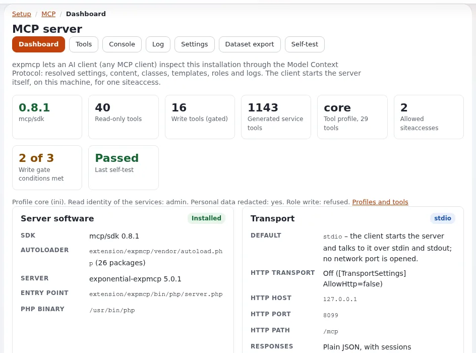

# CLI-Skripte mit eZScript

Diese Seite ist für Anwendungsentwickler, die Kommandozeilenwerkzeuge schreiben: Importe, Wartung, Berichte. Ein Skript
startet den Kernel mit `eZScript`, liest Optionen, erledigt seine Arbeit und endet mit einem Status. Neue Skripte sind
Klassen, die `Exponential\Runnable\Command` erweitern; die Konsole führt sie als `ext:<ext>:<name>` aus.



## Inhalt

1. [Der klassenbasierte Befehl](#der-klassenbasierte-befehl)
2. [Das klassische Muster](#das-klassische-muster)
3. [Ausgabe](#ausgabe)
4. [Siteaccess und Benutzer](#siteaccess-und-benutzer)
5. [Sicherheitsregeln](#sicherheitsregeln)

## Der klassenbasierte Befehl

Aus [Befehle als Klassen](../../../bc/6.0/cli-cronjob-und-view-abstraktionen.md#ein-befehl):

```php
<?php
// extension/expdemo/classes/runnable/commands/report.php
namespace Exponential\Command\Extension\Expdemo;

class Report extends \Exponential\Runnable\Command
{
    public function run()
    {
        $this->script( array( 'description' => "Writes the monthly report",
                              'use-session' => false, 'use-modules' => true, 'use-extensions' => true ) );
        $options = $this->startup( '[month:][dry-run]', '', array(
            'month'   => 'The month, YYYY-MM',
            'dry-run' => 'Show what would be written, write nothing' ) );

        $this->output( \expDemoReportService::build( $options['month'], !empty( $options['dry-run'] ) ) );
        $this->shutdown( 0 );
    }
}
```

```php
#!/usr/bin/env php
<?php
// extension/expdemo/bin/php/report.php
require_once 'autoload.php';
\Exponential\Command\Extension\Expdemo\Report::main( __FILE__ );
```

`php bin/php/console ext:expdemo:report --month=2026-10 --dry-run`.

## Das klassische Muster

Viele Skripte verwenden `eZScript` direkt, so wie `extension/expmcp/bin/php/dataset_inspect.php`:

```php
require_once 'autoload.php';
$cli = eZCLI::instance();
$script = eZScript::instance( array( 'description' => 'What it does', 'use-session' => false,
                                     'use-modules' => true, 'use-extensions' => true ) );
$script->startup();
$options = $script->getOptions( '[file:][dry-run]', '', array( 'file' => 'The input file' ) );
$script->initialize();
// work
$script->shutdown( 0 );
```

`getOptions()` erhält eine Konfigurationszeichenkette (`[name:]` mit einem Wert, `[name]` als Schalter), Argumente und
Hilfetexte; `--help`, `-s/--siteaccess`, `--allow-root-user` und die Debug-Optionen werden automatisch ergänzt.

## Ausgabe

`$cli->output()`, `$cli->notice()`, `$cli->warning()`, `$cli->error()`; Farben schalten sich ab, wenn die Ausgabe
umgeleitet wird. Enden Sie mit einer Zusammenfassungszeile und einem Exit-Code: `shutdown( 0 )` für Erfolg,
`shutdown( 1 )` für einen Fehlschlag.

## Siteaccess und Benutzer

- `-s <siteaccess>` wählt die Einstellungen; Erweiterungen, die nur in diesem Siteaccess aktiv sind, brauchen das.
- Der Benutzer ist anonym. Ein Skript, das Inhalte schreibt, meldet einen eigenen Benutzer an
  (`eZUser::setCurrentlyLoggedInUser( $user, $user->id() )`), niemals den gemeinsam genutzten Administrator.

## Sicherheitsregeln

- Ein `--dry-run` für jeden Befehl, der schreibt oder löscht.
- Lesen Sie die Hilfe, bevor Sie Befehle anderer ausführen: Manche löschen ohne `--help` (`exp:cleanupversions`).
- Nehmen Sie niemals Passwörter als Optionen entgegen (sie erscheinen in der Prozessliste); lesen Sie sie aus den
  Einstellungen oder der Umgebung.
- Führen Sie Skripte als Benutzer des Webservers aus; Dateien, die root geschrieben hat, legen die Website später lahm.

## Verwandte Seiten

- [Konsolenbefehle](konsolenbefehle.md)
- [Ein Cronjob-Skript schreiben](einen-cronjob-teil-schreiben.md)
- [Muster Command](../../../../eng-us/standards/patterns/command.md)
- [Freie Dokumentation](../../freie-dokumentation.md): Diese Seite darf unter der GNU FDL 1.3 frei kopiert, übersetzt und verbessert werden.

<!-- exp-partner-block:start -->
**Werden Sie Exponential-Partner.** Partner teilen ihre Informationen, stellen Mittel bereit, geben Beiträge zurück
und entwickeln die Produkte mit uns, und so wächst Exponential. Eine Partner-Website und ein Dashboard sind für Mitte
2027 geplant: Werden Sie noch heute Partner, damit wir schneller wachsen und neue Funktionen früher liefern. Beginnen
Sie mit [Partner: hier beginnen](../../partner/partner-hier-beginnen.md) und
[Wie Sie sich bewerben](../../partner/wie-sie-sich-bewerben.md).
<!-- exp-partner-block:end -->
