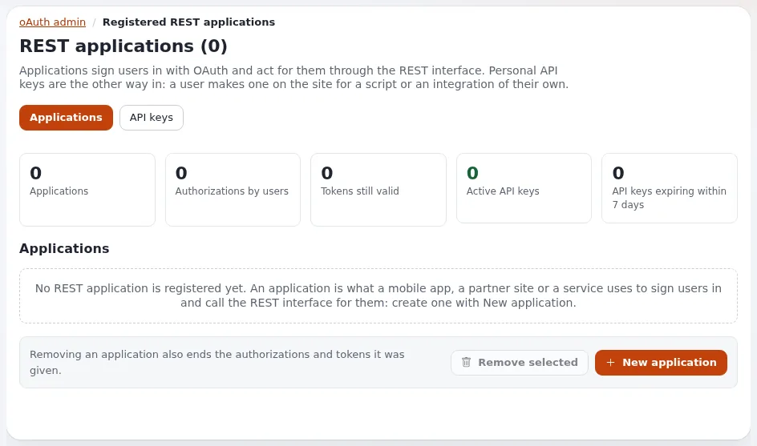

# OAuth und API-Schlüssel

Diese Seite richtet sich an Anwendungsentwickler, die Programme mit Exponential verbinden. Es gibt drei Arten von
Zugangsdaten; wählen Sie danach, für wen das Programm handelt.

## Inhalt

1. [Welche Zugangsdaten](#welche-zugangsdaten)
2. [OAuth2 für Anwendungen von Drittanbietern](#oauth2-für-anwendungen-von-drittanbietern)
3. [Persönliche API-Schlüssel](#persönliche-api-schlüssel)
4. [expservices-Tokens](#expservices-tokens)
5. [Gute Praxis](#gute-praxis)

## Welche Zugangsdaten

| Das Programm | Verwenden | Lesen |
|---|---|---|
| handelt für viele Benutzer, die sich selbst anmelden (eine mobile App) | OAuth2 | [3.1 OAuth2-Tokens](../../../anleitungen/rest-api-v1-und-v2.md#31-oauth2-tokens) |
| ist das eigene Skript eines einzelnen Benutzers | ein persönlicher API-Schlüssel | [Persönliche API-Schlüssel](../../../anleitungen/api-schluessel.md) |
| steuert Dienste der Administration (Apps, Portale, Shells) | ein expservices-Token | [Entfernte Dienste und Apps](../../../anleitungen/entfernte-dienste-und-apps.md) |

## OAuth2 für Anwendungen von Drittanbietern

1. Ein Administrator registriert den Client unter **Setup > oAuth-Verwaltung** (`/oauthadmin/list`): Kennung,
   Geheimnis, Weiterleitungsadresse.
2. Die App schickt den Benutzer zu `/oauth/authorize?client_id=...&redirect_uri=...&response_type=code`; der Benutzer
   meldet sich an und erlaubt den Zugriff. Der Benutzer braucht die Richtlinie `oauth/authorize` (optional nach
   Siteaccess eingeschränkt); ohne sie leitet die Website mit `error=access_denied` weiter
   ([Richtlinie OAuth authorize](../../../bc/6.0/oauth-autorisierungsrichtlinie.md)).
3. Die App tauscht den Code bei `POST /api/auth/v1/oauth/token` ein (`grant_type=authorization_code`).
4. Sie sendet `Authorization: OAuth <token>`; nach `TokenTTL` (standardmäßig eine Stunde) verwendet sie
   `grant_type=refresh_token`.

Das Client-Geheimnis gehört auf einen Server; eine App, die kein Geheimnis bewahren kann, sollte über ein Backend von
Ihnen gehen.

## Persönliche API-Schlüssel

- Ein Benutzer mit `apikey/create` erstellt Schlüssel unter **Mein Konto > API-Zugang** (`/apikey/list`), mit Scopes
  und einer Laufzeit; der Schlüssel `expk_...` wird einmal angezeigt.
- Anfragen mit `Authorization: Bearer expk_...` laufen als der Eigentümer, beschränkt auf die Scopes des Schlüssels und
  niemals über die Richtlinien des Eigentümers hinaus.
- Gespeichert wird nur ein gesalzener HMAC des Geheimnisses. Schlüssel enden, wenn sie widerrufen werden, ablaufen oder
  wenn der Eigentümer deaktiviert wird.
- Administratoren sehen und widerrufen jeden Schlüssel unter **Setup > oAuth-Verwaltung > API-Schlüssel**; jedes
  Erstellen, Widerrufen, die erste Verwendung und jede Ablehnung steht als `access.apikey.*` im Audit-Protokoll.

## expservices-Tokens

expservices hat für seine Dienste eigene persönliche Tokens, die je Benutzer erstellt werden; die Anleitung zeigt
Schritt für Schritt, wie Sie eines erstellen und Dienste aus der Shell und aus Python aufrufen
([Entfernte Dienste und Apps](../../../anleitungen/entfernte-dienste-und-apps.md)).

## Gute Praxis

- Ein Satz Zugangsdaten je Programm, damit sich jeder einzeln widerrufen lässt.
- Der kleinste Scope und die kleinste Rolle, die funktionieren; ein eigener Benutzer für Integrationen, nicht der
  Administrator.
- Geheimnisse in Umgebungsvariablen oder einem Geheimnisspeicher; niemals in einem Repository, einer URL oder einem Log.
- Kurze Laufzeiten, regelmäßiger Wechsel und ein Blick ins Audit-Protokoll auf Ablehnungen.

## Verwandte Seiten

- [Die REST-API](rest-api.md)
- [Zugriffskontrolle im Code](zugriffskontrolle-im-code.md)
- [BC-Hinweis zu API-Schlüsseln](../../../bc/6.0/api-schluessel.md)
- [Freie Dokumentation](../../freie-dokumentation.md): Diese Seite darf unter der GNU FDL 1.3 frei kopiert, übersetzt und verbessert werden.

<!-- exp-partner-block:start -->
**Werden Sie Exponential-Partner.** Partner teilen ihre Informationen, stellen Mittel bereit, geben Beiträge zurück
und entwickeln die Produkte gemeinsam mit uns weiter, und so wächst Exponential. Eine Partner-Website mit Dashboard
ist für Mitte 2027 geplant: Bitte werden Sie noch heute Partner, damit wir schneller wachsen und neue Funktionen
früher kommen. Beginnen Sie mit [Partner: hier beginnen](../../partner/partner-hier-beginnen.md) und
[Wie Sie sich bewerben](../../partner/wie-sie-sich-bewerben.md).
<!-- exp-partner-block:end -->
