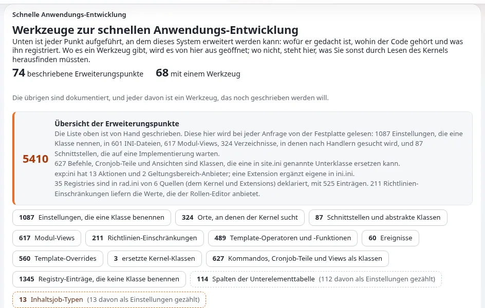

# RAD-Werkzeuge

Diese Seite richtet sich an Anwendungsentwickler, die funktionierende Gerüste wollen, statt Boilerplate abzutippen.
**Setup > RAD** (`/setup/rad`) listet jede Stelle auf, an der Exponential erweitert werden kann, und wie sie
registriert wird, und bietet Assistenten an, die eine vollständige Erweiterung schreiben
([RAD-Werkzeuge](../../../funktionen/6.0/rad-werkzeuge.md), [Erweiterungspunkte](../../../bc/6.0/rad-erweiterungspunkte.md)).

## Inhalt

1. [In fünf Minuten zu einer funktionierenden Erweiterung](#in-fünf-minuten-zu-einer-funktionierenden-erweiterung)
2. [Der Katalog](#der-katalog)
3. [Die Assistenten](#die-assistenten)
4. [Übersicht und Zustandsprüfung](#übersicht-und-zustandsprüfung)
5. [Mit oder ohne die Werkzeuge](#mit-oder-ohne-die-werkzeuge)

## In fünf Minuten zu einer funktionierenden Erweiterung

1. Öffnen Sie **Setup > RAD**; Sie brauchen `setup/setup`.
2. Wählen Sie einen Erweiterungspunkt; `/setup/rad/(show)/tools` listet diejenigen mit einem Assistenten auf.
3. Der Assistent fragt nach einem Namen und danach, was erzeugt werden soll, und listet jede Datei auf, die er unter
   `extension/<name>` schreiben würde, bevor er irgendetwas schreibt.
4. Bestätigen Sie, aktivieren Sie die Erweiterung, generieren Sie die Autoloads neu und leeren Sie die Caches.
5. Prüfen Sie das Ergebnis in der Übersicht und in der Zustandsprüfung.

## Der Katalog

`kernel/setup/expradcatalogue.php` listet die Erweiterungspunkte in Gruppen auf (Inhalte, Templates, Module, Workflow,
Speicher, Paketierung, Zugriff), jeweils mit ihrem Mechanismus (directory, handler, autoload, file, design, ini,
override, registry, filter), der Kernel-Datei, in der sie liegen, und ihrem Werkzeug. Das Überschreiben einer
Kernel-Klasse ist das letzte Mittel: Zwei Erweiterungen, die dieselbe Klasse ersetzen, kommen sich in die Quere, ohne
es zu merken.

## Die Assistenten

| Assistent | Schreibt |
|---|---|
| Design-Extension (`/setup/designextension`) | ein Design mit Templates, Stylesheets und einem Override-Satz |
| Template-Erweiterung (`/setup/templateoperator`) | Template-Operatoren, Fetch-Funktionen, Attribut-Operatoren, Template-Funktionen |
| Modul-Erweiterung, Modul-Assistent (`/setup/moduleextension`, `/setup/modulewizard`) | ein Modul mit Ansichten und Richtlinien oder ein Modul über vorhandenen Tabellen |
| Datentyp-Erweiterung (`/setup/datatype`) | einen Datentyp |
| Workflow-Ereignis-Erweiterung (`/setup/workflowevent`) | Workflow-Ereignistypen und Trigger |
| Inhalts-Erweiterung (`/setup/contentextension`) | eine als Skript geschriebene Inhaltsklasse |
| Handler-Erweiterung (`/setup/handlerextension/<point>`) | Handler, darunter für Mehrwertsteuer, Versand, Warenkorbsummen, Wechselkurse, Anmeldung |
| Einstellungs-Erweiterung (`/setup/settingsextension`) | eine Erweiterung, die nur Einstellungen enthält |
| Kernel-Override (`/setup/kerneloverride`) | einen Ersatz für eine Kernel-Klasse, das letzte Mittel |

Erzeugter Code schreibt niemals außerhalb von `extension/<name>`, überschreibt niemals eine vorhandene Erweiterung und
maskiert, was seine Templates ausgeben ([RAD-Sicherheit](../../../bc/6.0/rad-sicherheit.md)).

### Korrekturen an der Ausgabe von Assistenten vor 6.0.15

Ab Exponential 6.0.15 schreiben die Assistenten die folgenden Fehler nicht mehr. Eine Erweiterung, die ein älterer
Assistent erzeugt hat, braucht diese Änderungen von Hand:

| Assistent | Fehler in älterer Ausgabe | Korrektur von Hand |
|---|---|---|
| Template-Erweiterung | Die README und `doc/examples.php` rufen Operatoren mit `name=value` in den Klammern auf (`{$value\|op( limit=3 )}`), was der Template-Parser ablehnt | Übergeben Sie die Werte nach Position: `{$value\|op( 3 )}`. Template-Funktionen behalten `name=value` (`{box limit=3}`) |
| Template-Erweiterung | `operatorTemplateHints()` listet `'input-as-parameter'` zweimal; der zweite Eintrag gewinnt | Entfernen Sie die letzte Zeile `'input-as-parameter'` |
| Template-, Datentyp-, Einstellungs-Erweiterung | Die README nennt `php bin/php/ezpgenerateautoloads.php --extension=<name>`; `--extension` nimmt keinen Wert an, und das Skript lehnt den Aufruf ab | Führen Sie `php bin/php/ezpgenerateautoloads.php --extension` aus |
| Datentyp | Templates werden nach `templates/` in der Wurzel der Erweiterung geschrieben, wo kein Design sucht | Verschieben Sie sie nach `design/standard/templates/` (die `design.ini.append.php` der Erweiterung hat `DesignExtensions[]`) |
| Datentyp | Die Templates für Bearbeiten und Sammeln senden `{$attribute_base}_data_text_{$attribute.id}`, gleich welche Speicherung gewählt wurde | Senden Sie `_<type>_<column>_` für die Spalte, in der der Wert liegt (`_mytype_data_int_`), und lesen Sie denselben Namen in `fetchObjectAttributeHTTPInput()`; die erzeugte Klasse hat ihn jetzt als `VALUE_VARIABLE` |
| Datentyp | `content.ini.append.php` enthält `DataTypeGroup[<type>]`, was nichts liest | Entfernen Sie die Zeile; das Formular fragt nicht mehr nach einer Gruppe |
| Modul-Assistent | Templates werden nach `design/<extension name>/` geschrieben, das in keiner Design-Kette steht, sodass jede Ansicht eine leere Seite zeichnet | Verschieben Sie sie nach `design/standard/templates/<module>/` |
| Modul-Assistent | Das Ansichtsskript wandelt jeden Parameter in `(int)` um, sodass ein Textparameter (ein Sprachcode, eine Kennung) zu `0` wird | Wandeln Sie nur Zahlen um (`ID`, `NodeID`, `Offset`...); nehmen Sie Text als `(string)` und waschen Sie ihn im Template mit wash, wie es bereits geschieht |
| Design-Extension | Die README sagt, das Design werde gefunden, „ohne dass sonst etwas gesetzt wird“ | `DesignExtensions[]` macht die Designs der Erweiterung nur durchsuchbar: Ein Siteaccess muss das Design weiterhin in `SiteDesign` oder `AdditionalSiteDesignList[]` nennen |
| Handler (Mail-Transport) | `sendMail()` gibt `true` zurück und versendet nichts: Mails gehen spurlos verloren | Schreiben Sie den Versand und geben Sie `true` nur zurück, wenn die Mail hinausgegangen ist; der Stub protokolliert jetzt einen Fehler und gibt `false` zurück |

Die Korrekturen für den Assistenten der Design-Extension selbst (der Composer-Ordnername, die Autoload-Datei der
Operatoren, die Stylesheet- und Skriptlisten des Frontends, der Seitenkopf) stehen in
[Die Bestandteile des Design-Assistenten](../../designer/erweiterungen/die-teile-des-design-assistenten.md).

## Übersicht und Zustandsprüfung

**Setup > RAD > Übersicht der Erweiterungspunkte** (`/setup/radsurvey`) liest, was die Installation wirklich
bereitstellt: Einstellungen, die eine Klasse nennen, in `rad.ini` deklarierte Registries und Einträge, deren Klasse
oder Template fehlt. Die Zustandsprüfung lädt jede Registrierung und meldet, was nicht funktionieren kann
([Die RAD-Erweiterungsoberfläche](../../../bc/6.0/rad-erweiterungsoberflaeche.md)).

## Mit oder ohne die Werkzeuge

Die Assistenten schreiben denselben Code, den diese Seiten von Hand zeigen: Beginnen Sie mit einem Assistenten, um ein
funktionierendes Beispiel zu sehen, und lesen Sie dann die passende Seite
([Eigene Module und Ansichten](eigene-module-und-ansichten.md), [Eigene Datentypen](eigene-datentypen.md),
[Einen Workflow-Ereignistyp schreiben](einen-workflow-ereignistyp-schreiben.md),
[Template-Operatoren schreiben](template-operatoren-schreiben.md)).

## Verwandte Seiten

- [Ihre erste Erweiterung](ihre-erste-erweiterung.md)
- [Aufbau einer Erweiterung](aufbau-einer-erweiterung.md)
- [Muster für Erweiterungspunkte: INI-Plug-in-Punkte](../../../standards/muster/ini-plugin-punkt.md)
- [Freie Dokumentation](../../freie-dokumentation.md): Diese Seite darf unter der GNU FDL 1.3 frei kopiert, übersetzt und verbessert werden.

<!-- exp-partner-block:start -->
**Werden Sie Exponential-Partner.** Partner teilen ihre Informationen, stellen Mittel bereit, geben Beiträge zurück
und entwickeln die Produkte mit uns, und so wächst Exponential. Eine Partner-Website und ein Dashboard sind für Mitte
2027 geplant: Werden Sie noch heute Partner, damit wir schneller wachsen und neue Funktionen früher liefern. Beginnen
Sie mit [Partner: hier beginnen](../../partner/partner-hier-beginnen.md) und
[Wie Sie sich bewerben](../../partner/wie-sie-sich-bewerben.md).
<!-- exp-partner-block:end -->
