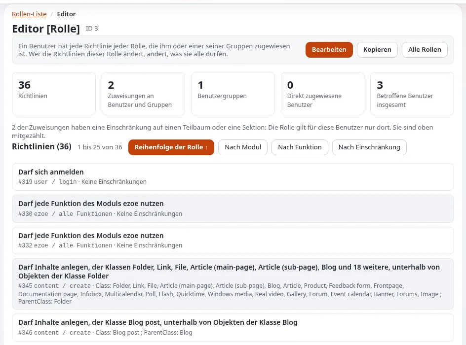

# Richtlinienfunktionen und Einschränkungen

Diese Seite richtet sich an Anwendungsentwickler, die festlegen, wer in ihrer Anwendung was tun darf. Die Rechte in
Exponential sind Rollen, die aus Richtlinien bestehen: einem Modul, einer Funktion und optionalen Einschränkungen. Ihr
Modul deklariert seine Funktionen; der Rolleneditor bietet sie dann an; Ihr Code prüft sie.

## Inhalt

1. [Funktionen deklarieren](#funktionen-deklarieren)
2. [Was der Kernel für Sie prüft](#was-der-kernel-für-sie-prüft)
3. [Prüfen im Code](#prüfen-im-code)
4. [Inhaltsrechte](#inhaltsrechte)
5. [Prüfen in Templates](#prüfen-in-templates)
6. [Entwurfsregeln](#entwurfsregeln)

## Funktionen deklarieren

In `module.php` benennt `$FunctionList` die Funktionen und ihre Einschränkungen
([Referenz der Moduldefinition](referenz-der-moduldefinition.md#functionlist-und-einschränkungen)):

```php
$FunctionList['read'] = array();
$FunctionList['manage'] = array( 'Section' => $SectionLimitation );
```

## Was der Kernel für Sie prüft

Das `'functions' => array( 'read' )` einer Ansicht wird geprüft, bevor die Ansicht läuft: Ohne die Funktion erhält der
Benutzer „Zugriff verweigert“, ein anonymer Benutzer die Anmeldeseite. Diese Prüfung wertet keine Einschränkungen für
Ihre eigenen Daten aus: Sie weiß nur, dass der Benutzer die Funktion hat, möglicherweise eingeschränkt.

## Prüfen im Code

```php
$user = eZUser::currentUser();
$access = $user->hasAccessTo( 'expdemo', 'manage' );
switch ( $access['accessWord'] )
{
    case 'yes':     // unlimited
        break;
    case 'limited': // $access['policies'] holds the limitations, e.g. allowed section ids
        $allowedSections = array();
        foreach ( $access['policies'] as $policy )
            if ( isset( $policy['Section'] ) )
                $allowedSections = array_merge( $allowedSections, $policy['Section'] );
        break;
    default:        // 'no'
        return $Params['Module']->handleError( eZError::KERNEL_ACCESS_DENIED, 'kernel' );
}
```

`hasAccessTo()` liefert `accessWord` (`yes`, `no`, `limited`), `policies` und `accessList`
(`kernel/classes/datatypes/ezuser/ezuser.php`).

## Inhaltsrechte

Bei Inhalten fragen Sie das Objekt oder den Knoten; sie wenden jede Inhaltseinschränkung an (Klasse, Sektion,
Eigentümer, Teilbaum, Zustand, Sprache):



```php
if ( !$node->canRead() ) { /* deny */ }
if ( !$object->canEdit() ) { /* deny */ }
$object->checkAccess( 'remove' );   // returns 1 when allowed
```

Abfragen wie `eZContentObjectTreeNode::subTreeByNodeID()` und die Template-Funktionen `fetch( 'content', ... )` liefern
nur, was der Benutzer lesen darf.

## Prüfen in Templates

```text
{if fetch( 'user', 'has_access_to', hash( 'module', 'expdemo', 'function', 'manage' ) )}
  <a href={'expdemo/manage'|ezurl}>{'Manage'|i18n( 'extension/expdemo' )}</a>
{/if}
```

Einen Link auszublenden ist Komfort, keine Sicherheit: Die Ansicht muss erneut prüfen.

## Entwurfsregeln

- Eine Funktion je Art von Aktion (`read`, `create`, `manage`), nicht je Bildschirm.
- Einschränkungen nur dort, wo ein echter Kunde sie braucht; jede muss im Code angewendet werden.
- Vergeben Sie eine neue Funktion niemals standardmäßig an Anonymous; dokumentieren Sie, was zu vergeben ist.
- Protokollieren Sie wichtige Ablehnungen im Audit-Protokoll ([Zugriffskontrolle im Code](zugriffskontrolle-im-code.md)).

## Verwandte Seiten

- [Rollen und Richtlinien](../../../anleitungen/rollen-und-richtlinien.md)
- [Template-Operatoren für Rollen und Richtlinien](../../../funktionen/6.0/template-operatoren-fuer-rollen-und-richtlinien.md)
- [Sicherheitsstandard](../../../standards/sicherheit.md)
- [Freie Dokumentation](../../freie-dokumentation.md): Diese Seite darf unter der GNU FDL 1.3 frei kopiert, übersetzt und verbessert werden.

<!-- exp-partner-block:start -->
**Werden Sie Exponential-Partner.** Partner teilen ihre Informationen, stellen Mittel bereit, geben Beiträge zurück
und entwickeln die Produkte mit uns, und so wächst Exponential. Eine Partner-Website und ein Dashboard sind für Mitte
2027 geplant: Werden Sie noch heute Partner, damit wir schneller wachsen und neue Funktionen früher liefern. Beginnen
Sie mit [Partner: hier beginnen](../../partner/partner-hier-beginnen.md) und
[Wie Sie sich bewerben](../../partner/wie-sie-sich-bewerben.md).
<!-- exp-partner-block:end -->
