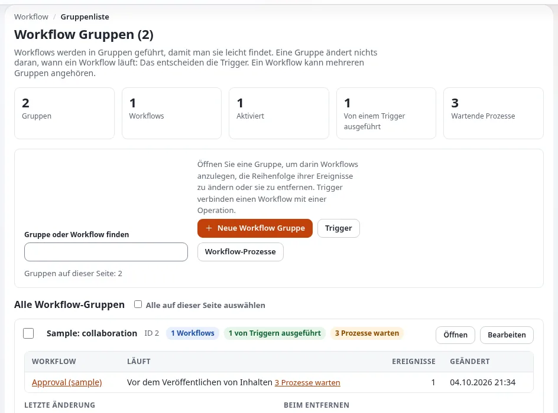
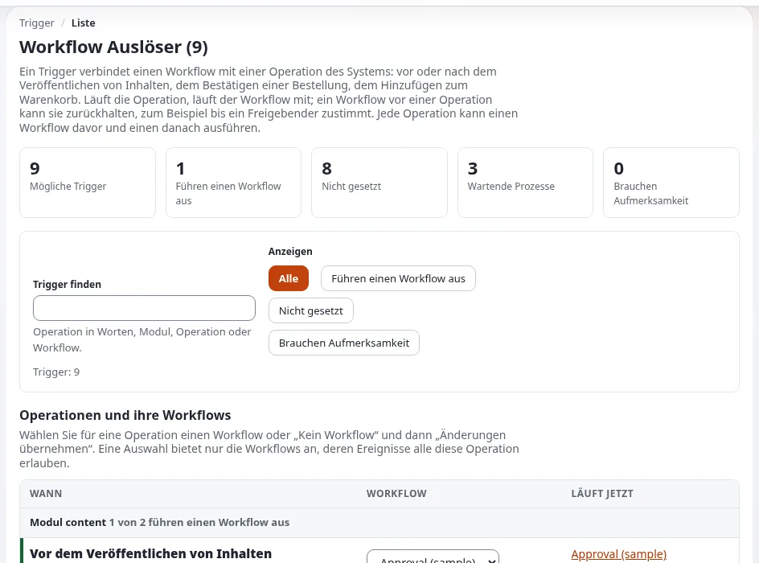

# Workflows und Ereignisse

Diese Seite richtet sich an Anwendungsentwickler, die eigene Logik ausführen, wenn etwas geschieht: bevor Inhalte
veröffentlicht werden, nachdem sich ein Benutzer registriert hat, an der Kasse. Exponential bietet zwei Mechanismen:
**Workflows** (von Administratoren konfiguriert, aus Ereignistypen aufgebaut) und **Kernel-Event-Listener** (Code). Die
Anleitung für Administratoren ist [Workflows](../../../anleitungen/workflows.md).

## Inhalt

1. [Die Bestandteile](#die-bestandteile)
2. [Operationen, in die Sie sich einhängen können](#operationen-in-die-sie-sich-einhängen-können)
3. [Wie ein Prozess abläuft](#wie-ein-prozess-abläuft)
4. [Workflow oder Event-Listener?](#workflow-oder-event-listener)
5. [Einrichtung für eine Anwendung](#einrichtung-für-eine-anwendung)

## Die Bestandteile

| Begriff | Was |
|---|---|
| Workflow | eine benannte Liste von Ereignissen in einer Workflow-Gruppe (**Setup > Workflows**) |
| Ereignistyp | eine Klasse, die einen Schritt ausführt: Freigabe, Warten bis Datum, Multiplexer, Payment-Gateway, einfacher Versand, Benutzerregistrierung abschließen sowie die Ereignistypen von Erweiterungen |
| Trigger | verbindet einen Workflow mit einer Operation, `before` oder `after` ihr (**Setup > Trigger**) |
| Prozess | ein Lauf eines Workflows für ein Objekt und eine Version, der aufbewahrt wird, solange er wartet |

## Operationen, in die Sie sich einhängen können

`settings/workflow.ini [OperationSettings] AvailableOperationList[]` listet die Operationen auf, die Trigger anbieten.
Ab Werk aktiv: `content_publish`, `before_shop_confirmorder`, `shop_checkout`, `shop_addtobasket`, `shop_updatebasket`.
Weitere sind auskommentiert aufgeführt (`content_move`, `content_hide`, `content_delete`, `content_updatesection`,
`content_read`, `content_updateobjectstate`, `user_activation`, `user_password` ...); aktivieren Sie eine in einem
Override, um sie zu verwenden.

## Wie ein Prozess abläuft

1. Die Operation erreicht ihren Trigger und startet den Workflow.
2. Das `execute()` jedes Ereignisses gibt einen Status zurück: angenommen (weiter), abgelehnt (die Operation stoppen),
   an Cron verschoben (warten), Template abrufen (eine Seite zeigen), Weiterleitung, abgebrochen.
3. Ein verschobener Prozess wird vom Cronjob `workflow.php` (Teil `frequent`) erneut ausgeführt; ohne ihn werden
   wartende Inhalte nie veröffentlicht.
4. Wenn das letzte Ereignis annimmt, wird die zurückgehaltene Operation abgeschlossen.

Wartende Prozesse sind unter **Setup > Workflow-Prozesse** (`/workflow/processlist`) aufgeführt.

## Workflow oder Event-Listener?

| Verwenden Sie einen Workflow, wenn | Verwenden Sie einen Kernel-Event-Listener, wenn |
|---|---|
| Administratoren ihn ein- und ausschalten oder Schritte anordnen sollen | das Verhalten immer Teil Ihrer Anwendung ist |
| der Schritt warten kann (Freigabe, Zahlung, ein Datum) | er synchron laufen muss und nie warten darf |
| er an eine der Trigger-Operationen gebunden ist | das Ereignis keinen Trigger hat (ein Ereignis aus `site.ini [Event] Listeners[]`) |

Kernel-Ereignisse und Filter-Ereignisse sind in [Erweiterungspunkte](../../../bc/6.0/rad-erweiterungspunkte.md#listener-für-kernel-ereignisse)
aufgeführt; Filter-Listener müssen den Wert zurückgeben, den sie erhalten. Siehe auch das
[Muster für Event-Hooks](../../../standards/muster/ereignis-hook.md).

## Einrichtung für eine Anwendung

1. Schreiben Sie den Ereignistyp ([Einen Workflow-Ereignistyp schreiben](einen-workflow-ereignistyp-schreiben.md)).
2. Liefern Sie einen Einrichtungsschritt oder eine Anleitung mit: den Workflow anlegen, das Ereignis hinzufügen, den
   Trigger verbinden.
3. Stellen Sie sicher, dass der Cronjob-Teil `frequent` läuft, falls ein Ereignis an Cron verschiebt.
4. Testen Sie das Veröffentlichen mit und ohne Workflow; testen Sie das Abbrechen unter **Setup > Workflow-Prozesse**.

## Verwandte Seiten

- [Einen Workflow-Ereignistyp schreiben](einen-workflow-ereignistyp-schreiben.md)
- [Objektzustände](../../../anleitungen/objektzustaende.md)
- [Muster für Workflow-Ereignisse](../../../standards/muster/workflow-ereignis.md)
- [Freie Dokumentation](../../freie-dokumentation.md): Diese Seite darf unter der GNU FDL 1.3 frei kopiert, übersetzt und verbessert werden.

<!-- exp-partner-block:start -->
**Werden Sie Exponential-Partner.** Partner teilen ihre Informationen, stellen Mittel bereit, geben Beiträge zurück
und entwickeln die Produkte mit uns, und so wächst Exponential. Eine Partner-Website und ein Dashboard sind für Mitte
2027 geplant: Werden Sie noch heute Partner, damit wir schneller wachsen und neue Funktionen früher liefern. Beginnen
Sie mit [Partner: hier beginnen](../../partner/partner-hier-beginnen.md) und
[Wie Sie sich bewerben](../../partner/wie-sie-sich-bewerben.md).
<!-- exp-partner-block:end -->
