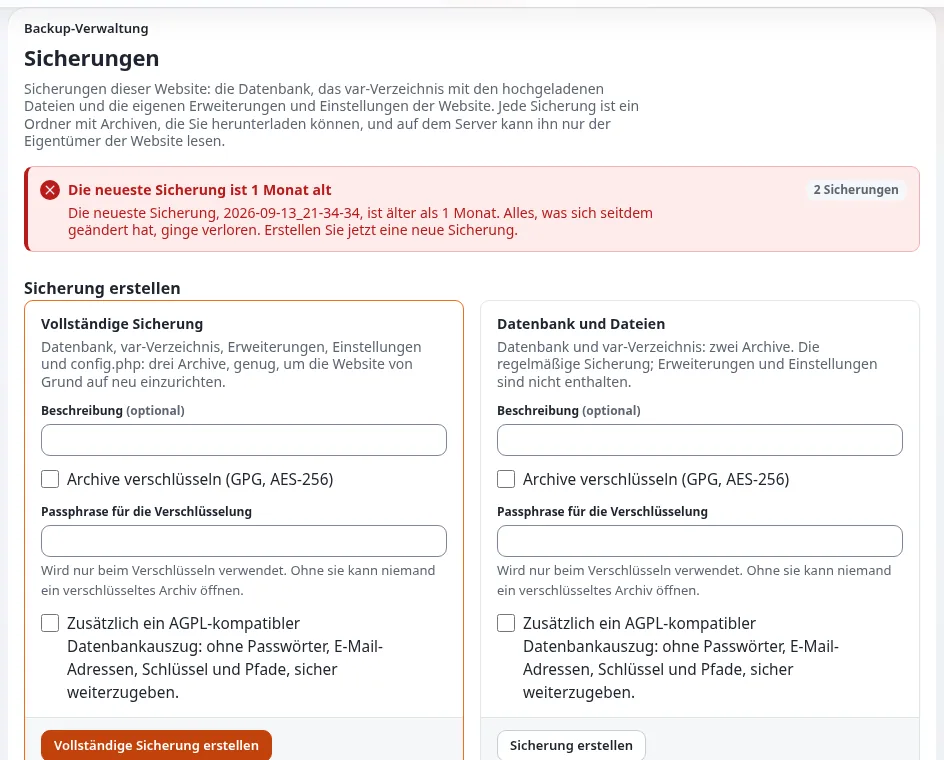

# Backups und Wiederherstellungen

Diese Seite richtet sich an Website-Ersteller, die für die Daten einer Website verantwortlich sind. Ein Backup besteht
aus der Datenbank und den Dateien, zum selben Zeitpunkt erstellt; ein Backup, das nie wiederhergestellt wurde, ist eine
Hoffnung, kein Backup ([10.9 Backups und Wiederherstellung](../../../installation/10-nach-der-installation.md#109-sicherung-und-wiederherstellung)).

## Inhalt

1. [Was gesichert wird](#was-gesichert-wird)
2. [Ein Backup erstellen](#ein-backup-erstellen)
3. [Wiederherstellen](#wiederherstellen)
4. [Der Wiederherstellungstest](#der-wiederherstellungstest)
5. [Aufbewahrung](#aufbewahrung)

## Was gesichert wird

| Pfad | Warum |
|---|---|
| die Datenbank | alle Inhalte, Benutzer und in der Datenbank gespeicherten Einstellungen |
| `var/storage`, `var/<site>/storage` | hochgeladene Bilder und Dateien |
| `settings/override`, `settings/siteaccess` | die Einstellungen der Installation (sie enthalten Passwörter: halten Sie Backups privat) |
| Ihre eigenen Erweiterungen und Designs | falls sie nicht in einem Git-Repository liegen |

Caches werden neu erzeugt und brauchen kein Backup.

## Ein Backup erstellen

1. Wartungsmodus einschalten, damit Datenbank und Dateien übereinstimmen:



   ```bash
   php bin/php/maintenance.php on --message="Back soon" --until=30m --allow-admin --allow-root-user
   ```

2. Die Datenbank:

   | Engine | Backup |
   |---|---|
   | SQLite | `sqlite3 var/storage/sqlite3/exponential.db ".backup '/backup/db.sqlite'"` |
   | MySQL, MariaDB | `mysqldump --single-transaction -u USER -p DATABASE > /backup/db.sql` |
   | PostgreSQL | `pg_dump -U USER -Fc DATABASE > /backup/db.dump` |
   | MongoDB | `mongodump --uri="mongodb://USER@HOST/DATABASE" --out=/backup/mongo` |

3. Die Dateien:

   ```bash
   tar czf /backup/files-$(date +%F).tar.gz var/storage settings/override settings/siteaccess
   ```

4. Wartungsmodus ausschalten: `php bin/php/maintenance.php off --allow-root-user`.

Unter SQLite (Online-Backup) und MySQL mit InnoDB ist das Datenbank-Backup allein auch ohne Wartungsmodus konsistent.

## Wiederherstellen

1. Wartungsmodus einschalten; unter Velocity den Server stoppen.
2. Die Datenbank mit dem Werkzeug der Engine wiederherstellen und die Dateien entpacken; Eigentümer und Rechte
   korrigieren.
3. Jeden Cache leeren und die Autoloads neu erzeugen:

   ```bash
   php bin/php/ezcache.php --clear-all --allow-root-user
   php bin/php/ezpgenerateautoloads.php -e
   ```

4. Velocity starten, seinen Antwort-Cache leeren, Wartungsmodus ausschalten, die Startseite und die Administration
   öffnen.

## Der Wiederherstellungstest

Stellen Sie mindestens einmal, und nach jedem größeren Upgrade, ein Backup auf einem anderen Rechner wieder her und
prüfen Sie: die Startseite, eine tief liegende Seite, ein Bild, einen Download, eine Anmeldung, ein Formular. Notieren
Sie, wie lange es gedauert hat; das ist Ihre Wiederherstellungszeit.

## Aufbewahrung

Lagern Sie Backups getrennt vom Server, bewahren Sie mehrere Generationen auf (zum Beispiel täglich für eine Woche,
wöchentlich für einen Monat), und denken Sie daran, dass sie personenbezogene Daten und Passwörter enthalten.

## Verwandte Seiten

- [Wartungsmodus](wartungsmodus.md)
- [Eine Website betreiben: sichern und wiederherstellen](../../../anleitungen/betrieb-einer-website.md#6-sichern-und-wiederherstellen)
- [Datenbanken](../../../installation/09-datenbanken.md)
- [Freie Dokumentation](../../freie-dokumentation.md): Diese Seite darf unter der GNU FDL 1.3 frei kopiert, übersetzt und verbessert werden.

<!-- exp-partner-block:start -->
**Werden Sie Exponential-Partner.** Partner teilen ihre Informationen, stellen Mittel bereit, geben Beiträge zurück
und entwickeln die Produkte mit uns, und so wächst Exponential. Eine Partner-Website und ein Dashboard sind für Mitte
2027 geplant: Werden Sie noch heute Partner, damit wir schneller wachsen und neue Funktionen früher liefern. Beginnen
Sie mit [Partner: hier beginnen](../../partner/partner-hier-beginnen.md) und
[Wie Sie sich bewerben](../../partner/wie-sie-sich-bewerben.md).
<!-- exp-partner-block:end -->
