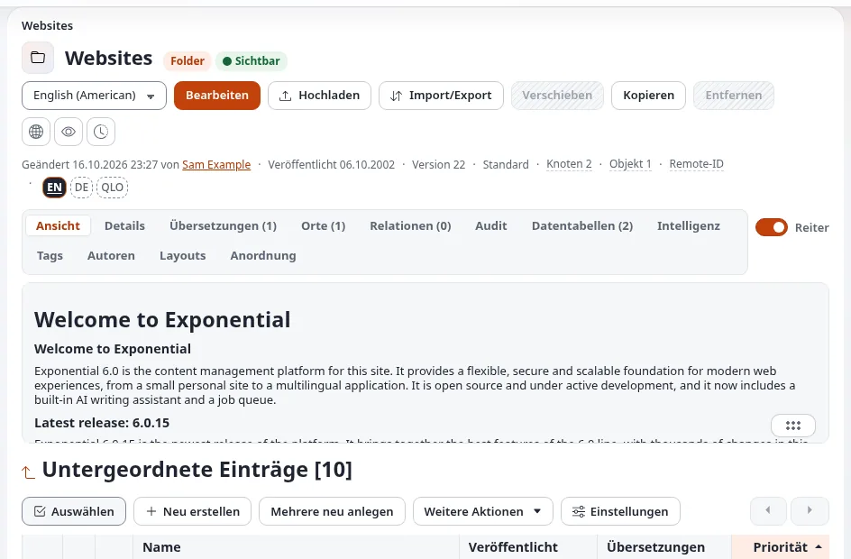
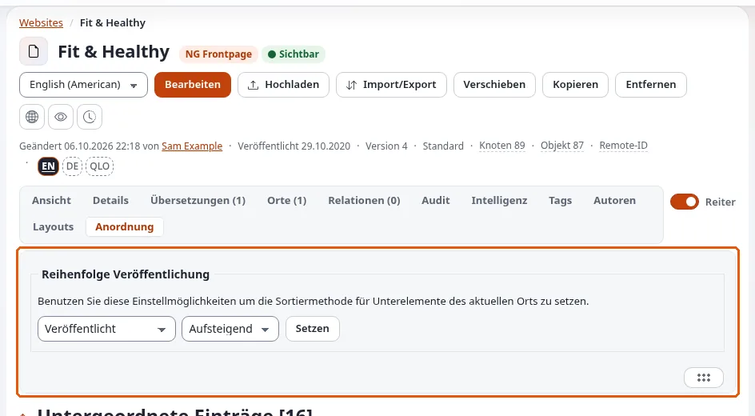

# Den Inhaltsbaum strukturieren

Diese Seite richtet sich an Website-Ersteller, die die Ordnerstruktur einer Website anlegen. In Exponential ist der
Inhaltsbaum mehr als ein Speicher: Er bestimmt die Menüs, die Adressen (URL-Aliasse), die Brotkrumennavigation und über
Teilbaum-Einschränkungen, wer was tun darf.

## Inhalt

1. [Die Wurzeln des Baums](#die-wurzeln-des-baums)
2. [Was der Baum bestimmt](#was-der-baum-bestimmt)
3. [Die oberen Ebenen anlegen](#die-oberen-ebenen-anlegen)
4. [Sortierung](#sortierung)
5. [Ein Objekt, mehrere Platzierungen](#ein-objekt-mehrere-platzierungen)
6. [Verstecken](#verstecken)
7. [Mehrere Websites in einem Baum](#mehrere-websites-in-einem-baum)
8. [Checkliste](#checkliste)

## Die Wurzeln des Baums

`settings/content.ini [NodeSettings]` benennt die obersten Knoten:



| Einstellung | Knoten | Enthält |
|---|---|---|
| `RootNode` | 2 | die Inhalte: alles, was Besucher sehen |
| `UserRootNode` | 5 | Benutzerkonten und -gruppen |
| `MediaRootNode` | 43 | die Medienbibliothek: Bilder, Dateien |
| `SetupRootNode` | 48 | Einrichtungsobjekte |

Eine Website zeigt die Inhalte unterhalb ihres Wurzelknotens. Ein Siteaccess kann einen anderen Knoten als Wurzel
verwenden; so teilen sich mehrere Websites einen Baum ([Mehrere Websites in einem Baum](#mehrere-websites-in-einem-baum)).

## Was der Baum bestimmt

| Der Baum bestimmt | Wie |
|---|---|
| Menüs | die Unterelemente der Wurzel (oder einer Sektion) werden zu Menüeinträgen ([Menüs und Navigation](menues-und-navigation.md)) |
| Adressen | der URL-Alias ist der Pfad der Namen: `/About-us/Team` ([URL-Aliasse und sprechende URLs](url-aliasse-und-sprechende-urls.md)) |
| Brotkrumennavigation | der Pfad von der Wurzel zum Knoten |
| Rechte | Richtlinien lassen sich auf einen Teilbaum einschränken ([Rollen und Richtlinien](../../../anleitungen/rollen-und-richtlinien.md)) |
| Templates | Overrides können auf `parent_node`, `depth` oder `url_alias` passen |
| Listen | die Vollansicht eines Ordners listet seine Unterelemente auf |

## Die oberen Ebenen anlegen

- Halten Sie die oberste Ebene kurz: Sie ist meist das Hauptmenü.
- Benennen Sie Ordner so, wie Besucher es tun würden; die Namen werden zu Adressen.
- Legen Sie Inhalte, die keinen Platz in der Navigation haben (Landingpages für Kampagnen, rechtliche Seiten), in einen
  eigenen Ordner, und verlinken Sie sie dort, wo sie gebraucht werden.
- Trennen Sie Inhalte danach, wer sie bearbeitet: Ein Teilbaum je Team macht Rollen einfach.
- Halten Sie Medien in der Medienbibliothek, nicht in Inhaltsordnern, es sei denn, die Medien gehören nur zu einer Seite.

## Sortierung

Jeder Container hat ein Sortierfeld und eine Richtung: nach Name, Veröffentlichungs- oder Änderungsdatum, Priorität,
Klasse und weiteren. Legen Sie sie am Ordner fest (in der Liste der Unterelemente), und wählen Sie den Standard der
Klasse für neue Container ([Inhaltsklassen für Websites](inhaltsklassen-fuer-websites.md)).



| Inhalt | Sortieren nach |
|---|---|
| Nachrichten, Blogbeiträge | Veröffentlichung, neueste zuerst |
| Menüordner, Seiten über uns | Priorität (Reihenfolge von Hand) |
| Glossar, Personen | Name |

## Ein Objekt, mehrere Platzierungen

Ein Objekt kann in mehreren Ordnern platziert werden (Reiter **Orte**). Jede Platzierung ist ein Knoten mit eigener
Adresse; eine davon ist die Hauptplatzierung. Verwenden Sie das, wenn dasselbe Element in zwei Bereiche des Menüs
gehört. Verwenden Sie stattdessen eine Relation, wenn Sie nur darauf verweisen wollen
([Relationen und Wiederverwendung](relationen-und-wiederverwendung.md)). Suchmaschinen sehen für ein Element zwei Adressen; verweisen
Sie sie auf die Hauptadresse ([SEO-Grundlagen](seo-grundlagen.md)).

## Verstecken

**Verstecken** nimmt einen Knoten und seinen Teilbaum für Besucher von der Website; die Redaktion sieht ihn weiterhin,
als versteckt markiert. Das Verstecken wird mit **Aufdecken** rückgängig gemacht. Das Entfernen eines Knotens
verschiebt ihn in den Papierkorb ([Papierkorb: wer und wo](../../../funktionen/6.0/papierkorb-wer-und-wo.md)). Vor dem
Verstecken oder Entfernen warnt die Administration vor Inhalten, die darauf verweisen
([Prüfung der Rückwärtsrelationen](../../../funktionen/6.0/pruefung-umgekehrter-beziehungen.md)).

## Mehrere Websites in einem Baum

Eine häufige Form: ein Ordner je Website unter der Wurzel, wobei jeder Siteaccess seinen Ordner als Wurzel verwendet:

```ini
# settings/siteaccess/<site_b>/content.ini.append.php
[NodeSettings]
RootNode=<node id of the site B folder>
```

```text
Root (2)
├── Site A
└── Site B
```

Die gesamte Einrichtung finden Sie unter [Multisite einrichten](multisite-einrichten.md).

## Checkliste

- [ ] Die oberste Ebene entspricht dem Hauptmenü.
- [ ] Jeder Ordner hat die Sortierung, die seine Inhalte brauchen.
- [ ] Ordnernamen ergeben gute Adressen.
- [ ] Medien liegen in der Medienbibliothek.
- [ ] Jedes Redaktionsteam hat seinen eigenen Teilbaum oder eine Sektion.
- [ ] Inhalte mit mehreren Platzierungen haben die richtige Hauptplatzierung.

## Verwandte Seiten

- [Sitemap und Inhaltsbestandsaufnahme](sitemap-und-inhaltsbestandsaufnahme.md)
- [Sektionen und Objektzustände für Website-Ersteller](sektionen-und-objektzustaende.md)
- [Inhalte bearbeiten](../../inhalte-bearbeiten.md)
- [Freie Dokumentation](../../freie-dokumentation.md): Diese Seite darf unter der GNU FDL 1.3 frei kopiert, übersetzt und verbessert werden.

<!-- exp-partner-block:start -->
**Werden Sie Exponential-Partner.** Partner teilen ihre Informationen, stellen Mittel bereit, geben Beiträge zurück
und entwickeln die Produkte mit uns, und so wächst Exponential. Eine Partner-Website und ein Dashboard sind für Mitte
2027 geplant: Werden Sie noch heute Partner, damit wir schneller wachsen und neue Funktionen früher liefern. Beginnen
Sie mit [Partner: hier beginnen](../../partner/partner-hier-beginnen.md) und
[Wie Sie sich bewerben](../../partner/wie-sie-sich-bewerben.md).
<!-- exp-partner-block:end -->
