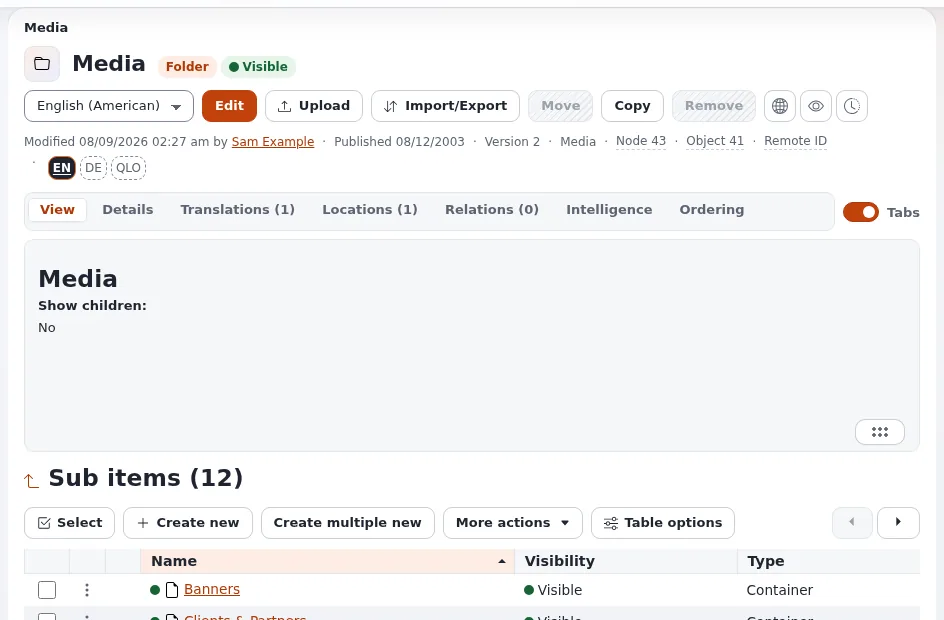

# Die Medienbibliothek organisieren

Diese Seite richtet sich an Website-Ersteller, die festlegen, wo Bilder und Dateien liegen. Die Medienbibliothek ist ein
Teil des Inhaltsbaums (`MediaRootNode=43` in `settings/content.ini`, Sektion Media) für Inhalte, die von anderen
Inhalten verwendet werden: Bilder, Dateien, Videos. Eine klare Struktur dort erspart der Redaktion Stunden.

## Inhalt

1. [Medien sind Inhaltsobjekte](#medien-sind-inhaltsobjekte)
2. [Eine Ordnerstruktur, die mitwächst](#eine-ordnerstruktur-die-mitwächst)
3. [Wo Uploads landen](#wo-uploads-landen)
4. [Viele Dateien auf einmal hochladen](#viele-dateien-auf-einmal-hochladen)
5. [Rechte](#rechte)
6. [Ordnung halten](#ordnung-halten)

## Medien sind Inhaltsobjekte

Ein hochgeladenes Bild ist ein Objekt der Klasse `image`, eine Datei ein Objekt der Klasse `file`. Das heißt, Medien
haben Versionen, Übersetzungen ihrer Namen und Alternativtexte, Sektionen und Relationen: Ein Artikel, der ein Bild
einbettet, ist mit ihm verknüpft, und die Administration warnt, bevor Sie ein Bild entfernen, das noch verwendet wird
([Prüfung umgekehrter Relationen](../../../funktionen/6.0/pruefung-umgekehrter-beziehungen.md)).

## Eine Ordnerstruktur, die mitwächst

| Struktur | Gut für |
|---|---|
| Nach Thema oder Bereich der Website (`Products`, `Team`, `Events`) | Websites, deren Redaktion in Themen denkt |
| Nach Jahr und Monat (`2026/10`) | Nachrichten-Websites mit vielen Bildern |
| Nach Website (`Site A`, `Site B`) | Multisite-Installationen, mit pro Ordner eingeschränkten Rollen |
| Ein Ordner `Shared` | Logos, Icons und Bilder, die überall verwendet werden |

Halten Sie sie höchstens drei Ebenen tief; der Upload-Dialog durchsucht höchstens `MaxDepth=3` Ebenen
(`settings/upload.ini`).

## Wo Uploads landen

`settings/upload.ini` entscheidet, was aus einem Upload wird und wohin er kommt:

| Einstellung | Mitgeliefert | Bedeutung |
|---|---|---|
| `[CreateSettings] MimeClassMap[image]` | `image` | Bilder werden zu Image-Objekten |
| `MimeClassMap[video/mp4]` | `video` | MP4-Dateien werden zu Video-Objekten |
| `DefaultClass` | `file` | alles andere wird zu einem File-Objekt |
| `[image_ClassSettings] NamePattern` | `<original_filename_base>` | der Name des Objekts ist der Dateiname ohne Endung |
| `[LocationSettings] RootNode` | `media` | der Upload-Dialog beginnt in der Medienbibliothek |
| `[LocationSettings] ClassList[]` | `folder` | die Klassen, die als Upload-Ziele angezeigt werden |

Überschreiben Sie sie pro Siteaccess in `upload.ini.append.php`, zum Beispiel um eine eigene Klasse zuzuordnen.

## Viele Dateien auf einmal hochladen

Die Erweiterung `ezmultiupload` lädt viele Dateien in einem Durchgang in einen Ordner hoch
([ezmultiupload](../../../funktionen/6.0/erweiterungen/ezmultiupload.md)); die Redaktion findet die Schritte in
[Medien und Uploads](../../medien-und-uploads.md).

## Rechte

- Besucher brauchen `content/read` für die Sektion Media nur, wenn Medien auf eigenen Seiten angezeigt werden;
  eingebettete Bilder werden als Dateien ausgeliefert und brauchen es nicht.
- Die Redaktion braucht `content/create` in den Medienordnern für die Klassen `image` und `file`.
- Auf einer Multisite beschränken Sie die Anlegerechte jedes Teams per Teilbaum auf seinen eigenen Medienordner.

## Ordnung halten

- [ ] Benennen Sie Bilder nach dem, was sie zeigen, nicht nach Dateinamen der Kamera; der Name wird zum Vorschlag für
      den Alternativtext und zur Adresse.
- [ ] Machen Sie Alternativtexte in Bildfeldern zur Pflicht
  ([Das Inhaltsmodell und die Bearbeitung](../../../anleitungen/inhaltsmodell-und-bearbeitung.md)).
- [ ] Entfernen Sie ungenutzte Medien regelmäßig; der Reiter für umgekehrte Relationen zeigt, ob ein Element noch
  verwendet wird.
- [ ] Prüfen Sie Dateien, die auf der Festplatte fehlen: [Fehlende Dateien](../../../anleitungen/fehlende-dateien.md).
- [ ] Nehmen Sie `var/<site>/storage` in die Backups auf ([Backups und Wiederherstellungen](backups-und-wiederherstellungen.md)).

## Verwandte Seiten

- [Bilder und Bildvarianten](bilder-und-bildvarianten.md)
- [Dateien und Downloads](dateien-und-downloads.md)
- [Medien und Uploads (für die Redaktion)](../../medien-und-uploads.md)
- [Freie Dokumentation](../../freie-dokumentation.md): Diese Seite darf unter der GNU FDL 1.3 frei kopiert, übersetzt und verbessert werden.

<!-- exp-partner-block:start -->
**Werden Sie Exponential-Partner.** Partner teilen ihre Informationen, stellen Mittel bereit, geben Beiträge zurück
und entwickeln die Produkte mit uns, und so wächst Exponential. Eine Partner-Website und ein Dashboard sind für Mitte
2027 geplant: Werden Sie noch heute Partner, damit wir schneller wachsen und neue Funktionen früher liefern. Beginnen
Sie mit [Partner: hier beginnen](../../partner/partner-hier-beginnen.md) und
[Wie Sie sich bewerben](../../partner/wie-sie-sich-bewerben.md).
<!-- exp-partner-block:end -->
