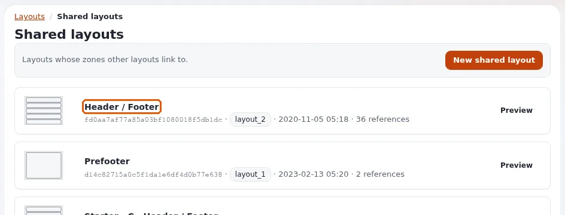

# Gemeinsamer Kopf- und Fußbereich

Diese Seite richtet sich an Website-Ersteller, die einen Kopfbereich und einen Fußbereich für jede Seite wollen, die mit
dem Layouts-Editor gebaut ist. Ein als **gemeinsam** markiertes Layout wird nicht über eine Regel Seiten zugeordnet; es
existiert, um ausgeliehen zu werden. Jede Zone eines anderen Layouts kann mit einer seiner Zonen **verknüpft** werden und
zeigt dann die Blöcke dieses Layouts statt ihrer eigenen
([Gemeinsame Layouts und verknüpfte Zonen](../../../bc/6.0/layouts.md#gemeinsame-layouts-und-verknüpfte-zonen)).

## Inhalt

1. [Warum gemeinsame Layouts](#warum-gemeinsame-layouts)
2. [Aufbauen](#aufbauen)
3. [Regeln, die Sie kennen sollten](#regeln-die-sie-kennen-sollten)
4. [Ändern und Entfernen](#ändern-und-entfernen)
5. [Checkliste](#checkliste)

## Warum gemeinsame Layouts

Ohne sie trägt jedes Seitenlayout seine eigene Kopie des Fußbereichs, und eine neue Telefonnummer bedeutet, jedes Layout
zu bearbeiten. Mit ihnen ist der Fußbereich einmal definiert; ändern Sie ihn, veröffentlichen Sie, und jede Seite folgt.

## Aufbauen

1. **Legen Sie das gemeinsame Layout an.** **Layouts > Erstellen**, ein Layouttyp mit passenden Zonen (zum Beispiel
   `layout_2` mit `header`, `post_header`, `main`, `pre_footer`, `footer`), Bezeichner `site_header_footer`, und
   markieren Sie es als **gemeinsam**.
2. **Füllen Sie seine Zonen**: Logo, Menü und Suche in `header`; Kontaktdaten und rechtliche Links in `footer`; einen
   Newsletter-Teaser in `pre_footer`.
3. **Veröffentlichen** Sie es. Nur veröffentlichte gemeinsame Layouts lassen sich verknüpfen.
4. **Verknüpfen Sie die Zonen jedes Seitenlayouts.** Öffnen Sie ein Seitenlayout, wählen Sie seine Zone `header` und
   verknüpfen Sie sie mit der Zone `header` von `site_header_footer` (ein Rundgang zu diesem Schritt:
   [Rundgang durch die Administration](../../rundgang-durch-die-administration.md)). Verfahren Sie ebenso mit `footer` und `pre_footer`.
5. **Veröffentlichen** Sie das Seitenlayout, und prüfen Sie eine Seite.

## Regeln, die Sie kennen sollten

- Eine Zone wird mit einer Zone eines **veröffentlichten** gemeinsamen Layouts verknüpft, niemals mit einem Entwurf.
- Eine verknüpfte Zone ignoriert ihre eigenen Blöcke, solange die Verknüpfung besteht; das Lösen der Verknüpfung stellt
  sie wieder her.
- Für eine Verknüpfung braucht eine Zone sowohl das Layout als auch den Zonennamen; der Editor setzt beides.
- Blöcke eines veröffentlichten gemeinsamen Layouts lassen sich nicht aus einem verknüpfenden Layout heraus ändern;
  öffnen Sie das gemeinsame Layout, legen Sie einen Entwurf an und bearbeiten Sie dort.
- Die formularbasierte Ansicht **Gemeinsame Layouts** (`/explayouts_ui/dashboard`) listet jedes gemeinsame Layout mit
  der Anzahl der Zonen auf, die damit verknüpft sind.

## Ändern und Entfernen

| Sie wollen | Vorgehen |
|---|---|
| Den Fußbereich überall ändern | Entwurf des gemeinsamen Layouts anlegen, bearbeiten, veröffentlichen |
| Eine Seite ohne den gemeinsamen Fußbereich | die Verknüpfung dieser Zone im Layout dieser Seite lösen |
| Ein gemeinsames Layout stilllegen | zuerst die Anzahl seiner Verknüpfungen prüfen; die Verknüpfung jeder Zone lösen, dann löschen |

## Checkliste

- [ ] Ein gemeinsames Layout je Website (oder je Marke in einer Multisite).
- [ ] Jedes Seitenlayout verknüpft seine Kopf- und Fußzonen.
- [ ] Die Redaktion weiß, wo der Fußbereich bearbeitet wird.
- [ ] Nach dem Veröffentlichen sind der Inhalts-Cache und der Antwort-Cache von Velocity geleert, sodass jede Seite die
  Änderung zeigt.

## Verwandte Seiten

- [Landingpages mit dem Layouts-Editor](landingpages-mit-dem-layouts-editor.md)
- [Layouttypen, Zonen und Blöcke](../../../../eng-us/help/creators/website-creators/layout-types-zones-and-blocks.md)
- [Der Layouts-Editor (für die Redaktion)](../../layout-editor.md)
- [Freie Dokumentation](../../freie-dokumentation.md): Diese Seite darf unter der GNU FDL 1.3 frei kopiert, übersetzt und verbessert werden.

<!-- exp-partner-block:start -->
**Werden Sie Exponential-Partner.** Partner teilen ihre Informationen, stellen Mittel bereit, geben Beiträge zurück
und entwickeln die Produkte gemeinsam mit uns weiter, und so wächst Exponential. Eine Partner-Website mit Dashboard
ist für Mitte 2027 geplant: Bitte werden Sie noch heute Partner, damit wir schneller wachsen und neue Funktionen
früher kommen. Beginnen Sie mit [Partner: hier beginnen](../../partner/partner-hier-beginnen.md) und
[Wie Sie sich bewerben](../../partner/wie-sie-sich-bewerben.md).
<!-- exp-partner-block:end -->
