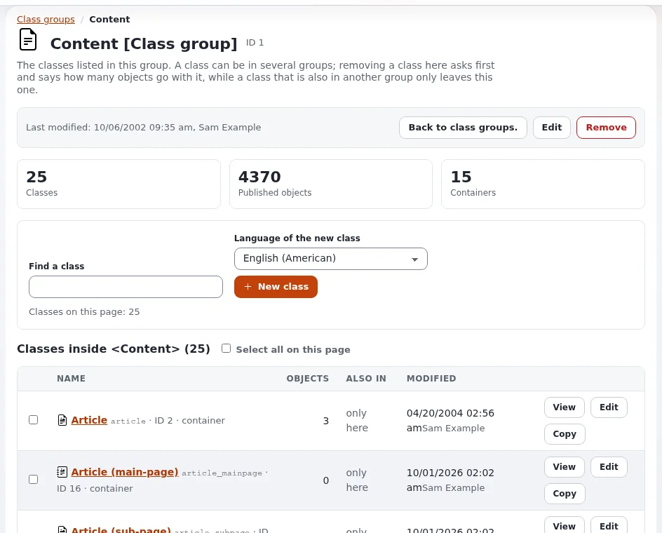

# Ihr Inhaltsmodell entwerfen

Diese Seite richtet sich an Website-Ersteller, die entscheiden, welche Inhaltsklassen eine Website bekommt. Das
Inhaltsmodell ist die dauerhafteste Entscheidung einer Website: Templates und Designs ändern sich oft, die Struktur der
Inhalte viel seltener. Ein gutes Modell ist einfach für die Redaktion, einfach in Templates umzusetzen und einfach zu
erweitern.

## Inhalt

1. [Die Bausteine](#die-bausteine)
2. [Von der Bestandsaufnahme zu Klassen](#von-der-bestandsaufnahme-zu-klassen)
3. [Faustregeln](#faustregeln)
4. [Container und Unterelemente](#container-und-unterelemente)
5. [Ansichtsmodi: eine Klasse, mehrere Darstellungen](#ansichtsmodi-eine-klasse-mehrere-darstellungen)
6. [Ein durchgespieltes Beispiel](#ein-durchgespieltes-beispiel)
7. [Checkliste für die Prüfung](#checkliste-für-die-prüfung)

## Die Bausteine

Aus [Das Inhaltsmodell und die Bearbeitung](../../../anleitungen/inhaltsmodell-und-bearbeitung.md):

| Begriff | Bedeutung |
|---|---|
| Inhaltsklasse | eine Art von Inhalt: Name, Bezeichner und eine Liste von Attributen |
| Attribut | ein Feld einer Klasse, mit einem Datentyp (`ezstring`, `ezxmltext`, `ezimage` ...) |
| Inhaltsobjekt | ein Stück Inhalt, mit Versionen und Übersetzungen |
| Knoten (Platzierung) | ein Platz eines Objekts im Inhaltsbaum; ein Objekt kann mehrere haben |
| Klassengruppe | ein Ordner für Klassen im Klasseneditor |

## Von der Bestandsaufnahme zu Klassen

Beginnen Sie mit der Bestandsaufnahme ([Sitemap und Inhaltsbestandsaufnahme](sitemap-und-inhaltsbestandsaufnahme.md)):

1. Fassen Sie Zeilen mit denselben Feldern zusammen: Sie bilden eine Klasse.
2. Listen Sie für jede Klasse die Felder auf; jedes wird zu einem Attribut mit einem Datentyp
   ([Datentypen wählen](datentypen-waehlen.md)).
3. Prüfen Sie die Klassen, die das Seitenpaket bereits mitliefert (Folder, Article, Image, File, Link, Blog post,
   Product, Event, Feedback form ... in der Standardinstallation). Wiederverwenden, bevor Sie neu anlegen.
4. Entscheiden Sie, welche Klassen Unterelemente enthalten (Container) und welche Blätter sind.
5. Legen Sie das **Muster für Objektnamen** jeder Klasse fest, zum Beispiel `<title>`: Daraus werden der Name und die
   URL des Objekts.

## Faustregeln

| Regel | Warum |
|---|---|
| Bezeichner in Kleinbuchstaben mit Unterstrichen (`news_item`, `start_date`) | Templates und Overrides verwenden sie; sie ändern sich nie |
| Eine Klasse pro Art von Inhalt, nicht pro Ort | ein Artikel unter „News“ und einer unter „Presse“ sind dieselbe Klasse in zwei Ordnern |
| Wenige Pflichtfelder | die Redaktion kann Entwürfe speichern; Templates prüfen auf leere Felder |
| Rich Text (`ezxmltext`) für Haupttexte, reiner Text für Teaser und Titel | reiner Text lässt sich leicht in Listen, Feeds und Meta-Tags wiederverwenden |
| Bilder als eigene Objekte, von Artikeln aus verknüpft, wenn sie wiederverwendet werden | ein Bild in vielen Artikeln, eine Stelle, um seinen Text zu aktualisieren |
| Ein Feld pro Fakt, nach dem Sie sortieren, filtern oder das Sie getrennt anzeigen (Datum, Preis, Ort) | nach einem Satz im Haupttext können Sie nicht sortieren |
| Keine Darstellung (Farben, Spaltenzahlen) in Inhalten kodieren | das gehört in Templates oder den Layouts-Editor |

## Container und Unterelemente

Eine als **Container** markierte Klasse darf Unterelemente haben. Verwenden Sie das für Ordner, Blogs (Beiträge als
Unterelemente), Galerien (Bilder als Unterelemente), Produkte mit Varianten. Blätter (ein Bild, eine Datei, ein Link)
sind keine Container. Das Full-Template eines Containers listet seine Unterelemente meist mit ihrer Line-Ansicht auf.

## Ansichtsmodi: eine Klasse, mehrere Darstellungen

Dasselbe Objekt wird je nach Ort unterschiedlich angezeigt: `full` auf seiner eigenen Seite, `line` in einer Liste,
`embed` innerhalb von Rich Text, weitere definiert Ihr Design. Jeder Ansichtsmodus ist ein Template, pro Klasse mit einem
Override ausgewählt ([Template-Overrides](../../../../eng-us/help/creators/website-creators/template-overrides.md)). Planen Sie die Ansichtsmodi pro Klasse früh:

| Klasse | full | line | embed |
|---|---|---|---|
| `<article>` | Seite | Titel, Teaser, Bild | Titel und Link |
| `<event>` | Seite | Datum und Titel | |
| `<image>` | Bild mit Bildunterschrift | Vorschaubild | Bild in Rich Text |

## Ein durchgespieltes Beispiel

Eine Website für einen Veranstaltungsort:

| Klasse | Bezeichner | Container | Attribute (Bezeichner: Datentyp) |
|---|---|---|---|
| Folder | `folder` | ja | `name`: ezstring, `short_description`: ezxmltext |
| Event | `event` | nein | `title`: ezstring, `start_date`: ezdatetime, `end_date`: ezdatetime, `teaser`: eztext, `body`: ezxmltext, `image`: ezobjectrelation, `tags`: eztags |
| Venue room | `room` | nein | `name`: ezstring, `capacity`: ezinteger, `description`: ezxmltext |
| Article | `article` | ja | die mitgelieferte Klasse |

Veranstaltungen sind über ein Feld `ezobjectrelation` mit einem Raum verknüpft, sodass die Seite des Raums ihre
Veranstaltungen über umgekehrte Relationen auflisten kann ([Relationen und Wiederverwendung](relationen-und-wiederverwendung.md)).

## Checkliste für die Prüfung

- [ ] Jede Klasse hat einen klaren Zweck und einen Bezeichner, der sich nie ändern muss.
- [ ] Jedes Attribut hat einen Datentyp, der nach seiner Verwendung gewählt ist (sortiert, gefiltert, angezeigt).
- [ ] Namensmuster ergeben lesbare Namen und Adressen.
- [ ] Container sind markiert; Blätter nicht.
- [ ] Ansichtsmodi sind pro Klasse aufgeführt.
- [ ] Übersetzbare Felder sind als übersetzbar markiert; Felder wie ein Preis können als nicht übersetzbar markiert
  werden.
- [ ] Die Redaktion hat einen Entwurf des Bearbeitungsformulars gesehen und versteht jedes Feld.

## Verwandte Seiten

- [Inhaltsklassen für Websites](inhaltsklassen-fuer-websites.md)
- [Workshops zur Inhaltsmodellierung durchführen](../../fuehrung/workshops-zur-inhaltsmodellierung.md)
- [Klassengruppen](../../../anleitungen/klassengruppen.md)
- [Freie Dokumentation](../../freie-dokumentation.md): Diese Seite darf unter der GNU FDL 1.3 frei kopiert, übersetzt und verbessert werden.

<!-- exp-partner-block:start -->
**Werden Sie Exponential-Partner.** Partner teilen ihre Informationen, stellen Mittel bereit, geben Beiträge zurück
und entwickeln die Produkte gemeinsam mit uns weiter, und so wächst Exponential. Eine Partner-Website mit Dashboard
ist für Mitte 2027 geplant: Bitte werden Sie noch heute Partner, damit wir schneller wachsen und neue Funktionen
früher kommen. Beginnen Sie mit [Partner: hier beginnen](../../partner/partner-hier-beginnen.md) und
[Wie Sie sich bewerben](../../partner/wie-sie-sich-bewerben.md).
<!-- exp-partner-block:end -->
