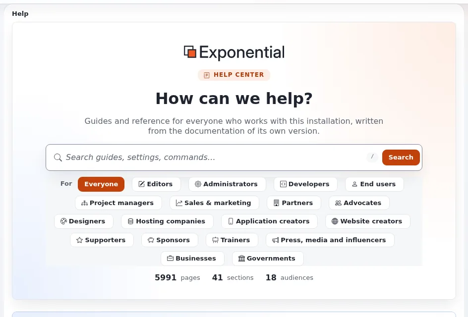

# Ihre erste Website Schritt für Schritt

Diese Seite richtet sich an Website-Ersteller, die zum Lernen eine laufende Website auf ihrem eigenen Rechner haben
wollen. Sie führt Sie von einem leeren Verzeichnis zu einer Website mit Ihren eigenen Inhalten und einem geänderten
Template. Jeder Schritt endet mit etwas, das Sie prüfen können. Sie verwendet bewusst die Standardwerte: SQLite (kein
Datenbankserver), das Standard-Seitenpaket und Velocity. Für eine echte Website lesen Sie danach
[Eine Installationsmethode wählen](eine-installationsmethode-waehlen.md).



## Inhalt

1. [Bevor Sie beginnen](#bevor-sie-beginnen)
2. [Schritte 1-3: Code, Installation, Auslieferung](#schritte-1-3-code-installation-auslieferung)
3. [Schritte 4-6: anmelden und Inhalte hinzufügen](#schritte-4-6-anmelden-und-inhalte-hinzufügen)
4. [Schritte 7-9: das Aussehen einer Seite ändern](#schritte-7-9-das-aussehen-einer-seite-ändern)
5. [Schritt 10: sich umsehen](#schritt-10-sich-umsehen)
6. [Wenn etwas nicht funktioniert](#wenn-etwas-nicht-funktioniert)

## Bevor Sie beginnen

Sie brauchen PHP 8.1 oder neuer auf der Kommandozeile, Composer 2 und Git
([Anforderungen](../../../installation/02-voraussetzungen.md)). Führen Sie jeden Befehl im Wurzelverzeichnis der Installation
aus, dem Verzeichnis mit `index.php`, und zwar als Ihr eigener Benutzer (nicht `root`).

## Schritte 1-3: Code, Installation, Auslieferung

**Schritt 1. Den Code holen** ([Den Code holen](../../../installation/03-den-code-beschaffen.md)):

```bash
git clone https://github.com/se7enxweb/exponential.git mysite
cd mysite
composer install
```

Prüfen: `ls index.php kernel settings` listet alle drei auf.

**Schritt 2. Installieren.** Ohne Optionen installiert `exp:install` das Paket `sevenx_multisite` auf SQLite mit dem
Administrator `admin` und einem erzeugten Passwort ([Die Installation über die Konsole](../../../installation/07-installation-ueber-die-konsole.md)):

```bash
php bin/php/console exp:install --url=http://127.0.0.1:8088
```

Prüfen: Die Zusammenfassung am Ende sagt "Exponential is installed" und zeigt das Passwort einmal an. Notieren Sie es;
es steht außerdem in `var/log/initial-admin-password` (nur für Sie lesbar), bis Sie diese Datei löschen.

**Schritt 3. Ausliefern.** Installieren Sie die Velocity-Engine und starten Sie sie
([8.3 Exponential Velocity](../../../installation/08-die-website-ausliefern.md#83-exponential-velocity-der-empfohlene-weg)):

```bash
composer require se7enxweb/exponential-velocity
php bin/php/console exp:velocity config set ServerSettings Engine qbix
php bin/php/console exp:velocity start
php bin/php/console exp:velocity status
```

Prüfen: `status` listet die Adressen auf; `curl -sI http://127.0.0.1:8088/ | head -1` gibt `200` oder eine Weiterleitung
aus.

> **Tipp**
> Noch kein Velocity? `php bin/php/console exp:velocity start --engine=php` verwendet den eingebauten Server von PHP, was
> zum Umsehen reicht (Port 8087, nur für die Entwicklung).

## Schritte 4-6: anmelden und Inhalte hinzufügen

**Schritt 4. Öffnen Sie die Website** unter der Adresse `Site:`, die die Installation ausgegeben hat. Sie sehen die
Startseite der Demo.

**Schritt 5. Melden Sie sich an** unter der Adresse `Admin login:` mit `admin` und dem Passwort, und ändern Sie dann das
Passwort (**Mein Konto**; siehe [Konten und Anmeldung](../../konten-und-anmeldung.md)). Löschen Sie danach
`var/log/initial-admin-password`.

**Schritt 6. Legen Sie Inhalte an.** Öffnen Sie in der Administration die Inhaltsstruktur, wählen Sie einen Ordner,
wählen Sie im Menü zum Anlegen **Article**, füllen Sie Titel und Fließtext aus, und klicken Sie auf **Zur
Veröffentlichung schicken** ([Inhalte bearbeiten](../../inhalte-bearbeiten.md)). Prüfen: Der Artikel erscheint in den
Unterelementen des Ordners und auf der Website.

## Schritte 7-9: das Aussehen einer Seite ändern

**Schritt 7. Finden Sie das Design.** Fragen Sie ab, welches Design der öffentliche Siteaccess verwendet:

```bash
php bin/php/console exp:ini where site/DesignSettings/SiteDesign site
```

Die letzte Zeile, `In effect`, nennt das Design ([Templates und Design](../../../anleitungen/templates-und-design.md)).

**Schritt 8. Überschreiben Sie das Template des Artikels** für genau diesen Artikel, per Klickpfad: **Design >
Template-Editor**, öffnen Sie `node/view/full.tpl`, klicken Sie auf **Neues Überschreib-Template**, wählen Sie
*Standardkopie*, geben Sie die Objekt-ID des Artikels an und legen Sie es an. Fügen Sie eine Zeile wie
`<p>My first override</p>` hinzu und speichern Sie. Details: [Template-Overrides](template-overrides.md).

**Schritt 9. Prüfen.** Laden Sie den Artikel auf der Website neu: Ihre Zeile ist da. Entfernen Sie den Override danach
wieder aus derselben Liste.

## Schritt 10: sich umsehen

- Die **Hilfe** (`/exphelp/dashboard` in der Administration) hat Seiten für Redaktion und Administratoren; Ihre
  Redaktion wird dort beginnen.
- **Setup > Systeminformationen** zeigt PHP, Datenbank und die verwendeten Erweiterungen
  ([Systeminformationen](../../../anleitungen/systeminformationen.md)).
- Der **Layouts-Editor** baut Landingpages ohne Templates
  ([Landingpages mit dem Layouts-Editor](landingpages-mit-dem-layouts-editor.md)).

## Wenn etwas nicht funktioniert

| Sie sehen | Tun Sie |
|---|---|
| `composer install` lehnt Ihr PHP ab | installieren Sie PHP 8.1 oder neuer ([2.2 PHP](../../../installation/02-voraussetzungen.md#22-php)) |
| Die Installation stoppt bei `SystemCheck` | lesen Sie die ausgegebene Lösung; meist eine fehlende PHP-Erweiterung oder ein Rechteproblem |
| Eine Wartungsseite statt der Website | `php bin/php/maintenance.php status`, dann `off` |
| Fehler über Dateien, die nicht geschrieben werden können | Sie haben einen Befehl als `root` ausgeführt; siehe [12. Fehlerbehebung](../../../installation/12-fehlerbehebung.md) |
| Etwas anderes | [Wenn etwas schiefgeht](../../wenn-etwas-schiefgeht.md) |

## Verwandte Seiten

- [Website-Ersteller: hier beginnen](website-ersteller-hier-beginnen.md)
- [Erste Schritte (Administratoren)](../../../anleitungen/erste-schritte.md)
- [Ein Design oder Theme wählen](ein-design-oder-theme-waehlen.md)
- [Freie Dokumentation](../../freie-dokumentation.md): Diese Seite darf unter der GNU FDL 1.3 frei kopiert, übersetzt und verbessert werden.

<!-- exp-partner-block:start -->
**Werden Sie Exponential-Partner.** Partner teilen ihre Informationen, stellen Mittel bereit, geben Beiträge zurück
und entwickeln die Produkte mit uns, und so wächst Exponential. Eine Partner-Website und ein Dashboard sind für Mitte
2027 geplant: Werden Sie noch heute Partner, damit wir schneller wachsen und neue Funktionen früher liefern. Beginnen
Sie mit [Partner: hier beginnen](../../partner/partner-hier-beginnen.md) und
[Wie Sie sich bewerben](../../partner/wie-sie-sich-bewerben.md).
<!-- exp-partner-block:end -->
