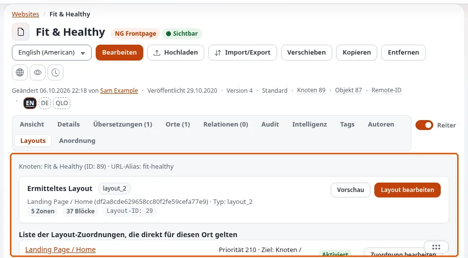

# Layout-Regeln

Diese Seite richtet sich an Website-Ersteller, die entscheiden, welche Seiten welches Layout verwenden. Ein Layout
bewirkt nichts, bis eine **Regel** Anfragen darauf richtet. Regeln liegen unter **Mappings** im Layouts-Editor und unter
**rule_list** in den formularbasierten Bildschirmen. Quelle:
[Regeln](../../../bc/6.0/layouts.md#regeln-entscheiden-welches-layout-eine-seite-erhält).

## Inhalt

1. [Woraus eine Regel besteht](#woraus-eine-regel-besteht)
2. [Ziele](#ziele)
3. [Bedingungen](#bedingungen)
4. [Priorität: der erste Treffer gewinnt](#priorität-der-erste-treffer-gewinnt)
5. [Rezepte](#rezepte)
6. [Fehlersuche](#fehlersuche)

## Woraus eine Regel besteht

| Teil | Bedeutung |
|---|---|
| Layout | was angezeigt wird |
| Ziele | für welche Anfragen sie gilt |
| Bedingungen | zusätzliche Einschränkungen, die ebenfalls erfüllt sein müssen |
| Priorität | die höhere gewinnt, wenn mehrere Regeln passen |
| Aktiviert | ein Schalter, um eine Regel stillzulegen, ohne sie zu löschen |

## Ziele

| Typ | Passt, wenn |
|---|---|
| `node` | die Anfrage auf diesen Inhaltsknoten aufgelöst wird |
| `subtree` | der Knoten der Anfrage unterhalb dieser Platzierung liegt |
| `path` | der Pfad gleich dem Wert ist |
| `path_prefix` | der Pfad mit dem Wert beginnt |
| `path_info_prefix` | dasselbe, normalisiert auf einen führenden `/` |
| `path_regex` | der Pfad einem regulären Ausdruck entspricht |

Ein Zieltyp `route` ist deklariert, aber nicht implementiert, und passt nie; verwenden Sie ihn nicht. Bevorzugen Sie
`subtree` und `node`: Sie folgen dem Inhalt, wenn die Redaktion ihn umbenennt oder verschiebt, während ein Pfad bricht.

## Bedingungen

| Typ | Schränkt ein nach | Wert |
|---|---|---|
| `siteaccess` | dem Siteaccess, der die Anfrage bedient | JSON-Array mit Namen |
| `content_type` / `class` | der Klasse des Knotens | JSON-Array mit Klassen-Bezeichnern |
| `query_parameter` | `?name=value` in der Adresse | JSON mit `parameter_name`, optional `parameter_values` |
| `route_parameter` | einem Benutzerparameter im Pfad | dasselbe |
| `time` | der aktuellen Zeit | JSON mit `from` und/oder `to` |

Ohne Werte verlangt eine Parameterbedingung nur, dass der Parameter vorhanden ist. Ein leerer Zeitraum passt immer. Ein
unbekannter Bedingungstyp **passt**: Ein Tippfehler erweitert die Regel, statt sie abzuschalten.

## Priorität: der erste Treffer gewinnt

Regeln werden nach Priorität ausgewertet, und der erste Treffer gewinnt. Die häufigste Verwirrung: Ein Layout erscheint
nicht, weil eine breitere Regel mit höherer Priorität die Anfrage zuerst abfängt. Geben Sie spezifischen Regeln (ein
Knoten) eine höhere Priorität als allgemeinen (ein Teilbaum, eine Klasse).

## Rezepte

| Ziel | Ziel-Typ | Bedingungen | Priorität |
|---|---|---|---|
| Layout der Startseite | `node` = der Wurzelknoten | `siteaccess` = `["site"]` | hoch |
| Alle Artikel im Ordner News | `subtree` = News | `content_type` = `["article"]` | mittel |
| Ein Kampagnen-Layout für Oktober | `node` = die Landingpage | `time` = `{"from":"2026-10-01","to":"2026-10-31"}` | höher als die normale Regel der Seite |
| Eine Vorschauvariante | `node` = die Seite | `query_parameter` = `{"parameter_name":"variant","parameter_values":["b"]}` | hoch |
| Ein websiteweiter Standard | `subtree` = die Wurzel | | am niedrigsten |

Eine Regel zu kopieren ist der schnellste Weg, eine Familie ähnlicher Regeln zu bauen.

## Fehlersuche

| Symptom | Prüfen |
|---|---|
| Die Seite zeigt das alte Layout | eine Regel mit höherer Priorität passt zuerst; das Layout ist nicht veröffentlicht; der Seiten-Cache enthält noch die alte Seite |
| Eine Regel gilt für zu viele Seiten | ein falsch geschriebener Bedingungstyp passt auf alles; das Ziel ist ein breiter Teilbaum |
| Eine Regel funktioniert nach einer Umbenennung nicht mehr | sie verwendet ein Pfad-Ziel; wechseln Sie zu `node` oder `subtree` |
| Nach dem Veröffentlichen ändert sich nichts | leeren Sie den View-Cache für Inhalte und, mit Velocity, dessen Antwort-Cache |

> **Hinweis**
> Der Resolver cacht, welches Layout eine Anfrage bekommt. Wenn Regeln oder Layouts außerhalb des Editors geändert
> wurden (ein Import, ein Skript), leeren Sie die Caches der Erweiterung, wie es deren Dokumentation beschreibt, und dann
> die Inhalts-Caches.

## Verwandte Seiten

- [Landingpages mit dem Layouts-Editor](landingpages-mit-dem-layouts-editor.md)
- [explayouts_ui: ein Layout einer Seite zuordnen](../../../funktionen/6.0/erweiterungen/explayouts_ui.md#ein-layout-einer-seite-zuordnen)
- [View-Cache und Cache-Blöcke](view-cache-und-cache-bloecke.md)
- [Freie Dokumentation](../../freie-dokumentation.md): Diese Seite darf unter der GNU FDL 1.3 frei kopiert, übersetzt und verbessert werden.

<!-- exp-partner-block:start -->
**Werden Sie Exponential-Partner.** Partner teilen ihre Informationen, stellen Mittel bereit, geben Beiträge zurück
und entwickeln die Produkte mit uns, und so wächst Exponential. Eine Partner-Website und ein Dashboard sind für Mitte
2027 geplant: Werden Sie noch heute Partner, damit wir schneller wachsen und neue Funktionen früher liefern. Beginnen
Sie mit [Partner: hier beginnen](../../partner/partner-hier-beginnen.md) und
[Wie Sie sich bewerben](../../partner/wie-sie-sich-bewerben.md).
<!-- exp-partner-block:end -->
