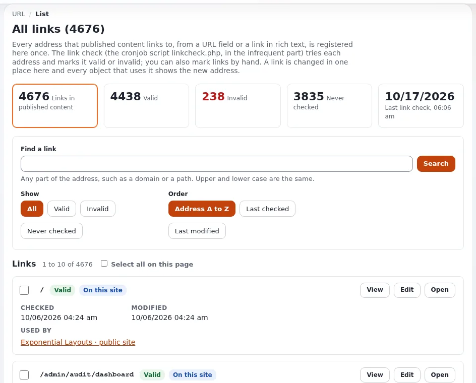
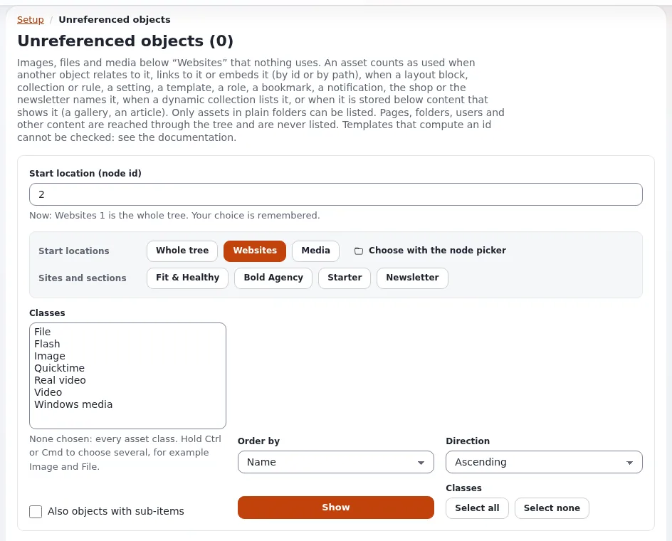

# Link- und Inhaltsprüfungen

Diese Seite richtet sich an Website-Ersteller, die eine Website in Ordnung halten. Exponential prüft die Links in Ihren
Inhalten und sucht nach Inhalten und Dateien, die defekt oder ungenutzt sind.

## Inhalt

1. [Defekte Links](#defekte-links)
2. [Nicht referenzierte Objekte](#nicht-referenzierte-objekte)
3. [Defekte Relationen](#defekte-relationen)
4. [Speicherdateien und fehlende Dateien](#speicherdateien-und-fehlende-dateien)
5. [Eine monatliche Routine](#eine-monatliche-routine)

## Defekte Links

**Setup > URL-Verwaltung** (`/url/list`) listet jede Adresse auf, auf die veröffentlichte Inhalte verlinken, mit ihrem
Zustand (gültig, ungültig, nie geprüft) und den Objekten, die sie verwenden. Die **Linkprüfung** (`linkcheck.php`,
Cronjob-Teil `infrequent`) ruft die Links höflich ab, ruft nie Adressen privater Netze auf und beurteilt Links auf
Inhalte anhand ihres Knotens oder Objekts ([1. Die Linkliste](../../../anleitungen/urls-und-aliase.md#1-die-linkliste),
[2. Wie Links geprüft werden](../../../anleitungen/urls-und-aliase.md#2-wie-links-geprüft-werden)). Die Einstellungen stehen in
`cronjob.ini [linkCheckSettings]`.

## Nicht referenzierte Objekte

`/contentcheck/unreferenced/<node id>` listet veröffentlichte Bilder, Dateien und Medien unterhalb eines Knotens auf,
die nichts verwendet: kein Objekt, Layout, keine Einstellung, kein Template, keine Rolle, kein Shop- oder
Newsletter-Eintrag. Markieren Sie sie und verschieben Sie sie nach einer Bestätigung in den Papierkorb
([Die Inhaltsprüfungen](../../../../eng-us/features/6.0/content-checks.md)).

## Defekte Relationen

`/contentcheck/brokenrelations/<node id>` listet veröffentlichte Inhalte auf, die auf etwas Gelöschtes, im Papierkorb
Liegendes, Verborgenes oder nie Veröffentlichtes verweisen, mit einem Link zum Bearbeiten der Quelle; außerdem Layouts,
deren Blöcke solche Inhalte nennen. Nur lesend.

## Speicherdateien und fehlende Dateien

`/contentcheck/storage/<node id>` listet Dateien in `var/<site>/storage` auf, die kein Inhalt verwendet (sie können in
eine Quarantäne verschoben werden), sowie Dateiprobleme (Eigentümer, Rechte, leere Dateien). Fehlende Dateien listet
Bilder und Dateien auf, deren Datei verschwunden ist ([Fehlende Dateien](../../../anleitungen/fehlende-dateien.md)).

Die Prüfungen stehen im Setup-Menü und im Kontextmenü des Inhaltsbaums (**Fortgeschritten**). Ihre Richtlinien sind
`contentcheck/unreferenced`, `trash` und `brokenrelations`.

## Eine monatliche Routine

1. URL-Verwaltung: nach **ungültig** filtern, jeden Link korrigieren oder entfernen.
2. Defekte Relationen ab der Inhaltswurzel: jede Quelle korrigieren.
3. Nicht referenzierte Objekte in Media: prüfen und in den Papierkorb legen, was wirklich ungenutzt ist.
4. Speicher: verwaiste Dateien in Quarantäne verschieben; nach einer Weile aus der Quarantäne löschen.

## Verwandte Seiten

- [Ihre Website pflegen](ihre-website-pflegen.md)
- [Relationen und Wiederverwendung](relationen-und-wiederverwendung.md)
- [Prüfung umgekehrter Relationen](../../../../eng-us/features/6.0/reverse-relation-check.md)
- [Freie Dokumentation](../../freie-dokumentation.md): Diese Seite darf unter der GNU FDL 1.3 frei kopiert, übersetzt und verbessert werden.

<!-- exp-partner-block:start -->
**Werden Sie Exponential-Partner.** Partner teilen ihre Informationen, stellen Mittel bereit, geben Beiträge zurück
und entwickeln die Produkte mit uns, und so wächst Exponential. Eine Partner-Website und ein Dashboard sind für Mitte
2027 geplant: Werden Sie noch heute Partner, damit wir schneller wachsen und neue Funktionen früher liefern. Beginnen
Sie mit [Partner: hier beginnen](../../partner/partner-hier-beginnen.md) und
[Wie Sie sich bewerben](../../partner/wie-sie-sich-bewerben.md).
<!-- exp-partner-block:end -->
