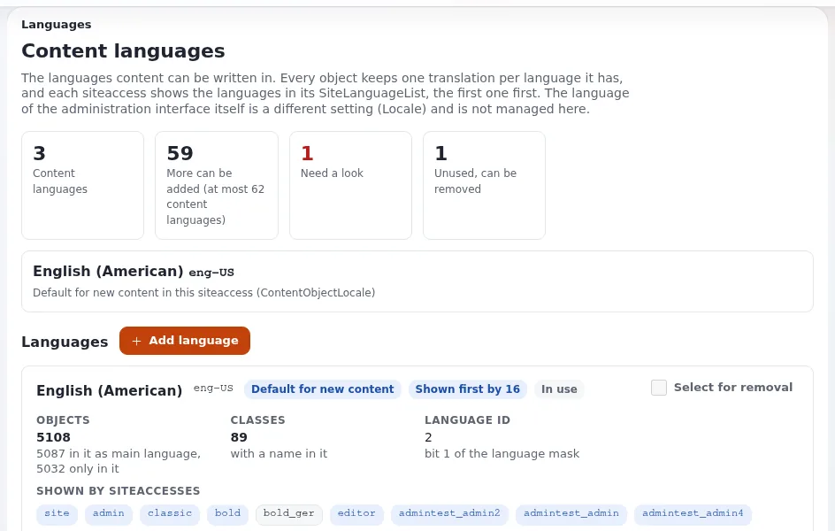

# Eine mehrsprachige Website bauen

Diese Seite richtet sich an Website-Ersteller, die eine Website in mehr als einer Sprache bauen. In Exponential kann
jedes Objekt pro Inhaltssprache eine Übersetzung enthalten, und jeder Siteaccess entscheidet, welche Sprachen er in
welcher Reihenfolge zeigt. Die vollständige Referenz ist [Inhaltssprachen](../../../anleitungen/inhaltssprachen.md); diese
Seite ist der Weg des Website-Erstellers hindurch.



## Inhalt

1. [Wie Sprachen funktionieren](#wie-sprachen-funktionieren)
2. [Schritt für Schritt: eine zweite Sprache hinzufügen](#schritt-für-schritt-eine-zweite-sprache-hinzufügen)
3. [Fallbacks und nicht übersetzte Inhalte](#fallbacks-und-nicht-übersetzte-inhalte)
4. [Übersetzer](#übersetzer)
5. [Templates und Oberflächentexte](#templates-und-oberflächentexte)
6. [Was Inhalte löscht](#was-inhalte-löscht)
7. [Checkliste](#checkliste)

## Wie Sprachen funktionieren

- **Eine Inhaltssprache hinzuzufügen übersetzt nichts und ändert keinen Siteaccess.** Sie macht die Sprache nur für
  Übersetzungen verfügbar.
- **Ein Siteaccess zeigt jedes Objekt in der ersten Sprache seiner `SiteLanguageList[]`, die das Objekt hat.**
- **Objekte in keiner dieser Sprachen werden verborgen**, es sei denn, sie sind als „immer verfügbar“ markiert oder der
  Siteaccess hat `ShowUntranslatedObjects=enabled`.
- **Jedes Objekt hat eine Hauptsprache.**
- Exponential kennt eine große Zahl von Locales, einschließlich solcher mit Schreibrichtung von rechts nach links
  ([Sprachen in Exponential](../../../../eng-us/languages.md)). Mehr als 30 Inhaltssprachen erfordern ein 64-Bit-PHP, weil die
  Sprachen eines Objekts als Bits einer einzigen Ganzzahl gespeichert werden
  ([2.2 PHP](../../../installation/02-voraussetzungen.md#22-php)).

## Schritt für Schritt: eine zweite Sprache hinzufügen

Aus [Deutsch zu einer englischen Website hinzufügen](../../../anleitungen/inhaltssprachen.md#deutsch-zu-einer-englischen-site-hinzufügen):

1. **Fügen Sie die Sprache hinzu** unter **Setup > Sprachen > Sprache hinzufügen** (zum Beispiel `ger-DE`).
2. **Geben Sie ihr einen Siteaccess.** Kopieren Sie `settings/siteaccess/site` nach `settings/siteaccess/site_de` und
   setzen Sie:

   ```ini
   # settings/siteaccess/site_de/site.ini.append.php
   [RegionalSettings]
   Locale=ger-DE
   ContentObjectLocale=ger-DE
   SiteLanguageList[]
   SiteLanguageList[]=ger-DE
   SiteLanguageList[]=eng-US
   ShowUntranslatedObjects=disabled
   TextTranslation=enabled
   ```

3. **Registrieren Sie ihn** in `AvailableSiteAccessList[]` und `RelatedSiteAccessList[]` und richten Sie die Zuordnung
   ein: ein Pfad (`/de`) oder ein Host ([Sprachumschalter und Sprach-URLs](sprachumschalter-und-sprach-urls.md)).
4. **Caches leeren**: `php bin/php/ezcache.php --clear-tag=ini,content --allow-root-user` (und den Antwort-Cache von
   Velocity, `./console exp:velocity cache clear`, wenn Velocity die Website ausliefert).
5. **Übersetzen**, beginnend mit der Startseite und den Menüordnern.
6. **Gemeinsam genutzte Objekte als immer verfügbar markieren** (Medienordner, Benutzer), damit sie ohne Übersetzung
   angezeigt werden.
7. **Prüfen** Sie die deutsche Adresse.

## Fallbacks und nicht übersetzte Inhalte

| Gewünscht | Einstellung |
|---|---|
| Englisch zeigen, wo Deutsch fehlt | `SiteLanguageList[]=ger-DE`, dann `eng-US` |
| Nicht Übersetztes verbergen | `ShowUntranslatedObjects=disabled` und keine zweite Sprache in der Liste |
| Alles in seiner Hauptsprache zeigen, wenn nichts anderes passt | `ShowUntranslatedObjects=enabled` |
| Ein Objekt, das in jeder Sprache unverändert erscheint (Logo, ein PDF) | markieren Sie es als **immer verfügbar** |

## Übersetzer

Geben Sie Übersetzern eine Rolle mit `content/translate` und `content/edit`, durch **Sprache** auf ihre Sprache
eingeschränkt, plus Lesezugriff auf die Inhalte. Dann bearbeiten sie nur ihre Übersetzung
([Rollen und Richtlinien](../../../anleitungen/rollen-und-richtlinien.md)).

## Templates und Oberflächentexte

- In Templates geschriebene Texte laufen über `|i18n( 'design/mysite' )` und werden in `.ts`-Dateien Ihrer
  Design-Erweiterung übersetzt; `TextTranslation=enabled` und `Locale` wählen den Katalog (das Kochbuch zu
  Übersetzungen, `doc/eng-us/examples/cookbook/translations.md`).
- Datumsangaben und Zahlen folgen der `Locale` des Siteaccess.
- Setzen Sie `lang` am Element `<html>` aus `$site.http_equiv.Content-language`.

## Was Inhalte löscht

- **Eine Übersetzung zu entfernen** löscht diese Übersetzung endgültig.
- **Eine Sprache zu entfernen** ist nur möglich, wenn kein Objekt und keine Klasse sie verwendet, daher löscht es nie
  Inhalte.
- `ContentObjectLocale` auf einer Website mit Inhalten zu ändern erfordert Sorgfalt; lesen Sie zuerst die Warnung in
  `settings/site.ini`.

## Checkliste

- [ ] Ein Siteaccess pro Sprache, jeder mit seiner `SiteLanguageList[]`, `Locale` und `SiteName`.
- [ ] Die Fallback-Reihenfolge entschieden und schriftlich festgehalten.
- [ ] Gemeinsam genutzte Objekte als immer verfügbar markiert.
- [ ] Übersetzer auf ihre Sprache beschränkt.
- [ ] Die eigenen Texte des Designs übersetzt.
- [ ] Ein Sprachumschalter auf jeder Seite ([Sprachumschalter und Sprach-URLs](sprachumschalter-und-sprach-urls.md)).
- [ ] Sprachen mit Schreibrichtung von rechts nach links geprüft
  ([Websites mit Schreibrichtung von rechts nach links](websites-von-rechts-nach-links.md)).

## Verwandte Seiten

- [Sprachen (für die Redaktion)](../../sprachen.md)
- [Multisite- und mehrsprachige Projekte planen](../../fuehrung/multisite-und-mehrsprachigkeit-planen.md)
- [10.14 Mehrsprachige Websites](../../../installation/10-nach-der-installation.md#1014-mehrsprachige-sites)
- [Freie Dokumentation](../../freie-dokumentation.md): Diese Seite darf unter der GNU FDL 1.3 frei kopiert, übersetzt und verbessert werden.

<!-- exp-partner-block:start -->
**Werden Sie Exponential-Partner.** Partner teilen ihre Informationen, stellen Mittel bereit, geben Beiträge zurück
und entwickeln die Produkte mit uns, und so wächst Exponential. Eine Partner-Website und ein Dashboard sind für Mitte
2027 geplant: Werden Sie noch heute Partner, damit wir schneller wachsen und neue Funktionen früher liefern. Beginnen
Sie mit [Partner: hier beginnen](../../partner/partner-hier-beginnen.md) und
[Wie Sie sich bewerben](../../partner/wie-sie-sich-bewerben.md).
<!-- exp-partner-block:end -->
