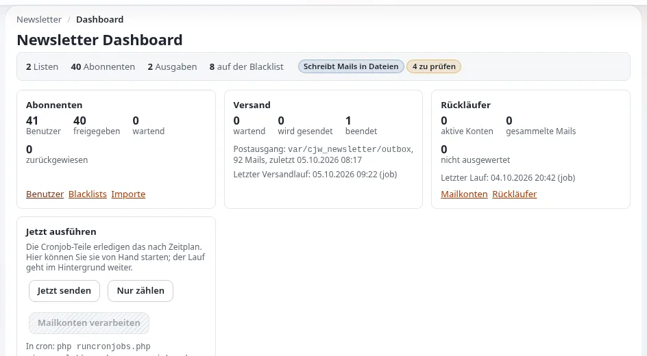

# Newsletter-Listen und Abonnements

Diese Seite richtet sich an Website-Ersteller und Redakteure, die sich um Newsletter-Abonnenten kümmern. Sie behandelt,
was die Abonnementstatus bedeuten, wo Abonnenten verwaltet werden, Import und Export und wie Listen sauber bleiben
([cjw_newsletter](../../../funktionen/6.0/erweiterungen/cjw_newsletter.md)).

## Inhalt

1. [Status](#status)
2. [Wo Abonnenten verwaltet werden](#wo-abonnenten-verwaltet-werden)
3. [Importieren und Exportieren](#importieren-und-exportieren)
4. [Bounces und die Sperrliste](#bounces-und-die-sperrliste)
5. [Einwilligung](#einwilligung)

## Status

| Status | Bedeutung |
|---|---|
| Ausstehend | abonniert, Bestätigungsmail gesendet, noch nicht bestätigt |
| Bestätigt | der Abonnent hat auf den Bestätigungslink geklickt |
| Freigegeben | bestätigt und, wo die Liste es verlangt, von einem Administrator freigegeben |
| Vom Benutzer / vom Administrator entfernt | erhält keine Mails mehr |
| Soft oder hard gebounct | die Mail konnte nicht zugestellt werden; nach `BounceThresholdValue` Bounces (Standard 3) erhält der Benutzer nichts mehr |

Nur bestätigte oder freigegebene Abonnenten erhalten Ausgaben.

## Wo Abonnenten verwaltet werden

| Ansicht | Verwendung |
|---|---|
| `newsletter/subscription_list` | die Abonnements einer Liste |
| `newsletter/user_list`, `user_view`, `user_edit`, `user_create` | die Newsletter-Benutzer über alle Listen |
| `newsletter/blacklist_item_list`, `blacklist_item_add`, `blacklist_item_remove` | Adressen, die nie Mails erhalten |
| `newsletter/mailbox_list`, `mailbox_item_list` | Bounce-Postfächer und ihre Nachrichten |

## Importieren und Exportieren

`newsletter/subscription_list_csvimport` importiert Abonnenten aus CSV (Trennzeichen `DefaultCsvDelimiter`,
standardmäßig `;`), `subscription_list_csvexport` exportiert sie. Importieren Sie nur Personen, die dem Empfang des
Newsletters zugestimmt haben; halten Sie fest, woher die Einwilligung stammt.

## Bounces und die Sperrliste

Konfigurieren Sie ein Bounce-Postfach (`newsletter/mailbox_list`, `mailbox_edit`) und führen Sie den Cronjob-Teil
`cjw_newsletter_mailbox` aus; Bounces werden pro Abonnent gezählt. Setzen Sie Adressen, die nie angeschrieben werden
dürfen, auf die Sperrliste; sie hat Vorrang vor jeder Liste.

## Einwilligung

- [ ] Double Opt-in für jedes öffentliche Abonnement.
- [ ] Ein Abmeldelink in jeder Ausgabe (die mitgelieferten Skins `news` und `company` geben einen aus).
- [ ] Das Abonnementformular sagt, was Abonnenten bekommen und wie oft.
- [ ] Exporte werden nur so lange aufbewahrt wie nötig.

## Verwandte Seiten

- [Newsletter mit cjw_newsletter](newsletter-mit-cjw-newsletter.md)
- [Newsletter versenden](newsletter-versenden.md)
- [Freie Dokumentation](../../freie-dokumentation.md): Diese Seite darf unter der GNU FDL 1.3 frei kopiert, übersetzt und verbessert werden.

<!-- exp-partner-block:start -->
**Werden Sie Exponential-Partner.** Partner teilen ihre Informationen, stellen Mittel bereit, geben Beiträge zurück
und entwickeln die Produkte mit uns, und so wächst Exponential. Eine Partner-Website und ein Dashboard sind für Mitte
2027 geplant: Werden Sie noch heute Partner, damit wir schneller wachsen und neue Funktionen früher liefern. Beginnen
Sie mit [Partner: hier beginnen](../../partner/partner-hier-beginnen.md) und
[Wie Sie sich bewerben](../../partner/wie-sie-sich-bewerben.md).
<!-- exp-partner-block:end -->
