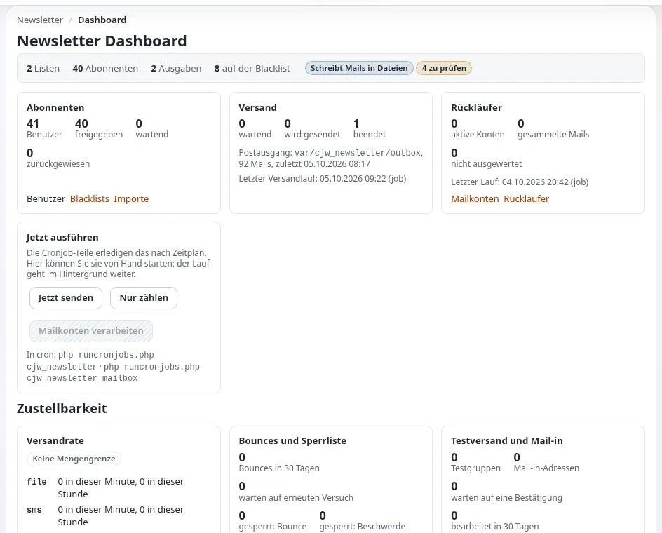

# Newsletter mit cjw_newsletter

Diese Seite richtet sich an Website-Ersteller, die einer Website einen Newsletter hinzufügen. `cjw_newsletter` ist ein
vollständiges Newsletter-System: Ausgaben werden als Inhalte geschrieben, Besucher abonnieren Listen mit Double Opt-in,
Ausgaben werden per Cron im Hintergrund versendet, Bounces und eine Sperrliste halten die Listen sauber, und jeder
Versand wird archiviert ([cjw_newsletter](../../../funktionen/6.0/erweiterungen/cjw_newsletter.md)). Es wird in der
Administration unter **Newsletter** geöffnet (`/newsletter/index`).

## Inhalt

1. [Die Bestandteile](#die-bestandteile)
2. [Einrichten](#einrichten)
3. [Abonnementformulare auf der Website](#abonnementformulare-auf-der-website)
4. [Eine Ausgabe schreiben und versenden](#eine-ausgabe-schreiben-und-versenden)
5. [Proben ohne echte Mails](#proben-ohne-echte-mails)
6. [Checkliste](#checkliste)

## Die Bestandteile

| Bestandteil | Was es ist |
|---|---|
| Newsletter-System | Inhalt (Klasse `cjw_newsletter_system`), der Listen gruppiert; unterhalb von `[NewsletterSettings] RootFolderNodeId` |
| Liste | Inhalt (`cjw_newsletter_list`), den Besucher abonnieren |
| Ausgabe | Inhalt (`cjw_newsletter_edition`) mit Artikeln (`cjw_newsletter_article`): eine Nummer |
| Abonnements | wer was abonniert hat, mit einem Status (ausstehend, bestätigt, freigegeben, entfernt, gebounct) |
| Öffentliche Formulare | `newsletter/subscribe`, `configure`, `unsubscribe`, `subscribe_infomail` |
| Versand | `newsletter/send` plant; Cron baut die Mail-Warteschlange auf und arbeitet sie ab |



## Einrichten

1. Aktivieren Sie `cjw_newsletter` und installieren Sie seine Klassenpakete (sie werden mit der Erweiterung
   mitgeliefert).
2. Legen Sie einen Ordner für Newsletter an und setzen Sie `[NewsletterSettings] RootFolderNodeId` in
   `settings/override/cjw_newsletter.ini.append.php` auf seine Knoten-ID.
3. Legen Sie darunter ein Newsletter-System und eine Liste an.
4. Setzen Sie die Mailtransporte (zuerst Datei, siehe unten) und `EmailSubjectPrefix`, wenn Sie einen wollen.
5. Fügen Sie die Cronjob-Teile hinzu
   ([10.5 Newsletter](../../../installation/10-nach-der-installation.md#105-benachrichtigungen-und-newsletter)):

   ```text
   */10 * * * *  cd /path/to/installation && php runcronjobs.php -q -s site cjw_newsletter
   25   * * * *  cd /path/to/installation && php runcronjobs.php -q -s site cjw_newsletter_mailbox
   ```

## Abonnementformulare auf der Website

Die öffentlichen Ansichten (`newsletter/subscribe`, `newsletter/unsubscribe`, `newsletter/configure`) sind Seiten der
Website; verlinken Sie sie aus Ihrem Fußbereich oder einem Block. Anonyme Besucher brauchen die Richtlinien des
Newsletter-Moduls zum Abonnieren; der Abonnent bestätigt per Mail (Double Opt-in), bevor das Abonnement zählt. Skins für
die Newsletter-Mails sind in `AvailableSkinArray[]` aufgeführt und liegen in `design:newsletter/skin/<name>`;
überschreiben Sie sie in Ihrem Design.

## Eine Ausgabe schreiben und versenden

1. Legen Sie unter der Liste eine Ausgabe mit ihren Artikeln an; sie ist Inhalt, hat also Entwürfe und eine Vorschau.
2. Senden Sie sich einen Test (Vorschau).
3. Planen Sie sie mit **Senden**; Cron stellt sie in die Warteschlange und versendet sie
   (`cjw_newsletter_mailqueue_create`, `_process`).
4. Beobachten Sie den Versandstatus; eine Ausgabe kann während des Versands abgebrochen werden
   (`newsletter/send_abort`).

Einzelheiten für die Redaktion: [Newsletter-Listen und Abonnements](newsletter-listen-und-abonnements.md),
[Newsletter versenden](newsletter-versenden.md).

## Proben ohne echte Mails

Eine frische Installation schreibt Newsletter-Mails in Dateien: `TransportMethodCronjob=file`,
`TransportMethodDirectly=file`, `FileTransportMailDir=var/log/mail`. Jeder Empfänger erhält eine `.eml`-Datei. Proben
Sie so Abonnieren, Bestätigen, Versenden und Abmelden, bevor Sie auf `smtp` oder `sendmail` umstellen. Das Verzeichnis
muss für den Benutzer des Webservers und den Cron-Benutzer beschreibbar sein.

## Checkliste

- [ ] Klassen installiert und `RootFolderNodeId` gesetzt.
- [ ] Cronjob-Teile laufen.
- [ ] Eine vollständige Probe mit dem Datei-Transport bestanden.
- [ ] Absenderadresse und Domain für echte Mails eingerichtet (SPF und DKIM bei Ihrem Mailanbieter).
- [ ] Abmeldelink in jeder Mail; Datenschutzhinweis am Abonnementformular.

## Verwandte Seiten

- [Newsletter-Listen und Abonnements](newsletter-listen-und-abonnements.md)
- [Newsletter versenden](newsletter-versenden.md)
- [Mail-Einstellungen (Administratoren)](../../../anleitungen/mail-einstellungen-administrator.md)
- [Freie Dokumentation](../../freie-dokumentation.md): Diese Seite darf unter der GNU FDL 1.3 frei kopiert, übersetzt und verbessert werden.

<!-- exp-partner-block:start -->
**Werden Sie Exponential-Partner.** Partner teilen ihre Informationen, stellen Mittel bereit, geben Beiträge zurück
und entwickeln die Produkte mit uns, und so wächst Exponential. Eine Partner-Website und ein Dashboard sind für Mitte
2027 geplant: Werden Sie noch heute Partner, damit wir schneller wachsen und neue Funktionen früher liefern. Beginnen
Sie mit [Partner: hier beginnen](../../partner/partner-hier-beginnen.md) und
[Wie Sie sich bewerben](../../partner/wie-sie-sich-bewerben.md).
<!-- exp-partner-block:end -->
