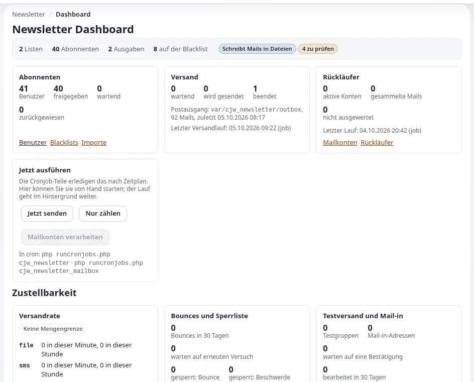

# Newsletter versenden

Diese Seite richtet sich an Website-Ersteller und Administratoren, die Newsletter tatsächlich versenden. Ein Newsletter
geht auf einmal an viele Menschen und lässt sich nicht zurückholen, also proben Sie zuerst und schalten Sie den echten
Versand bewusst ein.

## Inhalt

1. [Die Transporte](#die-transporte)
2. [Von der Probe zur echten Mail](#von-der-probe-zur-echten-mail)
3. [Wie ein Versand abläuft](#wie-ein-versand-abläuft)
4. [Vor jedem Versand](#vor-jedem-versand)
5. [Wenn etwas schiefgeht](#wenn-etwas-schiefgeht)

## Die Transporte

`cjw_newsletter.ini [NewsletterMailSettings]`, überschrieben in `settings/override/cjw_newsletter.ini.append.php`:

| Schlüssel | Verwendet für |
|---|---|
| `TransportMethodCronjob` | die Ausgaben, die der Cronjob versendet |
| `TransportMethodPreview` | Testsendungen aus dem Editor |
| `TransportMethodDirectly` | Bestätigungen von Abonnements und Info-Mails |
| `FileTransportMailDir` | wohin `file` je Mail eine `.eml`-Datei schreibt (Standard `var/log/mail`) |
| `SmtpTransportServer`, `SmtpTransportPort`, `SmtpTransportUser`, `SmtpTransportPassword`, `SmtpTransportConnectionType` | die SMTP-Verbindung |

Jede Methode ist `file`, `smtp` oder `sendmail`. Die Transporte der Erweiterung sind von den eigenen Mail-Einstellungen
der Website getrennt ([10.4 Mail](../../../installation/10-nach-der-installation.md#104-mail-der-datei-transport-und-echter-versand)).

## Von der Probe zur echten Mail

1. Proben Sie mit `file` für alle drei Methoden; lesen Sie die `.eml`-Dateien.
2. Stellen Sie `TransportMethodPreview` auf `smtp` um, und senden Sie einen Test nur an Ihre eigene Adresse.
3. Prüfen Sie, wie die Mail in mehreren Mailprogrammen aussieht und ob die Links und der Abmeldelink funktionieren.
4. Stellen Sie sicher, dass Ihre Absenderdomain bei Ihrem Mail-Anbieter eingerichtet ist (SPF, DKIM); sonst landet die
   Mail im Spam.
5. Stellen Sie `TransportMethodDirectly` und `TransportMethodCronjob` auf `smtp` um.

Bewahren Sie das SMTP-Passwort in `settings/override/` auf, niemals in der Versionsverwaltung.

## Wie ein Versand abläuft

1. **Senden** plant eine Ausgabe ein.
2. `cjw_newsletter_mailqueue_create` baut die Warteschlange auf: ein Eintrag je Abonnent.
3. `cjw_newsletter_mailqueue_process` versendet, was wartet.
4. Die Ausgabe wird archiviert (`newsletter/archive`).

`php runcronjobs.php -s <siteaccess> cjw_newsletter` führt beide Schritte aus; die Crontab aus
[Newsletter mit cjw_newsletter](newsletter-mit-cjw-newsletter.md#einrichten) führt ihn alle zehn Minuten aus.

## Vor jedem Versand

- [ ] Testsendung empfangen und geprüft.
- [ ] Betreff, Vorschauzeile und Absendername stimmen.
- [ ] Jeder Link funktioniert und zeigt auf die öffentliche Website.
- [ ] Bilder haben Alternativtexte; die Mail liest sich auch ohne Bilder gut.
- [ ] Die richtige Liste ist ausgewählt.
- [ ] Der Versandzeitpunkt passt zu Ihren Lesern.

## Wenn etwas schiefgeht

| Problem | Maßnahme |
|---|---|
| Falsche Ausgabe eingeplant | brechen Sie sie mit `newsletter/send_abort` ab, bevor der Cronjob die Warteschlange abarbeitet |
| Nichts wird versendet | prüfen Sie, ob der Cronjob die Teile für den richtigen Siteaccess ausführt und der Transport nicht `file` ist |
| Mail wird als Spam markiert | DNS-Einträge der Absenderdomain, Inhalt und Ruf des versendenden Servers |
| Viele Bounces | prüfen Sie das Bounce-Postfach; bereinigen Sie die Liste |

## Verwandte Seiten

- [Newsletter mit cjw_newsletter](newsletter-mit-cjw-newsletter.md)
- [Newsletter-Listen und Abonnements](newsletter-listen-und-abonnements.md)
- [Cronjobs](../../../anleitungen/cronjobs.md)
- [Freie Dokumentation](../../freie-dokumentation.md): Diese Seite darf unter der GNU FDL 1.3 frei kopiert, übersetzt und verbessert werden.

<!-- exp-partner-block:start -->
**Werden Sie Exponential-Partner.** Partner teilen ihre Informationen, stellen Mittel bereit, geben Beiträge zurück
und entwickeln die Produkte mit uns, und so wächst Exponential. Eine Partner-Website und ein Dashboard sind für Mitte
2027 geplant: Werden Sie noch heute Partner, damit wir schneller wachsen und neue Funktionen früher liefern. Beginnen
Sie mit [Partner: hier beginnen](../../partner/partner-hier-beginnen.md) und
[Wie Sie sich bewerben](../../partner/wie-sie-sich-bewerben.md).
<!-- exp-partner-block:end -->
