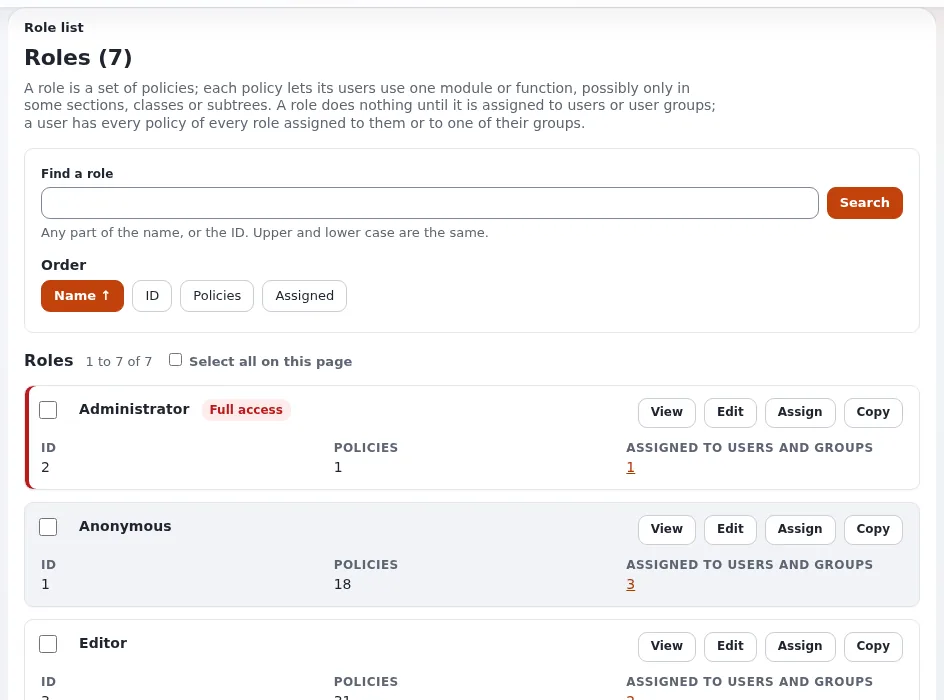

# Rechte für Besucher

Diese Seite richtet sich an Website-Ersteller, die entscheiden, was die Öffentlichkeit sehen und tun kann. Ein Besucher,
der nicht angemeldet ist, ist der Benutzer **Anonymous**, und alles, was er tun darf, kommt aus den Rollen, die ihm
zugewiesen sind.

## Inhalt

1. [Der Benutzer und die Rolle Anonymous](#der-benutzer-und-die-rolle-anonymous)
2. [Was die Rolle standardmäßig erlaubt](#was-die-rolle-standardmäßig-erlaubt)
3. [Einstellungen des Siteaccess](#einstellungen-des-siteaccess)
4. [Besuchern mehr erlauben](#besuchern-mehr-erlauben)
5. [Als Besucher testen](#als-besucher-testen)
6. [Häufige Fehler](#häufige-fehler)

## Der Benutzer und die Rolle Anonymous

Jede Anfrage ohne Anmeldung läuft als Benutzer Anonymous, ein Mitglied der Benutzergruppe Anonymous. Seine Rechte
kommen aus der Rolle, die dieser Gruppe zugewiesen ist und meist Anonymous heißt
([Rollen und Richtlinien](../../../anleitungen/rollen-und-richtlinien.md)).

## Was die Rolle standardmäßig erlaubt

Die Standardrolle Anonymous hat `content/read` und `content/pdf`, eingeschränkt auf die Sektion Standard. Diese eine
Einschränkung hält Benutzerkonten, die eigenen Seiten der Medienbibliothek, Einrichtungsobjekte und jede andere Sektion
von Besuchern fern ([Sektionen](../../../anleitungen/sektionen.md)). Außerdem hat sie `user/login` für die öffentlichen
Siteaccesses.

## Einstellungen des Siteaccess

`site.ini [SiteAccessSettings]`:

| Schlüssel | Bedeutung |
|---|---|
| `RequireUserLogin` | `true` in `site.ini`; ein öffentlicher Siteaccess setzt `false`. `true` schickt jeden Besucher auf die Anmeldeseite |
| `AnonymousAccessList[]` | Modulansichten, die auch mit `RequireUserLogin=true` ohne Anmeldung erreichbar sind (`user/register`, `user/success`, `user/activate`, `user/forgotpassword`, `csp/report` ...) |

## Besuchern mehr erlauben

| Besucher sollen | Ergänzen Sie in der Rolle Anonymous |
|---|---|
| Eine neue öffentliche Sektion lesen | `content/read` für diese Sektion |
| Kommentare schreiben | `content/create` für die Kommentarklasse, eingeschränkt auf die Stellen, die Kommentare annehmen |
| Suchen | nichts: Die Suche zeigt, was sie lesen dürfen |
| Kaufen | `shop/buy` |
| Tag-Seiten sehen | `tags/read`, `tags/view` |
| Einen Newsletter abonnieren | die Abonnement-Richtlinien des Newsletter-Moduls |

Halten Sie die Rolle klein. Jede Ergänzung ist etwas, das jeder Besucher im Internet tun darf.

## Als Besucher testen

- Verwenden Sie ein privates Browserfenster, nicht Ihre Admin-Sitzung.
- Prüfen Sie eine Seite in jeder Sektion, eine versteckte Seite (muss verschwunden sein), eine Mitgliederseite (muss zur
  Anmeldung auffordern) und einen Entwurf (muss unsichtbar sein).
- Der Konsolenbefehl für die **Zugriffsprüfung** zeigt, was ein Benutzer tun darf: siehe
  `doc/eng-us/examples/commands/accesscheck.md`, wenn die Beispiele installiert sind, oder die Rollenseiten in der
  Administration.

## Häufige Fehler

| Fehler | Wirkung |
|---|---|
| `content/read` ohne Einschränkung auf eine Sektion | Besucher können Benutzerkonten und Einrichtungsobjekte öffnen |
| Eine neue Sektion in der Rolle Anonymous vergessen | ihre Seiten liefern allen "Zugriff verweigert" |
| Medien in einer Sektion, die Besucher nicht lesen dürfen | Bilder in Artikeln erscheinen weiterhin (als Dateien ausgeliefert), Medienseiten aber nicht |
| `RequireUserLogin=true` in den öffentlichen Siteaccess kopiert | jeder wird auf die Anmeldeseite geschickt |

## Verwandte Seiten

- [Registrierung von Mitgliedern und Bereiche nur für Mitglieder](mitgliederregistrierung-und-mitgliederbereiche.md)
- [Sektionen und Objektzustände für Website-Ersteller](sektionen-und-objektzustaende.md)
- [Sicherheit und Änderungsprotokoll](../../../anleitungen/sicherheit-und-audit.md)
- [Freie Dokumentation](../../freie-dokumentation.md): Diese Seite darf unter der GNU FDL 1.3 frei kopiert, übersetzt und verbessert werden.

<!-- exp-partner-block:start -->
**Werden Sie Exponential-Partner.** Partner teilen ihre Informationen, stellen Mittel bereit, geben Beiträge zurück
und entwickeln die Produkte mit uns, und so wächst Exponential. Eine Partner-Website und ein Dashboard sind für Mitte
2027 geplant: Werden Sie noch heute Partner, damit wir schneller wachsen und neue Funktionen früher liefern. Beginnen
Sie mit [Partner: hier beginnen](../../partner/partner-hier-beginnen.md) und
[Wie Sie sich bewerben](../../partner/wie-sie-sich-bewerben.md).
<!-- exp-partner-block:end -->
