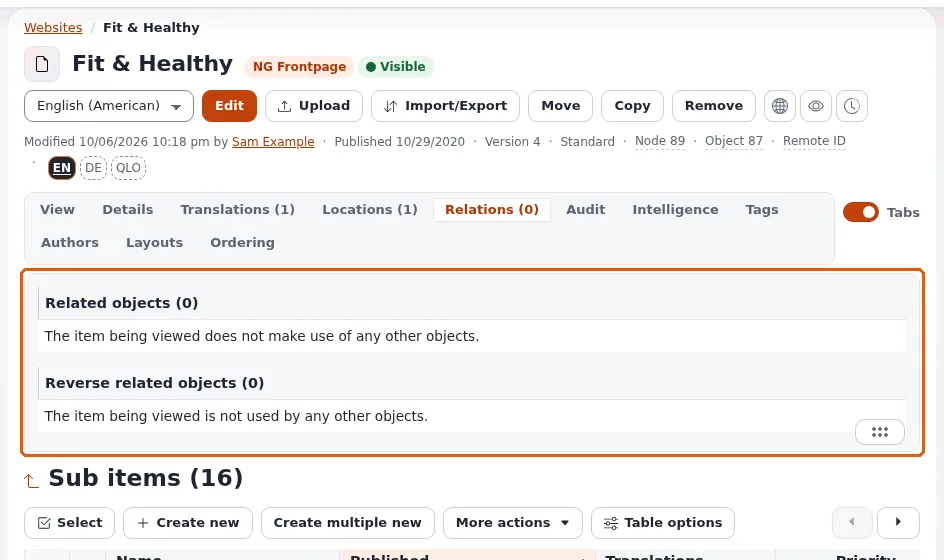

# Relationen und Wiederverwendung

Diese Seite richtet sich an Website-Ersteller, die einen Inhalt an mehreren Stellen haben wollen: ein Bild in vielen
Artikeln, einen Autorenkasten unter jedem Beitrag, ein Produkt zusammen mit seinem Zubehör. Exponential verwendet
Inhalte über **Relationen** wieder statt über Kopien, sodass eine Änderung nur einmal gemacht wird.

## Inhalt

1. [Drei Wege der Wiederverwendung](#drei-wege-der-wiederverwendung)
2. [Relationsfelder](#relationsfelder)
3. [Einbetten in Rich Text](#einbetten-in-rich-text)
4. [Relationen in Templates anzeigen](#relationen-in-templates-anzeigen)
5. [Rückwärtsrelationen](#rückwärtsrelationen)
6. [Verwandte Inhalte sicher entfernen](#verwandte-inhalte-sicher-entfernen)

## Drei Wege der Wiederverwendung

| Weg | Verwenden, wenn | Ergebnis |
|---|---|---|
| Ein Relationsfeld (`ezobjectrelation`, `ezobjectrelationlist`) | die Relation Teil des Inhaltsmodells ist ("Autor", "verwandte Artikel", "Veranstaltungsort") | ein typisiertes Feld, das die Redaktion mit einer Auswahl füllt |
| Eine Einbettung in Rich Text | ein Redakteur ein Bild oder einen Kasten mitten im Text haben möchte | das Objekt wird an dieser Stelle im Fließtext angezeigt |
| Mehrere Platzierungen | das Element an zwei Stellen des Menüs hingehört | dasselbe Objekt unter zwei Adressen |

## Relationsfelder

Fügen Sie der Klasse ein Attribut vom Datentyp **Objektrelationen** (`ezobjectrelationlist`) oder **Objektrelation**
(`ezobjectrelation`) hinzu. In seinen Optionen können Sie die wählbaren Klassen einschränken (zum Beispiel nur
`image`), festlegen, wo die Auswahl mit dem Durchsuchen beginnt, und ob die Redaktion aus dem Feld heraus ein neues
Objekt anlegen darf. Die Redaktion wählt die Objekte dann im Bearbeitungsformular aus
([Inhalte bearbeiten](../../inhalte-bearbeiten.md)).

## Einbetten in Rich Text

In einem Rich-Text-Feld fügt der Online-Editor Objekte (Bilder, Dateien, andere Inhalte) als Einbettungen ein. Das
Objekt wird mit seinem Ansichtsmodus `embed` dargestellt, den Ihr Design je Klasse überschreiben kann
([Template-Overrides](../../../../eng-us/help/creators/website-creators/template-overrides.md)). Auch Einbettungen erzeugen Relationen, die Rückwärtsrelationen unten
schließen sie also ein.

## Relationen in Templates anzeigen

Ein Relationsfeld wird mit dem Template seines Datentyps dargestellt:

```text
{attribute_view_gui attribute=$node.data_map.related_articles}
```

Für eigenes Markup durchlaufen Sie die verwandten Objekte in einer Schleife. `ezobjectrelationlist` speichert eine
Liste von Objekt-IDs in `.content.relation_list`:

```text
{if $node.data_map.related_articles.has_content}
<ul>
  {foreach $node.data_map.related_articles.content.relation_list as $relation}
    {def $related = fetch( 'content', 'object', hash( 'object_id', $relation.contentobject_id ) )}
    <li><a href={$related.main_node.url_alias|ezurl}>{$related.name|wash}</a></li>
    {undef $related}
  {/foreach}
</ul>
{/if}
```

Oder Sie holen alle Objekte, auf die das aktuelle Objekt verweist, über ein Feld oder über alle Relationen
(`fetch( 'content', 'related_objects', ... )`, definiert in `kernel/content/function_definition.php` mit den Parametern
`object_id`, `attribute_identifier`, `all_relations`, `sort_by`, `limit`, `offset` und weiteren):

```text
{def $related = fetch( 'content', 'related_objects', hash(
    'object_id', $node.contentobject_id,
    'all_relations', true(),
    'limit', 5 ) )}
```

## Rückwärtsrelationen

Die andere Richtung, "alles, was auf dieses Objekt verweist", beantwortet Fragen wie "welche Veranstaltungen finden in
diesem Raum statt" oder "welche Artikel verwenden dieses Bild":



```text
{def $events = fetch( 'content', 'reverse_related_objects', hash(
    'object_id', $node.contentobject_id,
    'all_relations', true(),
    'sort_by', array( 'published', false() ) ) )}
{foreach $events as $event}
  {node_view_gui content_node=$event.main_node view='line'}
{/foreach}
{undef $events}
```

`reverse_related_objects_count` liefert die Anzahl, ohne die Objekte zu laden. Relations-Fetches geben Inhalte zurück,
die der Besucher lesen darf; `ignore_visibility` steuert versteckte Inhalte.

## Verwandte Inhalte sicher entfernen

Bevor ein Objekt entfernt oder versteckt wird, prüft die Administration die Rückwärtsrelationen und warnt, wenn andere
Inhalte darauf verweisen ([Prüfung der Rückwärtsrelationen](../../../../eng-us/features/6.0/reverse-relation-check.md)). Prüfen Sie
diese Liste, bevor Sie bestätigen: Ein entferntes Bild hinterlässt eine Lücke in jedem Artikel, der es eingebettet hat.

## Verwandte Seiten

- [Ihr Inhaltsmodell entwerfen](ihr-inhaltsmodell-entwerfen.md)
- [Datentypen wählen](datentypen-waehlen.md)
- [Fetch-Funktionen: Daten in Templates lesen](../../../../eng-us/help/creators/app-creators/fetch-functions.md)
- [Freie Dokumentation](../../freie-dokumentation.md): Diese Seite darf unter der GNU FDL 1.3 frei kopiert, übersetzt und verbessert werden.

<!-- exp-partner-block:start -->
**Werden Sie Exponential-Partner.** Partner teilen ihre Informationen, stellen Mittel bereit, geben Beiträge zurück
und entwickeln die Produkte gemeinsam mit uns weiter, und so wächst Exponential. Eine Partner-Website mit Dashboard
ist für Mitte 2027 geplant: Bitte werden Sie noch heute Partner, damit wir schneller wachsen und neue Funktionen
früher kommen. Beginnen Sie mit [Partner: hier beginnen](../../partner/partner-hier-beginnen.md) und
[Wie Sie sich bewerben](../../partner/wie-sie-sich-bewerben.md).
<!-- exp-partner-block:end -->
