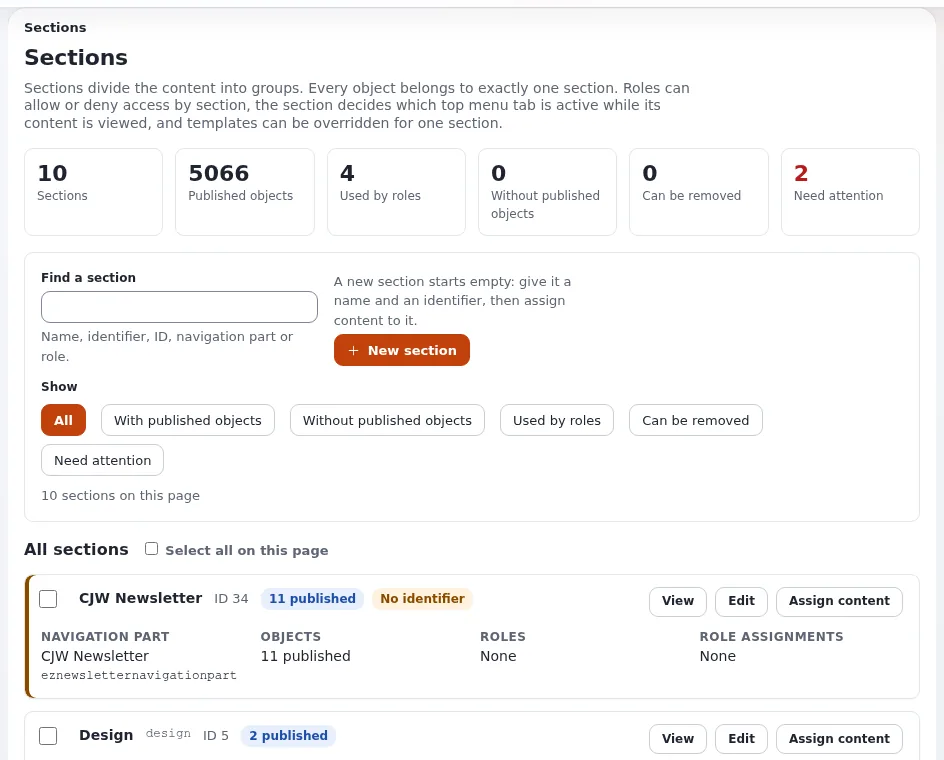

# Sektionen und Objektzustände für Website-Ersteller

Diese Seite richtet sich an Website-Ersteller, bei denen sich Teile einer Website unterschiedlich verhalten sollen: ein
Mitgliederbereich, Seiten, die warten, bevor sie öffentlich werden, Abteilungen, die nur ihre eigenen Seiten bearbeiten,
ein Prüfschritt. Exponential hat dafür zwei Werkzeuge, **Sektionen** und **Objektzustände**. Beide sind Kennzeichnungen
an Inhalten; Rollen und Richtlinien geben ihnen Bedeutung.

## Inhalt

1. [Sektionen und Zustände im Vergleich](#sektionen-und-zustände-im-vergleich)
2. [Die Sektionen einer neuen Installation](#die-sektionen-einer-neuen-installation)
3. [Rezept: ein Mitgliederbereich](#rezept-ein-mitgliederbereich)
4. [Rezept: Staging vor dem Veröffentlichen](#rezept-staging-vor-dem-veröffentlichen)
5. [Rezept: eine Prüfstufe mit Objektzuständen](#rezept-eine-prüfstufe-mit-objektzuständen)
6. [Templates je Sektion oder Zustand](#templates-je-sektion-oder-zustand)

## Sektionen und Zustände im Vergleich

| | Sektion | Objektzustand |
|---|---|---|
| Jedes Objekt hat | genau eine Sektion | einen Zustand aus jeder Zustandsgruppe |
| Verwaltet unter | **Setup > Sektionen** ([Sektionen](../../../anleitungen/sektionen.md)) | **Setup > Zustände** ([Objektzustände](../../../anleitungen/objektzustaende.md)) |
| Typische Verwendung | Bereiche der Website: Mitglieder, Intranet, Staging | Stufen: Entwurf, in Prüfung, freigegeben |
| Gesetzt durch | Zuweisen eines Teilbaums oder beim Anlegen des Objekts | den Reiter Details des Knotens, einen Teilbaum oder einen Workflow |
| Richtlinien schränken ein über | `Section` | `StateGroup_<group identifier>` |
| Override-Bedingung | `Match[section_identifier]` | `Match[state_identifier]` |


Keines von beiden ist ein Ort im Baum oder ein Siteaccess: Ein Bereich des Baums wird einer Sektion zugewiesen, und
Objekte behalten die Sektion beim Verschieben, sofern sie nicht neu zugewiesen werden.

## Die Sektionen einer neuen Installation

| ID | Name | Bezeichner | Enthält |
|---|---|---|---|
| 1 | Standard | `standard` | den Inhaltsbaum |
| 2 | Users | `users` | Benutzerkonten |
| 3 | Media | `media` | die Medienbibliothek |
| 4 | Setup | `setup` | Einrichtungsobjekte |
| 5 | Design | `design` | Designobjekte |



Die Rolle Anonymous liest nur die Sektion Standard. Diese eine Einschränkung hält alles andere von Besuchern fern
([2. Die Sektionen einer neuen Installation](../../../anleitungen/sektionen.md#2-die-sektionen-einer-neuen-installation)).

## Rezept: ein Mitgliederbereich

Nach [13.1 Ein Mitgliederbereich](../../../anleitungen/sektionen.md#131-ein-mitgliederbereich):

1. Legen Sie eine Sektion `Members area` mit dem Bezeichner `members_area` an.
2. Legen Sie einen Ordner `Members` mit seinen Seiten an.
3. Klicken Sie auf der Karte der Sektion auf **Inhalt zuweisen**, und wählen Sie den Ordner.
4. Abgemeldet ist der Ordner aus den Menüs verschwunden und liefert "Zugriff verweigert".
5. Geben Sie der Rolle der Mitglieder `content/read`, eingeschränkt auf Section( Members area ).

Besucher, die nicht angemeldet sind und eine Mitgliederseite öffnen, sehen die Anmeldeseite; nach der Anmeldung kehren
sie zur Seite zurück. Die Registrierung steht unter
[Registrierung von Mitgliedern und Bereiche nur für Mitglieder](../../../../eng-us/help/creators/website-creators/member-registration-and-areas.md).

## Rezept: Staging vor dem Veröffentlichen

Nach [13.3 Inhalte vorbereiten](../../../anleitungen/sektionen.md#133-inhalte-vorbereiten-bevor-sie-öffentlich-werden): eine Sektion
`Staging`, die Anonymous nicht lesen darf; die Redaktion baut Seiten an ihrem endgültigen Ort und weist sie Staging zu;
die Freigabe ist ein einziges **Inhalt zuweisen** an Standard.

## Rezept: eine Prüfstufe mit Objektzuständen

1. **Setup > Zustände**: Legen Sie eine Gruppe `review` mit den Zuständen Draft, In review, Approved an (der erste
   ist der Standard) ([4. Eine Gruppe und ihre Zustände anlegen](../../../anleitungen/objektzustaende.md#4-eine-gruppe-und-ihre-zustände-anlegen)).
2. Geben Sie Anonymous `content/read`, eingeschränkt auf Section( Standard ) **und** `StateGroup_review` ( Approved ).
3. Geben Sie Autoren `state/assign` mit `NewState` ( In review ); geben Sie Prüfern `state/assign` mit
   `NewState` ( Approved ).
4. Autoren veröffentlichen und setzen In review; Prüfer kontrollieren und setzen Approved; erst dann sehen Besucher
   die Seite.


Das vollständige Beispiel steht unter
[9. Ein durchgearbeitetes Beispiel: ein Prüf-Workflow](../../../anleitungen/objektzustaende.md#9-ein-durchgearbeitetes-beispiel-ein-prüf-workflow).
Für einen Freigabeschritt vor dem Veröffentlichen (nicht danach) siehe das Freigabe-Ereignis der Workflows
([Workflows](../../../anleitungen/workflows.md)).

## Templates je Sektion oder Zustand

```ini
# settings/siteaccess/<site>/override.ini.append.php
[full_members]
Source=node/view/full.tpl
MatchFile=full/members.tpl
Subdir=templates
Match[section_identifier]=members_area
```

Ein Mitglieder-Design, ein "Entwurf"-Banner auf nicht freigegebenen Seiten, ein anderes Layout für Staging: Jedes davon
ist eine einzige Regel ([Template-Overrides](../../../../eng-us/help/creators/website-creators/template-overrides.md)).

> **Tipp**
> Templates und Overrides verwenden Bezeichner. Geben Sie jeder Sektion und jeder Zustandsgruppe einen Bezeichner; die
> Sektionsliste markiert Sektionen ohne Bezeichner als behandlungsbedürftig.

## Verwandte Seiten

- [Rechte für Besucher](../../../../eng-us/help/creators/website-creators/visitor-permissions.md)
- [Rollen und Richtlinien](../../../anleitungen/rollen-und-richtlinien.md)
- [Den Inhaltsbaum strukturieren](den-inhaltsbaum-strukturieren.md)
- [Freie Dokumentation](../../freie-dokumentation.md): Diese Seite darf unter der GNU FDL 1.3 frei kopiert, übersetzt und verbessert werden.

<!-- exp-partner-block:start -->
**Werden Sie Exponential-Partner.** Partner teilen ihre Informationen, stellen Mittel bereit, geben Beiträge zurück
und entwickeln die Produkte gemeinsam mit uns weiter, und so wächst Exponential. Eine Partner-Website mit Dashboard
ist für Mitte 2027 geplant: Bitte werden Sie noch heute Partner, damit wir schneller wachsen und neue Funktionen
früher kommen. Beginnen Sie mit [Partner: hier beginnen](../../partner/partner-hier-beginnen.md) und
[Wie Sie sich bewerben](../../partner/wie-sie-sich-bewerben.md).
<!-- exp-partner-block:end -->
