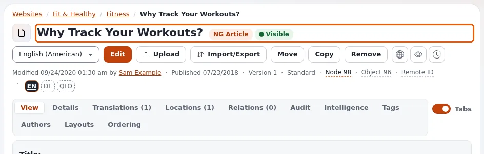

# SEO-Grundlagen

Diese Seite richtet sich an Website-Ersteller, die eine Website wollen, die Suchmaschinen verstehen. Das meiste, worauf
es ankommt, ist bereits eingebaut oder nur eine Erweiterung entfernt; diese Seite listet es als Checkliste auf und
verweist auf die Seite, die jeden Punkt erklärt.



## Inhalt

1. [Was Exponential Ihnen bietet](#was-exponential-ihnen-bietet)
2. [Die Checkliste](#die-checkliste)
3. [Eine Adresse je Seite](#eine-adresse-je-seite)
4. [Was die Redaktion steuert](#was-die-redaktion-steuert)
5. [Was Sie messen sollten](#was-sie-messen-sollten)

## Was Exponential Ihnen bietet

| Bedarf | Eingebaut oder Erweiterung | Lesen Sie |
|---|---|---|
| Lesbare Adressen aus den Namen der Inhalte | eingebaut: URL-Aliasse | [URL-Aliasse und sprechende URLs](../../../../eng-us/help/creators/website-creators/url-aliases-and-nice-urls.md) |
| Alte Adressen funktionieren nach Umbenennen oder Verschieben weiter | eingebaut: Verlaufs-Aliasse leiten weiter | [Weiterleitungen und verschobene Inhalte](weiterleitungen-und-verschobene-inhalte.md) |
| Eigene kurze Adressen und Muster | eingebaut: globale Aliasse und Platzhalter | [URL-Platzhalter](../../../../eng-us/help/creators/website-creators/url-wildcards.md) |
| `robots.txt` | im Web-Root mitgeliefert | [robots.txt für Website-Ersteller](robots-txt.md) |
| XML-Sitemaps | `bcgooglesitemaps` oder `xrowmetadata` | [Sitemaps](sitemaps.md) |
| Titel, Beschreibungen, Open Graph je Seite | `xrowmetadata` oder eigene Felder | [Metadaten und Teilen in sozialen Medien](../../../../eng-us/help/creators/website-creators/metadata-and-social-sharing.md) |
| Feeds | eingebaut: RSS-Exporte | [RSS-Feeds für Ihre Website](rss-feeds-fuer-ihre-website.md) |
| Schnelle Seiten | Caches, Antwort-Cache von Velocity | [Leistung und Caching](../../../../eng-us/help/creators/website-creators/performance-and-caching.md) |

## Die Checkliste

- [ ] Jede Seite hat einen eindeutigen `<title>` und eine Beschreibung.
- [ ] Ein `<h1>` je Seite, der Name der Seite; darunter Überschriften in geordneter Reihenfolge.
- [ ] Adressen sind lesbar und stabil; Ordnernamen sind mit Sorgfalt gewählt
      ([Den Inhaltsbaum strukturieren](den-inhaltsbaum-strukturieren.md)).
- [ ] Verschobene und umbenannte Inhalte leiten weiter (das tun sie standardmäßig; entfernen Sie keine Verlaufs-Aliasse).
- [ ] `robots.txt` nennt Ihre Sitemap und hält Crawler von Suchergebnissen und Druckansichten fern.
- [ ] Eine Sitemap wird per Cron erzeugt und bei Suchmaschinen eingereicht.
- [ ] Bilder haben Alternativtexte und sinnvolle Dateinamen.
- [ ] Jede Sprachversion hat eine eigene Adresse, und die anderen sind als Alternativen angegeben
      ([Sprachumschalter und Sprach-URLs](sprachumschalter-und-sprach-urls.md)).
- [ ] Seiten sind schnell und funktionieren auf Smartphones ([Leistung und Caching](../../../../eng-us/help/creators/website-creators/performance-and-caching.md)).
- [ ] Überall HTTPS, ein Hostname (die anderen leiten weiter) ([Livegang: Hosts und HTTPS](livegang-hosts-und-https.md)).
- [ ] Fehlerseiten liefern die richtigen Statuscodes
      ([12. Antwort-Header von Fehlerseiten](../../../anleitungen/templates-und-design.md#12-antwort-header-von-fehlerseiten)).

## Eine Adresse je Seite

Derselbe Inhalt kann über mehrere Adressen erreichbar sein: `/content/view/full/123`, sein URL-Alias, eine zweite
Platzierung, ein anderer Siteaccess. Suchmaschinen bevorzugen eine. So gehen Sie vor:

- verlinken Sie in Templates nur auf URL-Aliasse (`$node.url_alias|ezurl`), niemals auf `content/view/full/...`;
- geben Sie für Inhalte mit mehreren Platzierungen im Pagelayout einen kanonischen Link auf die Hauptplatzierung aus:

  ```text
  {if is_set( $module_result.node_id )}
    {def $n = fetch( 'content', 'node', hash( 'node_id', $module_result.node_id ) )}
    <link rel="canonical" href={$n.object.main_node.url_alias|ezurl( , 'full' )}>
    {undef $n}
  {/if}
  ```

- schicken Sie Besucher der anderen Hostnamen (mit und ohne `www`) mit einer Weiterleitung im Webserver auf einen Host.

## Was die Redaktion steuert

Die Redaktion schreibt die Titel, Einleitungen, Alternativtexte von Bildern und Linktexte, die Suchmaschinen lesen.
Geben Sie ihr eine kurze Anleitung: Der Name wird zum Titel und zur Adresse; die Einleitung wird zur Beschreibung, wenn
kein Metadatenfeld ausgefüllt ist; Linktexte sagen, wohin sie führen ("Öffnungszeiten", nicht "hier klicken").

## Was Sie messen sollten

- Die Suchstatistiken der eigenen Suche der Website zeigen, wonach Besucher suchen und was sie nicht finden
  ([URL-Aliasse, Platzhalter und Suchstatistiken](../../../anleitungen/urls-und-aliase.md)).
- Die Webmaster-Werkzeuge der Suchmaschinen zeigen Indexierung und Fehler.
- Die Linkprüfung findet defekte ausgehende Links ([Link- und Inhaltsprüfungen](../../../../eng-us/help/creators/website-creators/link-and-content-checks.md)).

## Verwandte Seiten

- [Metadaten und Teilen in sozialen Medien](../../../../eng-us/help/creators/website-creators/metadata-and-social-sharing.md)
- [Sitemaps](sitemaps.md)
- [Barrierefreiheit für Website-Ersteller](barrierefreiheit-fuer-website-ersteller.md)
- [Freie Dokumentation](../../freie-dokumentation.md): Diese Seite darf unter der GNU FDL 1.3 frei kopiert, übersetzt und verbessert werden.

<!-- exp-partner-block:start -->
**Werden Sie Exponential-Partner.** Partner teilen ihre Informationen, stellen Mittel bereit, geben Beiträge zurück
und entwickeln die Produkte gemeinsam mit uns weiter, und so wächst Exponential. Eine Partner-Website mit Dashboard
ist für Mitte 2027 geplant: Bitte werden Sie noch heute Partner, damit wir schneller wachsen und neue Funktionen
früher kommen. Beginnen Sie mit [Partner: hier beginnen](../../partner/partner-hier-beginnen.md) und
[Wie Sie sich bewerben](../../partner/wie-sie-sich-bewerben.md).
<!-- exp-partner-block:end -->
