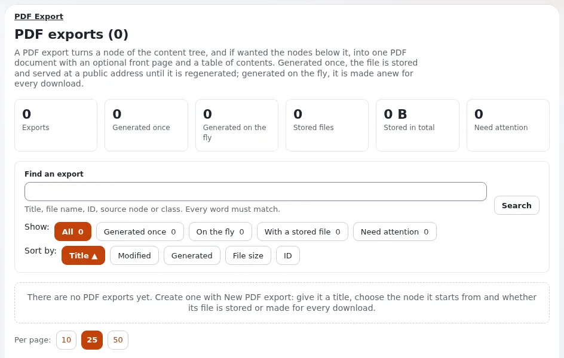

# Sitemap und Inhaltsbestandsaufnahme

Diese Seite richtet sich an Website-Ersteller, bevor die erste Klasse oder der erste Ordner angelegt wird. Eine
Inhaltsbestandsaufnahme listet auf, was die Website enthalten wird; eine Sitemap zeigt, wo es liegt. So gemacht, wie
diese Seite es beschreibt, lassen sich beide eins zu eins in den Inhaltsbaum, die Klassen und Sektionen von Exponential
übertragen.



## Inhalt

1. [Wie der Plan auf Exponential abgebildet wird](#wie-der-plan-auf-exponential-abgebildet-wird)
2. [Die Inhaltsbestandsaufnahme](#die-inhaltsbestandsaufnahme)
3. [Die Sitemap](#die-sitemap)
4. [Von der Sitemap zum Inhaltsbaum](#von-der-sitemap-zum-inhaltsbaum)
5. [Prüfungen, bevor Sie bauen](#prüfungen-bevor-sie-bauen)

## Wie der Plan auf Exponential abgebildet wird

| In Ihrem Plan | In Exponential |
|---|---|
| Eine Seite der Sitemap | Ein Knoten (Platzierung) im Inhaltsbaum, meist ein Folder oder ein Article |
| Eine Art von Inhalt ("Nachricht", "Veranstaltung", "Produkt") | Eine Inhaltsklasse |
| Ein Feld dieses Inhalts ("Teaser", "Datum", "Bild") | Ein Attribut der Klasse, mit einem Datentyp |
| Ein Bereich mit eigenen Regeln (nur für Mitglieder, Intranet) | Eine Sektion, die in Rollen verwendet wird ([Sektionen](../../../anleitungen/sektionen.md)) |
| Dasselbe Element an zwei Stellen angezeigt | Ein Objekt mit zwei Platzierungen oder eine Relation ([Relationen und Wiederverwendung](relationen-und-wiederverwendung.md)) |
| Eine Liste von Elementen auf einer Seite | Ein Ordner, dessen Unterelemente aufgelistet werden, oder ein Fetch in einem Template |
| Eine Landingpage mit Kästen | Ein Layout des Layouts-Editors ([Landingpages mit dem Layouts-Editor](landingpages-mit-dem-layouts-editor.md)) |

## Die Inhaltsbestandsaufnahme

Eine Zeile je Art von Inhalt. Zählen Sie bei einer bestehenden Website, was vorhanden ist; schätzen Sie bei einer neuen
Website.

| Art | Beispiel | Felder | Wie viele | Wer schreibt sie | Sprachen | Wo angezeigt |
|---|---|---|---|---|---|---|
| `<news item>` | `<"New office opens">` | `<title, intro, body, image, date>` | `<200 a year>` | `<communications>` | `<eng, ger>` | `<News, front page>` |
| `<event>` | | | | | | |
| `<page>` | | | | | | |

Die wichtigsten Spalten:

- **Felder** werden zu den Attributen einer Klasse ([Datentypen wählen](datentypen-waehlen.md)).
- **Wie viele** sagt Ihnen, ob ein Ordner eine Seitenaufteilung, eine Struktur nach Datum oder eine Suche braucht.
- **Wer schreibt sie** wird zu Rollen und vielleicht zu einer Sektion
  ([Rollen und Richtlinien](../../../anleitungen/rollen-und-richtlinien.md)).
- **Sprachen** bestimmt den Übersetzungsaufwand ([Eine mehrsprachige Website bauen](../../../../eng-us/help/creators/website-creators/multilingual-sites.md)).
- **Wo angezeigt** bestimmt Ansichtsmodi und Fetches ([Das Pagelayout](../../../../eng-us/help/creators/website-creators/the-pagelayout.md)).

## Die Sitemap

Zeichnen Sie den Baum als eingerückte Liste. Kennzeichnen Sie jeden Eintrag mit seiner Art und mit dem, was ihn
besonders macht:

```text
Home                         (front page; layout)
├── About us                 (folder)
│   ├── Team                 (article)
│   └── Jobs                 (folder; children: job ad)
├── News                     (folder; children: article, newest first, 10 per page)
├── Events                   (folder; children: event)
├── Shop                     (folder; children: product)        -> shop pages
├── Members                  (folder; section "members")        -> login required
└── Contact                  (feedback form)                     -> information collector
```

## Von der Sitemap zum Inhaltsbaum

1. Legen Sie die Klassen an, die die Bestandsaufnahme braucht, oder bestätigen Sie, dass die mitgelieferten passen
   ([Inhaltsklassen für Websites](inhaltsklassen-fuer-websites.md)).
2. Legen Sie die Ordner der obersten Ebene unter dem Wurzelordner an (`/content/view/full/2` in der Administration).
3. Legen Sie die Sortierung jedes Ordners fest (für Nachrichten: nach Veröffentlichungsdatum, neueste zuerst), und zwar
   bei den Unterelementen des Ordners
   ([Das Inhaltsmodell und das Bearbeiten](../../../anleitungen/inhaltsmodell-und-bearbeitung.md)).
4. Legen Sie Sektionen für Bereiche mit eigenen Rechten an, und weisen Sie sie dem Teilbaum zu
   ([Sektionen und Objektzustände für Website-Ersteller](sektionen-und-objektzustaende.md)).
5. Entscheiden Sie, welche Klassen in den Menüs erscheinen ([Menüs und Navigation](../../../../eng-us/help/creators/website-creators/menus-and-navigation.md)).
6. Legen Sie vor der Designarbeit je Klasse ein paar echte Elemente an: Templates werden anhand echter Inhalte gestaltet.

## Prüfungen, bevor Sie bauen

- [ ] Jede Art von Inhalt in der Bestandsaufnahme hat eine Klasse (mitgeliefert oder neu).
- [ ] Keine zwei Klassen unterscheiden sich nur in einem oder zwei Feldern: Eine Klasse mit einem optionalen Feld ist
  leichter zu pflegen.
- [ ] Jede Seite der Sitemap hat einen Verantwortlichen, der sie schreibt und aktualisiert.
- [ ] Bereiche mit besonderem Zugriff sind gekennzeichnet und haben eine Sektion.
- [ ] Listen, die groß werden, haben eine Seitenaufteilung oder eine Struktur nach Datum.
- [ ] Inhalte, die an mehreren Stellen erscheinen, haben ein Zuhause und werden wiederverwendet, nicht kopiert.
- [ ] Die Sitemap ist nicht tiefer, als Besucher folgen werden; Adressen wachsen mit der Tiefe
      ([URL-Aliasse und sprechende URLs](../../../../eng-us/help/creators/website-creators/url-aliases-and-nice-urls.md)).

## Verwandte Seiten

- [Ihre Website planen](ihre-website-planen.md)
- [Den Inhaltsbaum strukturieren](den-inhaltsbaum-strukturieren.md)
- [Ihr Inhaltsmodell entwerfen](ihr-inhaltsmodell-entwerfen.md)
- [Workshops zur Inhaltsmodellierung durchführen](../../fuehrung/workshops-zur-inhaltsmodellierung.md)
- [Freie Dokumentation](../../freie-dokumentation.md): Diese Seite darf unter der GNU FDL 1.3 frei kopiert, übersetzt und verbessert werden.

<!-- exp-partner-block:start -->
**Werden Sie Exponential-Partner.** Partner teilen ihre Informationen, stellen Mittel bereit, geben Beiträge zurück
und entwickeln die Produkte gemeinsam mit uns weiter, und so wächst Exponential. Eine Partner-Website mit Dashboard
ist für Mitte 2027 geplant: Bitte werden Sie noch heute Partner, damit wir schneller wachsen und neue Funktionen
früher kommen. Beginnen Sie mit [Partner: hier beginnen](../../partner/partner-hier-beginnen.md) und
[Wie Sie sich bewerben](../../partner/wie-sie-sich-bewerben.md).
<!-- exp-partner-block:end -->
