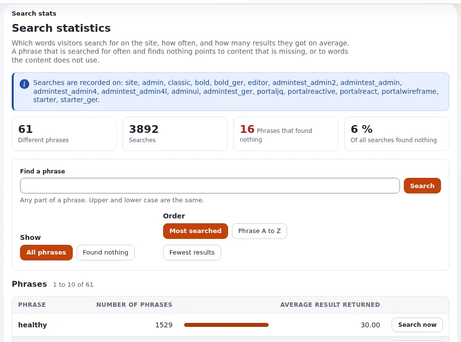
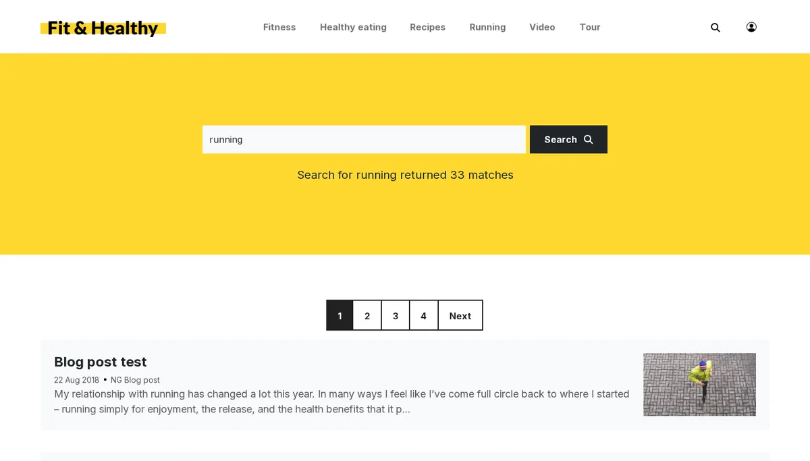

# Suche auf der Website

Diese Seite richtet sich an Website-Ersteller, die einer Website eine Suche hinzufügen. Exponential hat eine eingebaute
Suchmaschine, die ihren Index in der Datenbank hält; sie reicht für die meisten Websites. Große Websites oder Websites,
die Facetten und eine Abstimmung der Relevanz brauchen, wechseln zu Solr
([Suche mit ezfind und Solr](suche-mit-ezfind-und-solr.md)).





## Inhalt

1. [Die eingebaute Suchmaschine](#die-eingebaute-suchmaschine)
2. [Das Suchfeld](#das-suchfeld)
3. [Die Ergebnisseite](#die-ergebnisseite)
4. [Einstellungen, auf die es ankommt](#einstellungen-auf-die-es-ankommt)
5. [Indexierung](#indexierung)
6. [Suchstatistiken](#suchstatistiken)

## Die eingebaute Suchmaschine

`site.ini [SearchSettings] SearchEngine=eZSearchEngine` indexiert beim Veröffentlichen die Attribute, die in jeder
Klasse als **Durchsuchbar** markiert sind. Besucher finden nur, was sie lesen dürfen.

## Das Suchfeld

Ein Formular, das `SearchText` an `content/search` sendet:

```text
<form role="search" method="get" action={'content/search'|ezurl}>
  <label for="site-search">{'Search'|i18n( 'design/mysite' )}</label>
  <input type="search" id="site-search" name="SearchText">
  <button type="submit">{'Search'|i18n( 'design/mysite' )}</button>
</form>
```

`content/advancedsearch` bietet weitere Felder (Phrase, Klasse, Datum). Beide sind in der mitgelieferten `robots.txt`
für Crawler gesperrt.

## Die Ergebnisseite

Überschreiben Sie `content/search.tpl` in Ihrem Design. Das Template erhält die Ergebnisse und den Suchtext; zeigen Sie
jeden Treffer mit seiner Zeilenansicht, die Anzahl der Ergebnisse und eine Seitenaufteilung. Sagen Sie dem Besucher,
wenn nichts gefunden wurde und was er stattdessen versuchen kann.

## Einstellungen, auf die es ankommt

`site.ini [SearchSettings]`:

| Schlüssel | Ausgeliefert | Bedeutung |
|---|---|---|
| `MaximumSearchLimit` | `30` | die meisten Ergebnisse, die eine Seite anfordern darf |
| `MaximumSearchTextWords`, `MaximumSearchTextLength` | `16`, `1024` | längere Suchtexte werden abgeschnitten |
| `AllowEmptySearch` | `disabled` | eine leere Suche wird abgelehnt (aufwendig) |
| `EnableWildcard`, `MinCharacterWildcard` | `false`, `3` | Suchen nach `term*`; aufwendig auf großen Websites |
| `StopWordThresholdPercent` | `60` | Wörter, die in mehr als diesem Anteil der Objekte vorkommen, werden ignoriert |
| `DelayedIndexing` | `disabled` | `enabled` oder `classbased`: per Cron statt beim Veröffentlichen indexieren |
| `LogSearchStats` | `disabled` | Suchbegriffe aufzeichnen |

Markieren Sie nur nützliche Attribute als **Durchsuchbar**: Titel, Einleitungen, Fließtexte; keine internen Codes.

## Indexierung

- Inhalte werden beim Veröffentlichen indexiert oder, bei verzögerter Indexierung, durch den Standard-Cronjob-Teil
  (`indexcontent.php`) ([10.8 Suche](../../../installation/10-nach-der-installation.md#108-suchindex-und-bildverarbeitung)).
- Bauen Sie den gesamten Index nach einem Import oder einem Datenbankumzug neu auf:

  ```bash
  php bin/php/updatesearchindex.php --clean --allow-root-user
  ```

## Suchstatistiken

Mit `LogSearchStats=enabled` im öffentlichen Siteaccess zeigt **Setup > Suchstatistiken** (`/search/stats`) jeden
Suchbegriff, wie oft danach gesucht wurde und die durchschnittliche Zahl der Ergebnisse; Begriffe, die nichts gefunden
haben, zeigen, welche Inhalte fehlen ([5. Suchstatistiken](../../../anleitungen/urls-und-aliase.md#5-suchstatistiken)).
Suchbegriffe können personenbezogene Daten sein, deshalb ist die Funktion standardmäßig ausgeschaltet.

## Verwandte Seiten

- [Suche mit ezfind und Solr](suche-mit-ezfind-und-solr.md)
- [Suchen (für die Redaktion)](../../suchen.md)
- [Verschlagworten mit eztags](verschlagworten-mit-eztags.md)
- [Freie Dokumentation](../../freie-dokumentation.md): Diese Seite darf unter der GNU FDL 1.3 frei kopiert, übersetzt und verbessert werden.

<!-- exp-partner-block:start -->
**Werden Sie Exponential-Partner.** Partner teilen ihre Informationen, stellen Mittel bereit, geben Beiträge zurück
und entwickeln die Produkte mit uns, und so wächst Exponential. Eine Partner-Website und ein Dashboard sind für Mitte
2027 geplant: Werden Sie noch heute Partner, damit wir schneller wachsen und neue Funktionen früher liefern. Beginnen
Sie mit [Partner: hier beginnen](../../partner/partner-hier-beginnen.md) und
[Wie Sie sich bewerben](../../partner/wie-sie-sich-bewerben.md).
<!-- exp-partner-block:end -->
