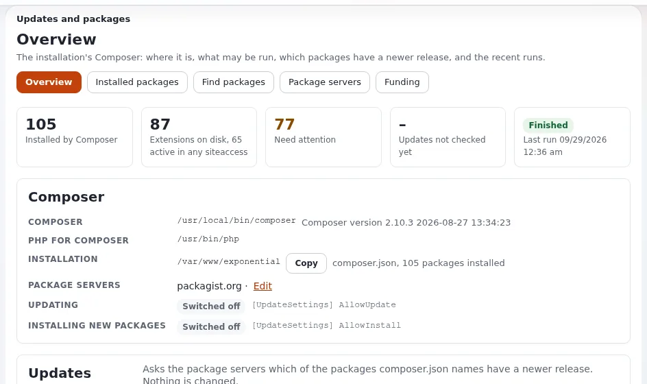
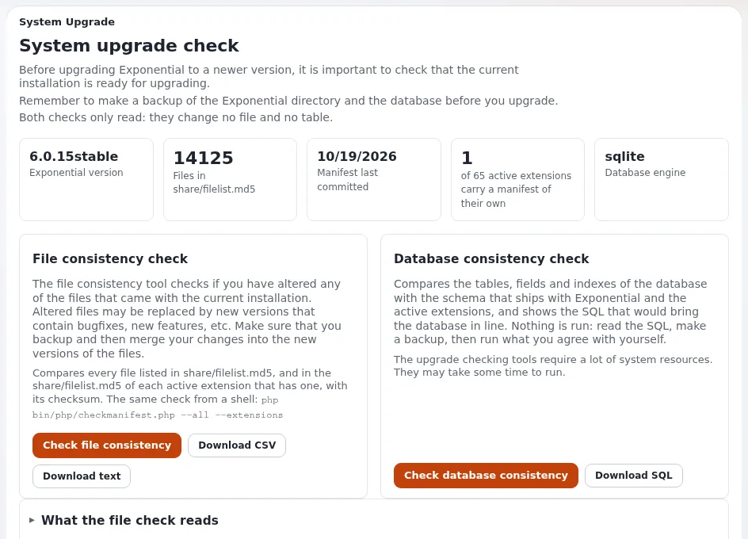

# Updates und Aktualisierungen

Diese Seite richtet sich an Website-Ersteller, die eine Website aktuell halten. Updates bringen Sicherheitskorrekturen
und Funktionen; wer sie regelmäßig einspielt, hält jedes einzelne klein. Das vollständige Verfahren steht unter
[Upgrade](../../../installation/11-aktualisieren.md) und [Upgrade (Leitfaden)](../../../anleitungen/aktualisieren.md).

## Inhalt

1. [Was aktualisiert wird](#was-aktualisiert-wird)
2. [Bevor Sie aktualisieren](#bevor-sie-aktualisieren)
3. [Das Update, Schritt für Schritt](#das-update-schritt-für-schritt)
4. [Nach dem Update](#nach-dem-update)
5. [PHP-Versionen](#php-versionen)

## Was aktualisiert wird

| Teil | Wie |
|---|---|
| Der Kernel (Exponential 6.0.x) | Git oder Composer, dann die Dateien für das Datenbank-Update |
| Erweiterungen | Composer-Pakete, jedes mit eigener Version ([Erweiterungen](../../../anleitungen/extensions.md)) |
| Velocity | das Engine-Paket, dann `exp:velocity restart` |
| PHP | das Betriebssystem |

Veröffentlichte Versionen sind dauerhaft: Eine Korrektur kommt als nächste Version, nie als geänderte alte.

## Bevor Sie aktualisieren

- [ ] Lesen Sie das Changelog jeder Version, die Sie überspringen (`doc/changelogs/6.0/`), und die Hinweise zu
  Verhaltensänderungen (`doc/eng-us/bc/6.0/`).
- [ ] Notieren Sie Ihre eigenen Erweiterungen und Template-Overrides, die geänderte Bereiche berühren.
- [ ] Erstellen Sie ein Backup ([Backups und Wiederherstellungen](backups-und-wiederherstellungen.md)).
- [ ] Probieren Sie das Update zuerst auf einer Kopie (Staging) aus.

## Das Update, Schritt für Schritt

Nach [11.6 Von jeder 6.0.x bis heute](../../../installation/11-aktualisieren.md#116-von-einer-beliebigen-60x-auf-den-heutigen-stand):

1. Spielen Sie den neuen Code ein (Git Pull oder Composer-Update des Root-Pakets, zuerst in einer Staging-Kopie).
2. Wenden Sie das Datenbank-Update für Ihre Engine an.
3. Lesen Sie die Checkliste jedes Zeitraums, den Sie überspringen.
4. Prüfen Sie Ihre eigenen Erweiterungen.
5. Erzeugen Sie die Autoloads neu, leeren Sie die Caches, laden Sie PHP neu und starten Sie Velocity neu
   (`exp:velocity deploy --kernel` erledigt das in der richtigen Reihenfolge).
6. Überprüfen Sie das Ergebnis ([11.7](../../../installation/11-aktualisieren.md#117-das-upgrade-überprüfen)).

Verwenden Sie für den Datenbankschritt den Wartungsmodus ([Wartungsmodus](wartungsmodus.md)).

## Nach dem Update

- **Setup > Upgrade-Prüfung**: Prüfungen der Dateikonsistenz und der Datenbank
  ([Upgrade-Prüfung](../../../anleitungen/upgrade-pruefung.md)).
- Klicken Sie sich durch jeden Seitentyp und jedes Formular; führen Sie Ihre Barrierefreiheits- und Benchmark-Prüfungen
  aus.
- Beobachten Sie einen Tag lang das Fehlerlog.

## PHP-Versionen

Exponential 6.0.15 läuft auf PHP 8.0 bis 8.5, ebenso Velocity ab seinem Release 0.0.4.54. Verwenden Sie die neueste
PHP-Version, die Ihr System anbietet; ältere Versionen verlieren zuerst die Sicherheitsunterstützung
([2.2 PHP](../../../installation/02-voraussetzungen.md#22-php)). Testen Sie ein PHP-Upgrade wie jedes andere Update auf
Staging.

## Verwandte Seiten

- [Release- und Upgrade-Planung](../../fuehrung/release-und-upgrade-planung.md)
- [Ihre Website pflegen](ihre-website-pflegen.md)
- [Versionen und Releases](../anwendungsentwickler/versionen-und-releases.md)
- [Freie Dokumentation](../../freie-dokumentation.md): Diese Seite darf unter der GNU FDL 1.3 frei kopiert, übersetzt und verbessert werden.

<!-- exp-partner-block:start -->
**Werden Sie Exponential-Partner.** Partner teilen ihre Informationen, stellen Mittel bereit, geben Beiträge zurück
und entwickeln die Produkte gemeinsam mit uns weiter, und so wächst Exponential. Eine Partner-Website mit Dashboard
ist für Mitte 2027 geplant: Bitte werden Sie noch heute Partner, damit wir schneller wachsen und neue Funktionen
früher kommen. Beginnen Sie mit [Partner: hier beginnen](../../partner/partner-hier-beginnen.md) und
[Wie Sie sich bewerben](../../partner/wie-sie-sich-bewerben.md).
<!-- exp-partner-block:end -->
