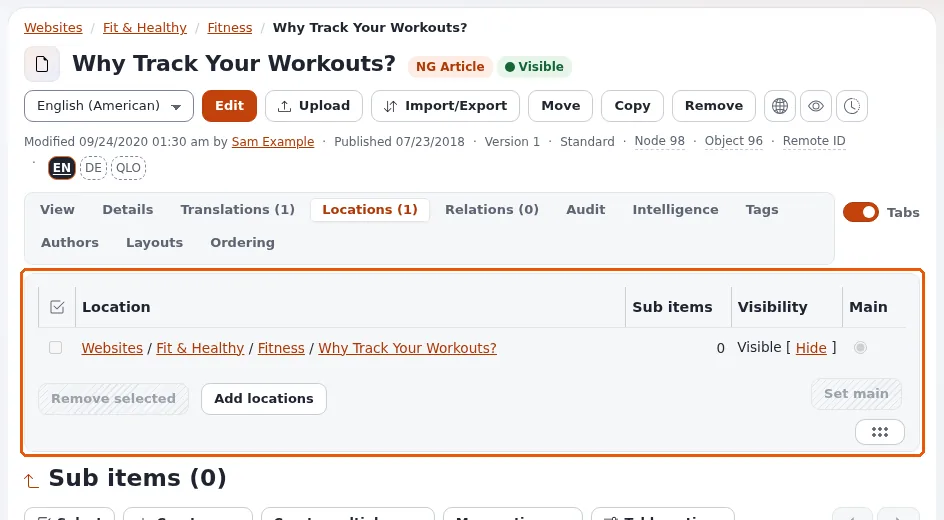
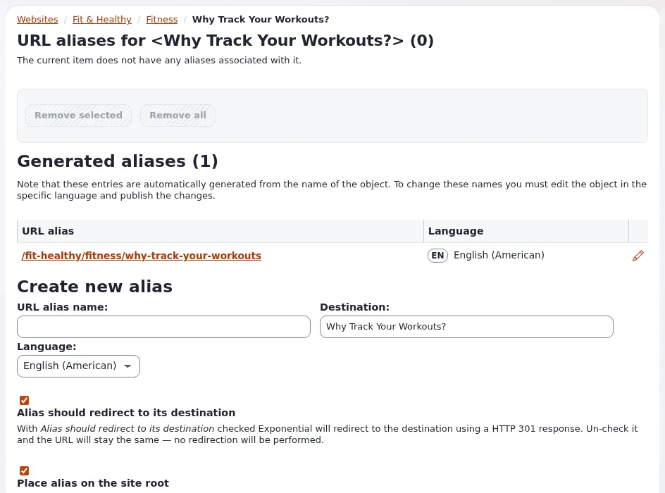

# URL-Aliasse und sprechende URLs

Diese Seite richtet sich an Website-Ersteller, denen das Aussehen der Adressen wichtig ist. Jeder Knoten erhält einen
**URL-Alias** aus den Namen seines Pfads: Der Artikel "Opening hours" im Ordner "About us" liegt unter
`/About-us/Opening-hours`. Die interne Adresse `/content/view/full/<node>` funktioniert weiterhin, sollte aber nie in
Links erscheinen.

## Inhalt

1. [Wie Aliasse entstehen](#wie-aliasse-entstehen)
2. [Die Einstellungen](#die-einstellungen)
3. [Eigene Aliasse für einen Knoten](#eigene-aliasse-für-einen-knoten)
4. [In Templates verlinken](#in-templates-verlinken)
5. [Aliasse neu aufbauen](#aliasse-neu-aufbauen)
6. [Checkliste](#checkliste)

## Wie Aliasse entstehen

- Aus dem Namen des Objekts oder aus dem **Namensmuster für den URL-Alias** der Klasse, wenn sie eines hat
  ([Inhaltsklassen für Websites](inhaltsklassen-fuer-websites.md)).
- Zeichen werden von der Transformationsgruppe umgewandelt; Wörter werden durch den Worttrenner verbunden.
- Jede Übersetzung hat ihren eigenen Alias in ihrer Sprache.
- Wenn ein Knoten umbenannt oder verschoben wird, entsteht der neue Alias, und der alte bleibt als Weiterleitung darauf
  erhalten ([Weiterleitungen und verschobene Inhalte](weiterleitungen-und-verschobene-inhalte.md)).

## Die Einstellungen

`site.ini [URLTranslator]`:

| Schlüssel | Ausgeliefert | Bedeutung |
|---|---|---|
| `Translation` | `enabled` | Adressen werden über Aliasse aufgelöst |
| `WordSeparator` | `dash` | `dash`, `underscore` oder `space` |
| `TransformationGroup` | `urlalias` | `urlalias` (ASCII), `urlalias_iri` (behält Akzente und andere Buchstaben), `urlalias_compat` (alter Stil) |
| `ScriptFallbackTransformationGroup` | `urlalias_iri` | für einen Titel, dem die Transformation keinen Buchstaben lässt (Arabisch, Chinesisch, Thai und andere Schriften ohne Transliterationstabelle unter `urlalias`); leer schaltet sie ab ([10. Titel in Schriften ohne Transliterationstabelle](../../../anleitungen/urls-und-aliase.md#10-titel-in-schriften-ohne-transliterationstabelle)) |
| `UrlAliasNameLimit` | `255` | die Begrenzung je Pfadelement; `0` schaltet sie ab |
| `LoadOnPartialAliasPath` | `/` | was ein unvollständiger Alias-Pfad lädt |
| `DecodeOnce`, `TrailingCleanup` | `disabled` | zwei optionale Bereinigungen von Adressen ([8. Adressen dekodieren und bereinigen](../../../anleitungen/urls-und-aliase.md#8-adressen-dekodieren-und-bereinigen-zwei-optionale-einstellungen)) |

Entscheiden Sie `TransformationGroup` vor dem Start: Für eine Website auf Deutsch oder Französisch hält `urlalias_iri`
`Über-uns` lesbar; `urlalias` macht daraus `Uber-uns`. Eine spätere Änderung wirkt sich auf Objekte erst aus, wenn sie
erneut veröffentlicht oder die Aliasse neu aufgebaut werden.

## Eigene Aliasse für einen Knoten

Der Reiter **URL-Aliase** des Knotens fügt dem Knoten weitere Aliasse hinzu (eine kurze Kampagnenadresse, eine alte
Adresse einer früheren Website). Globale Aliasse für Modulansichten und Platzhalter für Muster liegen unter
**Setup > URL-Übersetzer** und **Setup > URL-Platzhalter** ([URL-Platzhalter](url-platzhalter.md)).





## In Templates verlinken

```text
<a href={$node.url_alias|ezurl}>{$node.name|wash}</a>
```

`ezurl` ergänzt den Siteaccess-Pfad, wenn der Siteaccess Teil der Adresse ist, und maskiert das Ergebnis; es wird in
einem Attribut ohne Anführungszeichen geschrieben. `|ezurl( , 'full' )` liefert die vollständige Adresse mit Host, für
Mails und Feeds. In PHP liefert `eZURI::build()` dasselbe
([Für Entwickler](../../../anleitungen/urls-und-aliase.md#für-entwickler)).

## Aliasse neu aufbauen

Bauen Sie nach einem Import, einer Änderung von `TransformationGroup` oder einer Reparatur jeden Alias neu auf:

```bash
php bin/php/updateniceurls.php --allow-root-user
```

Auf großen Websites dauert das eine Weile; führen Sie es außerhalb der Stoßzeiten und mit einem Backup aus. Leeren Sie
danach den Cache `urlalias`.

## Checkliste

- [ ] Die Transformationsgruppe ist für die Sprachen der Website gewählt.
- [ ] Namen von Ordnern und Artikeln ergeben gute Adressen (kurz, keine Daten, sofern nicht gewünscht).
- [ ] Templates verlinken mit `url_alias|ezurl`, niemals mit `content/view/full/...`.
- [ ] Kampagnenadressen sind als Aliasse angelegt, nicht als neue Seiten.

## Verwandte Seiten

- [Weiterleitungen und verschobene Inhalte](weiterleitungen-und-verschobene-inhalte.md)
- [Links, URL-Aliasse, Platzhalter und Suchstatistiken](../../../anleitungen/urls-und-aliase.md)
- [SEO-Grundlagen](seo-grundlagen.md)
- [Freie Dokumentation](../../freie-dokumentation.md): Diese Seite darf unter der GNU FDL 1.3 frei kopiert, übersetzt und verbessert werden.

<!-- exp-partner-block:start -->
**Werden Sie Exponential-Partner.** Partner teilen ihre Informationen, stellen Mittel bereit, geben Beiträge zurück
und entwickeln die Produkte mit uns, und so wächst Exponential. Eine Partner-Website und ein Dashboard sind für Mitte
2027 geplant: Werden Sie noch heute Partner, damit wir schneller wachsen und neue Funktionen früher liefern. Beginnen
Sie mit [Partner: hier beginnen](../../partner/partner-hier-beginnen.md) und
[Wie Sie sich bewerben](../../partner/wie-sie-sich-bewerben.md).
<!-- exp-partner-block:end -->
