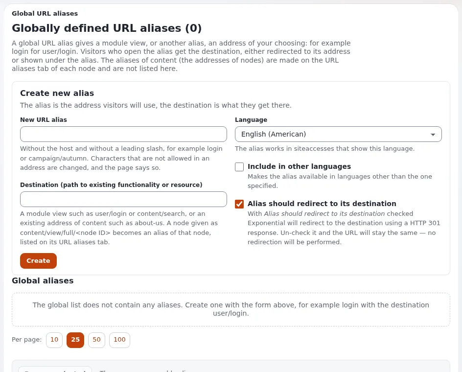
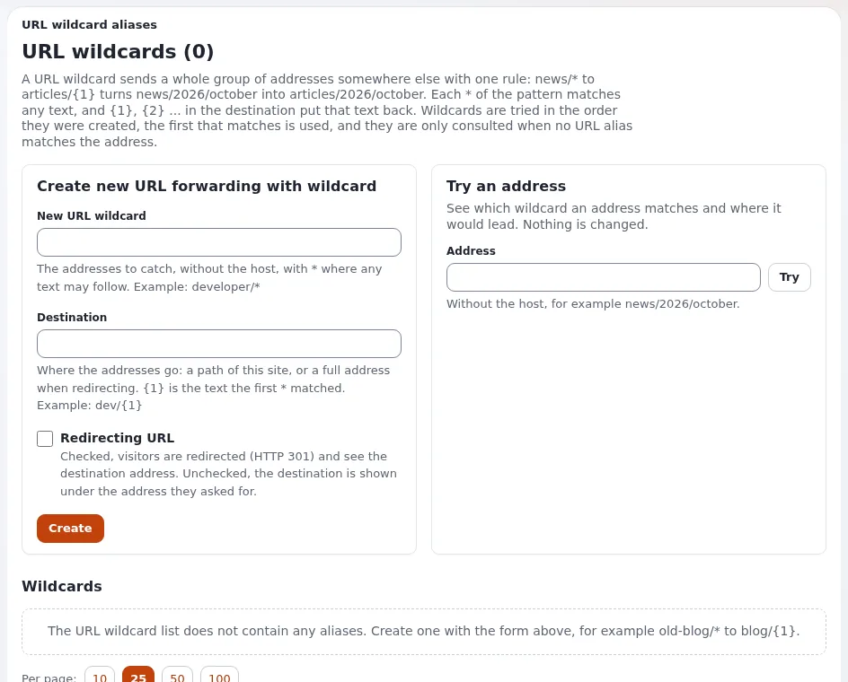

# URL-Platzhalter

Diese Seite richtet sich an Website-Ersteller, die Adressen brauchen, die der Inhaltsbaum nicht von selbst erzeugt:
kurze Kampagnenadressen, freundliche Adressen für Modulseiten (`/login`) und Muster, die eine ganze Familie alter
Adressen auf neue schicken. Nachschlagewerk:
[Links, URL-Aliasse, Platzhalter und Suchstatistiken](../../../anleitungen/urls-und-aliase.md).

## Inhalt

1. [Drei Arten von Adressen](#drei-arten-von-adressen)
2. [Globale URL-Aliasse](#globale-url-aliasse)
3. [URL-Platzhalter](#url-platzhalter-1)
4. [Weiterleitung oder direkt](#weiterleitung-oder-direkt)
5. [Reihenfolge der Auflösung](#reihenfolge-der-auflösung)
6. [Beispiele](#beispiele)

## Drei Arten von Adressen

| Art | Wo angelegt | Beispiel |
|---|---|---|
| Knoten-Alias | automatisch und im Reiter URL-Aliase des Knotens | `/About-us` |
| Globaler Alias | **Setup > URL-Übersetzer** (`/content/urltranslator`) | `login` für `user/login` |
| Platzhalter | **Setup > URL-Platzhalter** (`/content/urlwildcards`) | `news/*` auf `articles/{1}` |

## Globale URL-Aliasse

Felder: **Neuer URL-Alias** (ohne Host und führenden Schrägstrich), **Ziel** (eine Modulansicht wie `user/login` oder
eine bestehende Adresse), **Sprache**, **In andere Sprachen übernehmen** und **Alias soll auf sein Ziel weiterleiten**.
Ein Alias auf `content/view/full/<node>` wird zu einem Alias dieses Knotens und erscheint stattdessen im Reiter des
Knotens. Die Liste markiert Aliasse, deren Modul nicht mehr existiert.

## URL-Platzhalter

Jeder `*` im Muster passt auf beliebigen Text; `{1}`, `{2}` im Ziel setzen ihn wieder ein. Die Seite lehnt ein Ziel ab,
das einen Platzhalter verwendet, für den das Muster keinen `*` hat. **Eine Adresse ausprobieren** zeigt, auf welchen
Platzhalter eine Adresse passt, was daraus wird und ob Besucher weitergeleitet werden, ohne etwas zu ändern.

| Muster | Ziel | `news/2026/october` wird zu |
|---|---|---|
| `news/*` | `articles/{1}` | `articles/2026/october` |
| `news/*/*` | `archive/{2}/{1}` | `archive/october/2026` |
| `old-blog/*` | `https://blog.example.org/{1}` | eine Weiterleitung auf die andere Website |

## Weiterleitung oder direkt

| | Weiterleitung (301) | Direkt |
|---|---|---|
| Besucher sieht | die Adresse des Ziels | die Adresse, die er eingegeben hat |
| Suchmaschinen | indexieren das Ziel | indexieren möglicherweise beide |
| Verwenden für | alte Adressen, kurze Kampagnenadressen | freundliche Adressen für Modulansichten |

Bevorzugen Sie die Weiterleitung: Eine Adresse je Seite ist für Suchmaschinen besser.

## Reihenfolge der Auflösung

1. Zuerst URL-Aliasse (Knoten und global).
2. Platzhalter nur, wenn kein Alias passt, in der Reihenfolge ihrer Anlage; der erste Treffer gewinnt.
3. Andernfalls die Modulansicht selbst (`/content/view/...`), sonst "nicht gefunden".

Ein Platzhalter, der "nichts tut", wird meist von einem Alias oder einem älteren Platzhalter verdeckt.

## Beispiele

- Printkampagne: `autumn` leitet auf `/Campaigns/Autumn-2026` weiter.
- Anmeldung: `login` auf `user/login`, direkt.
- Alte Website: `products/*.html` lässt sich nicht wörtlich ausdrücken; `products/*` auf `Products/{1}`, wobei die alten
  `.html`-Adressen an den abweichenden Knoten als Aliasse behandelt werden.

## Verwandte Seiten

- [Weiterleitungen und verschobene Inhalte](weiterleitungen-und-verschobene-inhalte.md)
- [URL-Aliasse und sprechende URLs](url-aliasse-und-sprechende-urls.md)
- [Einstellungsseite](../../../anleitungen/einstellungsseite.md)
- [Freie Dokumentation](../../freie-dokumentation.md): Diese Seite darf unter der GNU FDL 1.3 frei kopiert, übersetzt und verbessert werden.

<!-- exp-partner-block:start -->
**Werden Sie Exponential-Partner.** Partner teilen ihre Informationen, stellen Mittel bereit, geben Beiträge zurück
und entwickeln die Produkte mit uns, und so wächst Exponential. Eine Partner-Website und ein Dashboard sind für Mitte
2027 geplant: Werden Sie noch heute Partner, damit wir schneller wachsen und neue Funktionen früher liefern. Beginnen
Sie mit [Partner: hier beginnen](../../partner/partner-hier-beginnen.md) und
[Wie Sie sich bewerben](../../partner/wie-sie-sich-bewerben.md).
<!-- exp-partner-block:end -->
