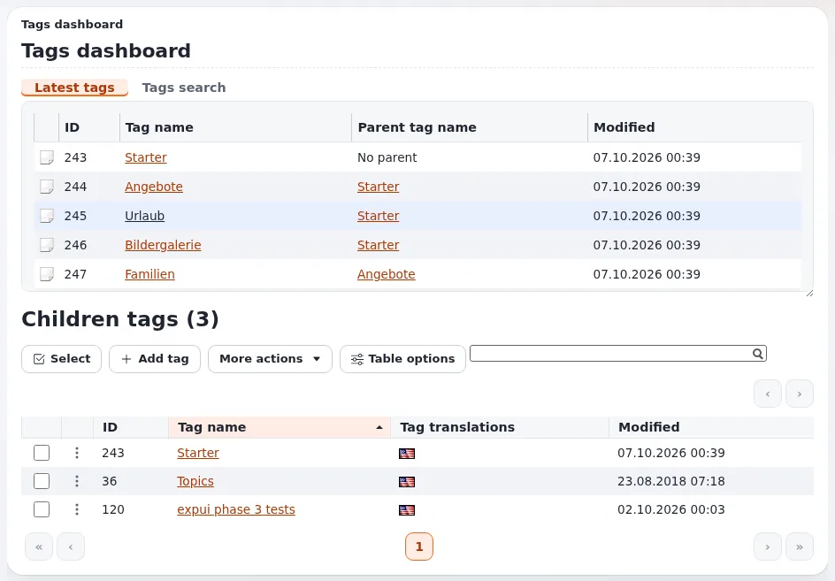

# Verschlagworten mit eztags

Diese Seite richtet sich an Website-Ersteller, die Besucher Inhalte nach Themen finden lassen wollen. Die Erweiterung
`eztags` (in der Administration als **Tags** angezeigt) fügt einen Tag-Baum hinzu, den Sie verwalten, ein Tag-Feld für
Klassen mit Autovervollständigung und eine Seite je Tag, die alles auflistet, was damit verschlagwortet ist. Sie leistet
mehr als der Datentyp `ezkeyword` des Kernels: eine Hierarchie, Synonyme sowie geschlossene oder offene Vokabulare
([eztags](../../../../eng-us/features/6.0/extensions/eztags.md)).

## Inhalt

1. [Wann Sie Tags verwenden](#wann-sie-tags-verwenden)
2. [Einrichten](#einrichten)
3. [Tags auf einer Website anzeigen](#tags-auf-einer-website-anzeigen)
4. [Einstellungen, auf die es ankommt](#einstellungen-auf-die-es-ankommt)
5. [Rechte](#rechte)
6. [Gute Praxis beim Verschlagworten](#gute-praxis-beim-verschlagworten)

## Wann Sie Tags verwenden

| Bedarf | Verwenden Sie |
|---|---|
| Themen, die quer zur Ordnerstruktur liegen | Tags |
| Eine feste Liste von Kategorien, aus der die Redaktion wählen muss | Tags mit einem geschlossenen (vordefinierten) Vokabular |
| Freie Schlagwörter, die jeder hinzufügen darf | Tags mit einem offenen Vokabular oder `ezkeyword` |
| Ein einziger Platz für ein Element im Menü | den Inhaltsbaum, keine Tags |

## Einrichten

1. Stellen Sie sicher, dass `eztags` aktiv ist (**Setup > Extensions**;
   [Erweiterungen](../../../anleitungen/extensions.md)).
2. Öffnen Sie **Tags** (`/tags/dashboard`), und bauen Sie den Tag-Baum auf: Themen der obersten Ebene, Unterthemen,
   Synonyme.
3. Fügen Sie unter **Setup > Klassen** jeder Klasse, die verschlagwortet werden soll, ein Attribut des Tag-Datentyps
   hinzu, und wählen Sie seine Bearbeitungsansicht (Default, Select oder Tree).
4. Bearbeiten Sie ein Objekt, und tippen Sie in das Tag-Feld: Die Autovervollständigung schlägt vorhandene Tags vor.
5. Öffnen Sie `/tags/view/<tag>` auf der Website: Die Seite listet alles auf, was mit dem Tag verschlagwortet ist.

## Tags auf einer Website anzeigen

- **Tags eines Artikels**: Stellen Sie das Feld mit `{attribute_view_gui attribute=$node.data_map.tags}` dar, das jeden
  Tag mit seiner Tag-Seite verlinkt.
- **Die Tag-Seite**: `/tags/view/...` funktioniert wie eine Inhaltsseite, mit dem aktuellen Tag in `$tag`;
  überschreiben Sie ihr Template in Ihrem Design wie jedes andere.
- **Listen nach Tag**: Die Erweiterung fügt den Fetches `content/list` und `content/tree` einen erweiterten
  Attributfilter hinzu, sodass ein Ordner oder ein Block "die neuesten fünf mit X verschlagworteten Elemente" zeigen kann.
- **Tag-Wolke**: wird aus Solr aufgebaut, wenn es verfügbar ist (`TagCloudOverSolr`).

## Einstellungen, auf die es ankommt

Aus `eztags.ini` ([eztags, Einstellungen](../../../../eng-us/features/6.0/extensions/eztags.md#settings)):

| Block | Schlüssel | Standard | Bedeutung |
|---|---|---|---|
| `GeneralSettings` | `URLPrefix` | `tags/view` | das Adresspräfix der Tag-Seiten |
| `GeneralSettings` | `MaxResults` | `24` | Ergebnisse der Autovervollständigung |
| `GeneralSettings` | `AutoCompleteType` | `start` | den Anfang oder einen beliebigen Teil eines Tags abgleichen |
| `GeneralSettings` | `DefaultAlwaysAvailable` | `false` | neue Tags in jeder Sprache verfügbar |
| `SearchSettings` | `IndexSynonyms`, `IndexParentTags` | `enabled`, `disabled` | was in den Suchindex aufgenommen wird |
| `EditSettings` | `AvailableViews[]` | Default, Select, Tree | Bearbeitungsansichten des Feldes |

## Rechte

Das Modul `tags` hat eigene Richtlinien: `read`, `dashboard`, `view`, `add` (eingeschränkt nach Tag), `edit`, `delete`,
Funktionen für Synonyme und weitere. Geben Sie Besuchern `tags/read` und `tags/view`, damit Tag-Seiten für sie
funktionieren; geben Sie der Redaktion `add` nur unterhalb der Tags, die sie pflegt
([Rollen und Richtlinien](../../../anleitungen/rollen-und-richtlinien.md)).

## Gute Praxis beim Verschlagworten

- [ ] Legen Sie fest, wem das Vokabular gehört und ob die Redaktion Tags hinzufügen darf.
- [ ] Führen Sie Duplikate zusammen, und verwenden Sie Synonyme statt nahezu identischer Tags.
- [ ] Halten Sie den Baum flach; drei Ebenen reichen für die meisten Websites.
- [ ] Übersetzen Sie Tags für mehrsprachige Websites.
- [ ] Geben Sie jeder Tag-Seite eine Einleitung, damit sie eine nützliche Landingpage für Suchmaschinen ist.

## Verwandte Seiten

- [Datentypen wählen](datentypen-waehlen.md)
- [Suche auf der Website](suche-auf-der-website.md)
- [SEO-Grundlagen](seo-grundlagen.md)
- [Freie Dokumentation](../../freie-dokumentation.md): Diese Seite darf unter der GNU FDL 1.3 frei kopiert, übersetzt und verbessert werden.

<!-- exp-partner-block:start -->
**Werden Sie Exponential-Partner.** Partner teilen ihre Informationen, stellen Mittel bereit, geben Beiträge zurück
und entwickeln die Produkte gemeinsam mit uns weiter, und so wächst Exponential. Eine Partner-Website mit Dashboard
ist für Mitte 2027 geplant: Bitte werden Sie noch heute Partner, damit wir schneller wachsen und neue Funktionen
früher kommen. Beginnen Sie mit [Partner: hier beginnen](../../partner/partner-hier-beginnen.md) und
[Wie Sie sich bewerben](../../partner/wie-sie-sich-bewerben.md).
<!-- exp-partner-block:end -->
