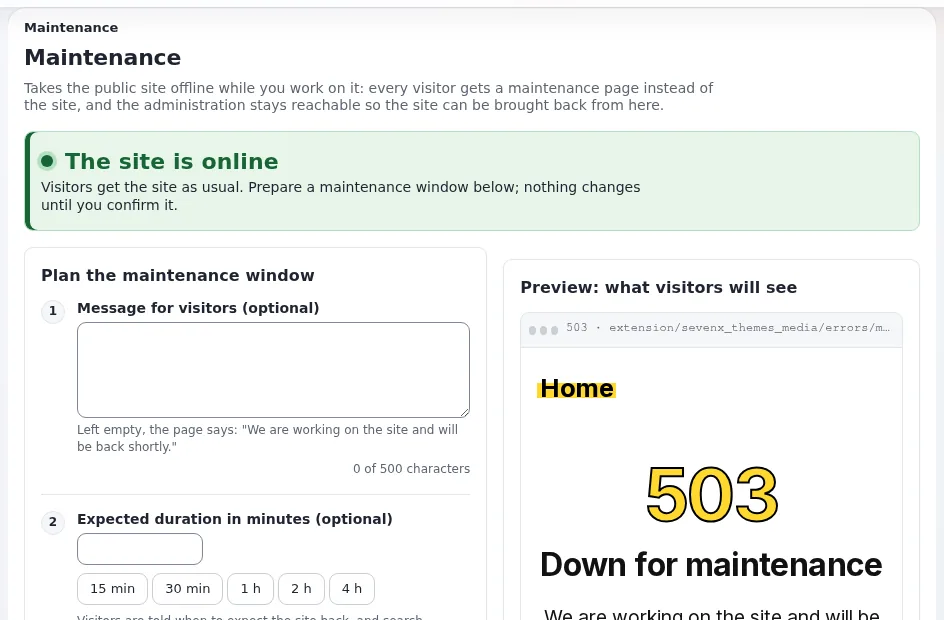

# Wartungsmodus

Diese Seite richtet sich an Website-Ersteller, die eine Website für eine Weile offline nehmen müssen: ein Upgrade, ein
Import, eine Wiederherstellung. Der Wartungsmodus beantwortet jede öffentliche Seite mit einer freundlichen 503-Seite,
während Sie arbeiten, und hält die Administration erreichbar ([Wartungsmodus](../../../anleitungen/wartungsmodus.md)).

## Inhalt

1. [Was Besucher erhalten](#was-besucher-erhalten)
2. [Aus der Administration](#aus-der-administration)
3. [Aus einer Shell](#aus-einer-shell)
4. [Der Weg zurück](#der-weg-zurück)
5. [Bewährte Vorgehensweise](#bewährte-vorgehensweise)

## Was Besucher erhalten

Jede Seitenanfrage erhält die Wartungsseite mit dem Status `503 Service Unavailable`, `Retry-After` und `no-store`,
sodass Suchmaschinen später wiederkommen und nichts gecacht wird. Bilder, Styles und Skripte werden weiterhin
ausgeliefert. Ihre Nachricht und das erwartete Ende werden angezeigt.

## Aus der Administration

**Setup > Wartung** (`/setup/maintenance`): eine optionale Nachricht, eine optionale erwartete Dauer (15 Minuten bis
4 Stunden mit einem Klick), wer weiterhin hineinkommt (Ihre eigene Adresse mit einem Häkchen, andere Adressen), eine
Vorschau und eine Bestätigung vor **Website offline nehmen**. Solange die Website offline ist, zeigt die Seite ein
bernsteinfarbenes Banner und **Website wieder online bringen**. Die Wartung endet nie von selbst.



## Aus einer Shell

```bash
php bin/php/maintenance.php on --message="Back soon" --until=2h --allow-admin --allow-root-user
php bin/php/maintenance.php status --allow-root-user
php bin/php/maintenance.php off --allow-root-user
```

Ohne `--allow-admin` ist auch die Administration offline. Dasselbe leistet `./console exp:maintenance`.

## Der Weg zurück

Der gesamte Zustand ist eine Datei, `var/maintenance.json`. Wird sie gelöscht, endet die Wartung, ganz gleich, was sonst
nicht stimmt. Jedes Umschalten wird im Audit-Trail festgehalten.

## Bewährte Vorgehensweise

- Kündigen Sie geplante Wartung im Voraus an und halten Sie das Fenster kurz.
- Lassen Sie Ihre eigene Adresse durch, um vor dem Zurückschalten zu testen.
- Unter Velocity leeren Sie nach dem Zurückschalten den Antwort-Cache.
- Für ein Backup allein ist der Wartungsmodus nur nötig, um Datenbank und Dateien konsistent zu halten.

## Verwandte Seiten

- [Backups und Wiederherstellungen](backups-und-wiederherstellungen.md)
- [Updates und Aktualisierungen](updates-und-aktualisierungen.md)
- [Die Funktion Wartungsmodus](../../../../eng-us/features/6.0/maintenance-mode.md)
- [Freie Dokumentation](../../freie-dokumentation.md): Diese Seite darf unter der GNU FDL 1.3 frei kopiert, übersetzt und verbessert werden.

<!-- exp-partner-block:start -->
**Werden Sie Exponential-Partner.** Partner teilen ihre Informationen, stellen Mittel bereit, geben Beiträge zurück
und entwickeln die Produkte gemeinsam mit uns weiter, und so wächst Exponential. Eine Partner-Website mit Dashboard
ist für Mitte 2027 geplant: Bitte werden Sie noch heute Partner, damit wir schneller wachsen und neue Funktionen
früher kommen. Beginnen Sie mit [Partner: hier beginnen](../../partner/partner-hier-beginnen.md) und
[Wie Sie sich bewerben](../../partner/wie-sie-sich-bewerben.md).
<!-- exp-partner-block:end -->
