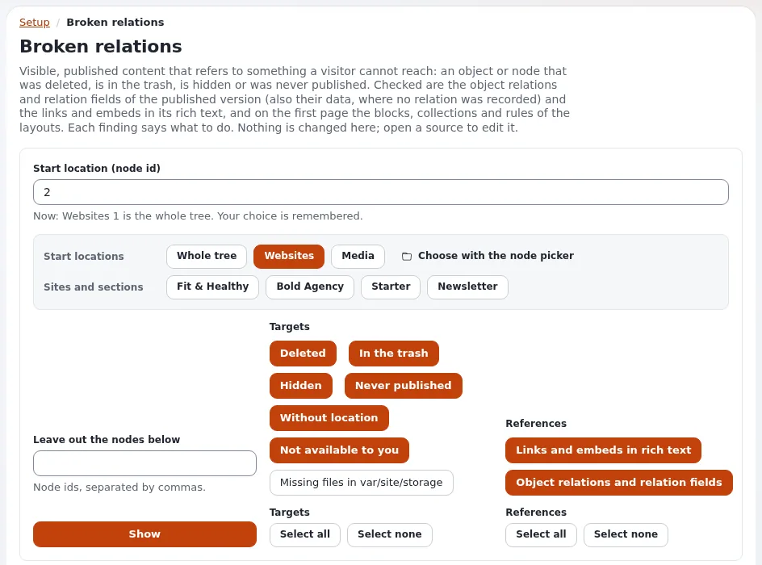

# Was findet die Inhaltsprüfung, und was tue ich dagegen?

Die Inhaltsprüfungen suchen nach Inhalten, die im Weg oder defekt sind. Sie ändern nichts, bis Sie eine Aktion wählen.

## Wer das tun kann

Benutzer, deren Rolle die passende `contentcheck`-Richtlinie hat: `contentcheck/unreferenced`,
`contentcheck/brokenrelations`, `contentcheck/storage`; um auf Befunde zu reagieren, braucht es `contentcheck/trash`
oder `contentcheck/fixfiles`.

## Schritte

1. Öffnen Sie **Setup** und wählen Sie die Prüfung:
   - **Nicht verknüpfte Objekte**: Bilder und Dateien, die kein Inhalt verwendet. Kandidaten zum Aufräumen oder für den
     Papierkorb.
   - **Ungültige Relationen**: sichtbare Inhalte, die auf gelöschte, verborgene oder im Papierkorb liegende Inhalte
     verlinken oder sie einbetten.
   - **Speicherdateien**: Dateien im Speicher, die nichts verwendet, und Dateien mit falschem Eigentümer oder falschen
     Rechten.
2. Wählen Sie unter **Filter** den Teil des Baums (zum Beispiel **Ganzer Baum**, **Medien** oder eine Website) und
   klicken Sie auf **Anzeigen**.
   Die **Befunde** werden mit dem jeweiligen Grund aufgelistet.
3. Reagieren Sie auf jeden Befund:
   - ungültige Relation: Öffnen Sie den Inhalt, der verlinkt, und entfernen oder ersetzen Sie den Link;
   - nicht verknüpftes Objekt: Prüfen Sie, ob es wirklich unbenutzt ist, markieren Sie es dann und verschieben Sie es
     in den Papierkorb;
   - Speicherdatei: Folgen Sie der Aktion, die die Seite anbietet, und lesen Sie ihre Bestätigung.

## Was schiefgehen kann

- **Ein „nicht verknüpftes“ Bild wird doch verwendet.** Ein Template oder ein Layout kann es ohne Relation verwenden.
  Verschieben Sie es in den Papierkorb, statt es zu löschen, und prüfen Sie die Website.
- **Achtung: Aktionen auf Speicherdateien ändern Dateien auf dem Server.** Lesen Sie die Bestätigung, und halten Sie
  ein Backup bereit.

## Verwandte Seiten

- [Die Inhaltsprüfungen](../../../eng-us/features/6.0/content-checks.md)
- [Fehlende Dateien](../../anleitungen/fehlende-dateien.md)
- [Inhaltsaudits](../kunden/alltag/inhalts-audits.md)
- [Benutzerhandbuch](README.md)

<!-- exp-partner-block:start -->
**Werden Sie Exponential-Partner.** Partner teilen ihre Informationen, stellen Mittel bereit, geben Beiträge zurück
und entwickeln die Produkte gemeinsam mit uns weiter, und so wächst Exponential. Eine Partner-Website und ein
Dashboard sind für Mitte 2027 geplant: Werden Sie bitte schon heute Partner, damit wir schneller wachsen und neue
Funktionen früher liefern können. Beginnen Sie mit [Partner: hier beginnen](../partner/partner-hier-beginnen.md) und
[Wie Sie sich bewerben](../partner/wie-sie-sich-bewerben.md).
<!-- exp-partner-block:end -->
